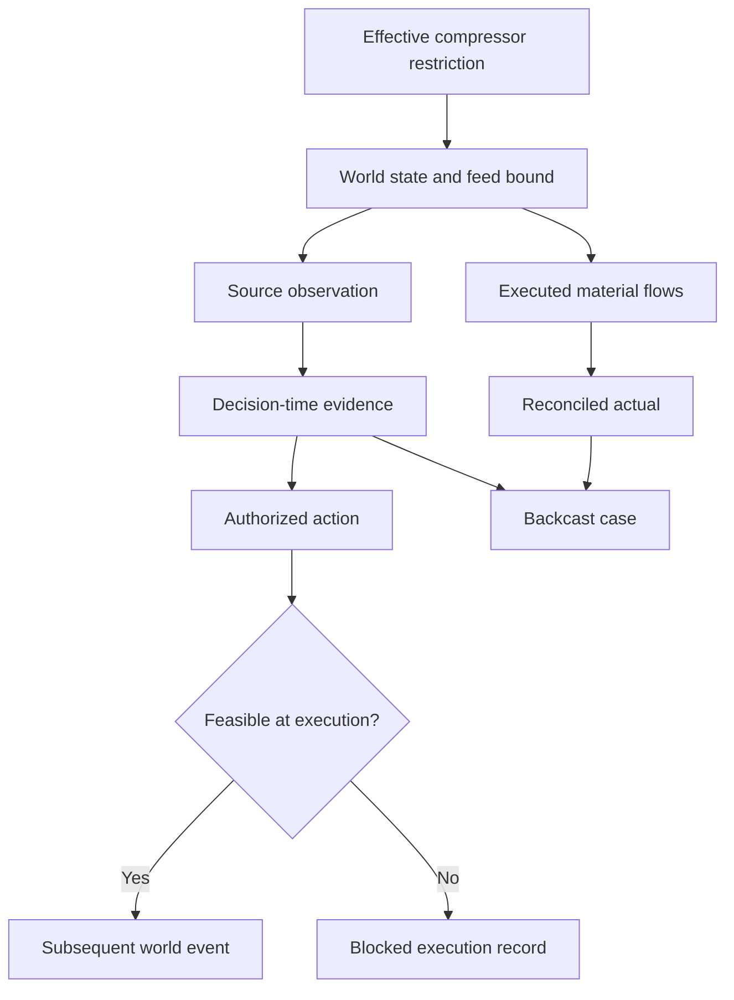

# PPC-WORLD-001 — Canonical Enterprise World

**Draft 0.1 for owner review · 25 November 2026.** This proposed specification extends PPC-001 and PPC-005. The repository baseline is [08e7b33](https://github.com/aadehamid/pearland-petroleum-corporation/tree/08e7b3356f9b3ad18ce6a632d82615ad5a4e3847). Source references T1–T145 resolve through the [discussion and decision register](../registers/PPC-Discussion-Decision-Traceability.md). Example identifiers, times and input quantities below are `SYNTHETIC` unless marked as `SCENARIO_ASSUMPTION`; calculated example quantities are `DERIVED`. Passing a paper arithmetic check does not qualify a process model.

## 1. Purpose and boundary

PPC needs to answer a backcasting question: given the refinery, inventory, commitments, prices and information available during a completed period, which alternative could the operator actually have executed, and how different would the result have been? The owner adopted a hybrid engineering and business simulation at T20. The world therefore carries both equipment and material state and the commercial obligations that make a physical change consequential.

The existing World v0.1 charter covers one fictional PADD 3 Gulf Coast refinery with simplified CDU, FCC and hydrocracker units, three terminals, pipeline/truck/marine logistics, gasoline and ULSD, twelve customers, and twelve months of daily history. Under [ADR-0040](../../adr/0040-staged-mechanistic-refinery-model-and-closed-flowsheet.md) and [ADR-0043](../../adr/0043-refinery-v1-unit-physics-and-hybrid-clock.md), **Refinery A v1** locks the minimum physically closed flowsheet (crude receipt and segregated hold tank `TK-101H`, CDU plus VDU cut-point separation, FCC, hydrocracker with recycle-gas compressor, feed-dependent DHT routing for LCO/kero/AGO, shared hydrogen and utility headers, product blending, finished tankage, quality release, and dispatch), with SMR/Reformer/FCC HDS vs boundary imports resolved in WP-0 ([PPC-REVIEW-002 §1](../independent-review/PPC-REVIEW-002_Governing_Refinery_Equations_and_Balances.md#critical-flowsheet-closure-finding-requiring-wp-0-owner-disposition-proposed-amendment-to-adr-0040)). This spine supports `UC-1` through `UC-6` ([ADR-0049](../../adr/0049-v1-business-use-cases.md)). Every object carries a `site_id` so the staged **Refinery B** expansion (`T21`, post-WP-7) can enter additively without rewriting history.

Under [ADR-0041](../../adr/0041-function-first-lean-core-enabling-stack.md) and [ADR-0053](../../adr/0053-legacy-data-quarantine-and-world-export-bundle.md), PPC owns this canonical world and publishes a versioned `WorldExportBundle` in `WP-8` split strictly into an `observable/` layer (source-emitted OT/EDI/Delta/KPI/evidence records for sister repos) and a separately credentialed `hidden_truth/` evaluation layer under `evaluation/hidden/`. Older pre-world-model synthetic datasets in Cloudflare R2 and sister repositories are quarantined as `LEGACY_PRE_WORLD_MODEL` and archived or deleted only after WP-1 canonical world verification passes. **Sources:** T19–24, T34, T43–44, T58, T97, T122, T125; PPC-001/005, ARCH-000 §1, and `ADR-0040`–`0053`.

## 2. Objects, identity and write authority

| Object and grain | Minimum information | Who can originate or change it |
|---|---|---|
| Asset, functional position and equipment installation | Stable identities for site, unit, functional position and installed item; valid interval, configuration revision and source references. A replacement compressor gets its own equipment identity. | The world configuration loads an accepted engineering revision. EDI provides the source assertions and topology evidence. A SCADA tag alias cannot change installation history. |
| Material, stream and tank | Material and lot/assay revision, density or measurement basis, quality units, allowed origin/destination, stream direction, tank working bounds and inventory by material. | The world configuration declares valid routes. The material engine posts production, transfer and loss as bounded movements. |
| Unit model and operating state | Model version, lifecycle mode, health, availability, effective capacity, feed envelope, utility limits and time interval. | An effective event updates restrictions. The engineering calculation advances feasible throughput subject to all active constraints. |
| Commercial commitments and plans | Contract line, material specification, location, time window, quantity, counterparty and terms; distinguish reservation, signed agreement, approved plan, delivery and settlement. | Commercial lifecycle events create obligations. Scheduling reserves or requests movements. Physical delivery requires an actual movement. Finance recognizes its own transaction under its rules. |
| Observations and reconciled actuals | Source-native identifier, value/unit/basis, observation and availability times, status, quality, correction/reconciliation revision, approval. | Historian and other simulated source systems own their assertions. Production accounting publishes the reconciled quantity with evidence. |
| Decision, authorization and execution | Actor/role, available evidence, decision time, alternatives, constraints, authority, chosen option, authorization, execution time and outcome links. | A role proposes; the authorized party approves; an execution event records what occurred. Agent-visible evidence uses the ECE boundary. |
| Public observation and scenario assumption | Source, vintage, geography, publication/effective time, original units and uncertainty; for an assumption, author, rationale, branch, interval and model version. | A public release conditions the simulated environment. A hypothetical override belongs to its branch. Trace generated values back to inputs and transformations. |

Use stable PPC identities in hidden canonical state. Emit source-specific aliases when creating a tag, work order, lift ticket, sample or sale. Resolve them through governed mappings with source evidence, validity intervals and ambiguity handling. Maintain asset-to-position, asset-to-stream and material-to-commitment links separately. A graph can find exposed commitments; the qualified world and commercial calculations determine a quantity or margin effect. At the semantic boundary, use a versioned dependency and approval status. An unmapped process or unqualified KPI remains explicitly pending. **Sources:** T7–12, T23, T32–35, T37–45, T57, T69–70, T94–105, T131–135; ADR-001/002/008/024/026/028/033–035/038–039.

## 3. State change contract

An event envelope carries a unique event ID, world version, branch, subject ID, event type, effective time, source/evidence references, cause or approved action if applicable, payload schema and units. A transition records the previous state revision, the accepted event and the resulting revision. Tag, historian, quality, planning and maintenance records also retain their own observation, publication/availability and ingestion times.

1. Load the active asset configuration, operating state, inventories, active reservations and obligations for the branch and effective time. Check source authority and preconditions.
2. Compute the proposed transition using the pinned parameter set. Test routed material availability, working capacity, unit and quality compatibility, event order and permissions. A blocked proposal returns the violated limit, requested value, available value and units. The world state stays at its prior revision.
3. Apply an accepted transition and its causal record together. Repeated delivery of the same event and payload yields the same outcome. A reused ID with a changed payload is a conflict. An approval may precede physical execution by hours or be followed by failure.
4. Publish derived observations and transactional records on their own timelines. A late meter correction revises the source assertion and may trigger a new accounting reconciliation. Preserve previous evidence and the decision-time view.
5. A user can supply new evidence, propose an intervention or change an assumption. Classify the input before computing. Evidence updates what an actor can know. A feasible intervention can change a scenario branch. An observation by itself cannot actuate a physical transition.

The following paths describe one synthetic incident. The separate evidence and execution paths allow a reviewer to reconstruct what changed and what each role could know.

A derated unit can remain running. Store health, operating mode, availability and actual rate independently. A repair order can remain open after an alarm clears. A delivered item may remain on quality hold. These cases require distinct state fields with effective times. WORLD-002 specifies event ordering, checkpoints, random-stream control, replay and branch isolation. **Sources:** T26–27, T31–36, T71–73, T94–97, T121, T125.

## 4. Physical, commercial and evidence rules

| Rule | Operational consequence and expected check |
|---|---|
| Conserve material at a declared boundary | On a common mass basis, closing stock = opening stock + receipts + production + transfers in − shipments − consumption − transfers out − losses. Use only terms that cross the selected boundary; internal transfers cancel when consolidating. Record both ends and transit stock where time elapses. |
| Make units, interval and reference basis explicit | Integrate rates over elapsed time. Convert volume to mass using an identified density at compatible conditions. Refining can exhibit volumetric gain. Check plant closure in mass with modeled inputs, including hydrogen where applicable, all products, coproducts and losses. Record residual and tolerance separately. |
| Enforce physical feasibility | Rate is nonnegative and bounded by the active capacity, feasible feed, utilities, quality envelope, storage and routing. Dispatch needs available quantity, a valid route, transit time and receiving capacity. Blending rules must match the property and basis; do not assume every property is volume-additive. |
| Link material to commercial state | A contract is an obligation. Quality release, tank stock, commitments, delivery window and transport capacity determine what can be supplied. Qualification of a shortfall or margin effect requires those inputs and the governed formula. Prevent duplicate use of a lot or reservation. |
| Reconstruct knowledge at decision time | Preserve approved plan, observed measurement, reconciled actual and validated feasible counterfactual as distinct versioned records. Hidden truth is evaluation-only. Store information cutoff and compare public publication and source availability with that cutoff. |
| Preserve model and data lineage | Record source and category (OBSERVED, DERIVED, ESTIMATED, SYNTHETIC or SCENARIO_ASSUMPTION), world/model/parameter releases, seed policy, event lineage and supersession. A regional EIA series can condition a fictional distribution; it cannot supply a fictional unit's actual production. |

Independent operational evidence may disagree for good reasons. In T23, a planned 40,000 bbl/day, a historian reading near 32,500 and reconciled actual of 32,200 illustrate three authorities. Preserve all three. Those numbers belong to a different example from the 75% derate below. **Sources:** T2–3, T20–27, T43–45, T55–57, T72–73, T85–87; PPC-005/013/016.

## 5. Worked slice — hydrocracker compressor derate

The original EA-09C example gives a nominal hydrocracker maximum of **40,000 bbl/day** VGO ($\text{SG}_{60/60} = 0.910 \Rightarrow 5,781.44\text{ t/day}$ under `EQ-01`) and a `SCENARIO_ASSUMPTION` compressor speed/driver restriction at `08:10 UTC`. Under [ENG-001](../02-industrial-engineering/PPC-ENG-001_Physical_and_Numerical_Engineering.md) `EQ-05` and `EQ-07`, every candidate feed ceiling is expressed on an identical SI mass-rate basis (`kg/s` or `t/day`):

`0 ≤ feed mass rate ≤ min(mechanical cap, (w_H2,rec * m_dot_rec_max) / R_min_mass, quench cap, allocable shared H2 / c_H2_net(ξ), available feed, downstream capacity)`.

Under normal `SCN-A-T125` plant operation, net $\text{H}_2$ supply is `170.00 t/day` (`125.00 t/day` headroom after `5.00 t/day` header loss and `40.00 t/day` DHT), so shared $\text{H}_2$ is non-binding for nominal (`115.63 t/day`) and planned (`104.07 t/day`) HCU feed. Lowering recycle $\text{H}_2$ flow to 75% (`289.17 t/day` pure $\text{H}_2$ at $R_{\min,\text{mass}} = 0.06669\text{ kg/kg}$) freezes the `SCN-A-T125` binding cap at a `SCENARIO_ASSUMPTION` **30,000 bbl/day** (`4,336.08 t/day`, assuming the unit runs at $R_{\min}$ at 40,000 bbl/day with quench non-binding). In the separate `SCN-A-H2CONT` SMR-turndown boundary sub-case (`120.00 t/day` supply → `75.00 t/day` headroom after DHT, under constant `2.0 wt%` uptake and zero purge loss, [PPC-REVIEW-004 §3.2](../independent-review/PPC-REVIEW-004_Proof_Obligation_and_Validation_Register.md#32-worked-example-b--world-002-compressor-derate-two-stage-retry-and-shared-h2-double-allocation-po-03-po-04)), the shared header bound overrides the compressor cap at `3,750.00 t/day` (`25,945 bbl/day`). Exact mass closure includes chemical $\text{H}_2$ uptake (`4,422.80 t/day` total outputs separating acid gas, dry gas, LPG, and `32,643.6 bbl/day` $\text{C}_5+$ liquids, `+8.81%` liquid volumetric gain). Never multiply a feed cap directly by a diesel price and call it lost margin.

| Time or stage | Read the state as follows |
|---|---|
| Before 08:10 | A pinned plan requests 36,000 bbl/day in this fixture. The nominal limit is 40,000. An available-feed check is still required. |
| 08:10 effective | The recycle-gas compressor restriction (`EQ-05`) caps feasible HCU feed at `30,000 bbl/day` (`4,336.08 t/day`) under the stated `SCENARIO_ASSUMPTION` (`R_min` binding, quench and shared $\text{H}_2$ non-binding). The HCU stays running. The `36,000 bbl/day` plan now exceeds the cap by `6,000 bbl/day`. Keep the historical plan. |
| 08:12 source publication | A synthetic instrument observation becomes available under its source tag, timestamp, unit and quality. It can be noisy. A planner at 08:11 cannot use it. |
| 08:25 work-order creation | The maintenance record references its native equipment ID. Authorized mappings tie the record to the installed compressor. An ambiguous mapping is flagged. |
| Scenario comparison | Compare authorized options such as rescheduling a commitment, using available inventory or sourcing a replacement lot. Check product specification, route, time and cost before claiming feasibility. |
| Reconciliation | Use actual executed flows and the approved accounting revision for the period. Store the LP case, model settings, changed assumptions, constraints, result and evidence cutoff for each feasible comparison. |

**Arithmetic check.** For a six-hour interval entirely under the restriction, a constant 36,000 bbl/day request corresponds to 9,000 bbl and a constant 30,000 bbl/day bound to 7,500 bbl. The 1,500 bbl difference is a gap between *requested feed and maximum permitted feed*. Actual processed feed can be lower. Product shortfall, customer impact and margin each need additional evidence. The six-hour interval is a `SCENARIO_ASSUMPTION` and the 36,000 request is a `SYNTHETIC` test input; the 40,000 and 0.75 values come from T125, lines 36857–36916.

**Independent inventory check.** The separate T125 tank fixture starts with 10,000 bbl, receives 500 bbl/h and dispatches 700 bbl/h for two hours. With no other flows, the `DERIVED` closing inventory is 9,600 bbl against a `SYNTHETIC` 12,000 bbl tank limit. The exercise uses one liquid on a consistent reference-volume basis. When a receipt or dispatch would cross a bound *during* the interval, split at the boundary and reject or reschedule the infeasible remainder. An acceptable closing balance alone cannot establish intraperiod feasibility.

**Backcasting attribution.** Compare the approved plan, reconciled actual and feasible alternative at a common period and basis. Re-run with a revised calibration while holding the event, decisions and execution fixed to isolate model effects. Then compare alternatives under the same model and decision-time evidence. Record execution deviations separately. If the result depends on case ordering, report the order and interaction or residual. A favorable hindsight case can bound opportunity; availability of a feasible option at decision time is a separate finding. **Sources:** T2–3, T23–27, T58, T115, T122, T125.

## 6. Two further scenario checks

**Crude-quality rejection.** An arrival and custody measurement can precede a failed quality result. Record the sample, result, specification revision, affected lot, held quantity and disposition. The stock may be physically present and commercially unavailable. A delayed certificate can change the knowledge available to a scheduler. Receipt of a duplicate result must leave the held quantity unchanged. Release or rerouting requires an authorized disposition, valid route and capacity. Feed and commitment effects are calculated from accepted movements. See T97 and T122.

**Hurricane.** Use a timestamped storm observation or forecast with its vintage, affected geography and uncertainty. A separate PPC exposure assumption translates the external condition into a scenario restriction on a site or route. A weather bulletin alone cannot determine a fictional outage. Compare a baseline and intervention with matched starting stock, commitments and weather assumptions. Report service and economic effects under versioned calculations. See T45, T72, T83 and PPC-001.

## 7. Verification contract

The identifiers below retain the original WORLD questions at T27, lines 4583–4592. Locate these as `(exchange 27, source ID)`; the T122 WORLD-01/02 identifiers name unrelated implementation work packages. These are acceptance criteria for the eventual implementation. Expected outcomes below are reviewable today.

| Source ID | Fixture and expected evidence |
|---|---|
| WORLD-01 | Apply the `EQ-05` recycle-gas compressor restriction (75% recycle $\text{H}_2$ circulation at $R_{\min}$, quench and shared $\text{H}_2$ non-binding) to a running HCU. State remains running, condition is derated, the cap is `30,000 bbl/day` (`4,336.08 t/day`) and a `30,001 bbl/day` request is reported as infeasible. |
| WORLD-02 | Replay the tank and derate fixtures in §5. Match independent arithmetic. Reject an overfill, a negative inventory and an unmatched transfer. Report the residual on the declared basis. |
| WORLD-03 | Approve a dispatch to a full receiving tank. Record the approval, blocked execution and reason. Stock at both locations and delivered quantity must stay unchanged. |
| WORLD-04 | Query at 08:11, 08:13 and 08:26. Only records already available to the role appear; the hidden restriction and future work order cannot be retrieved early. |
| WORLD-05 | From one checkpoint run a qualified inventory option and replacement-sourcing option. Match starting inputs and disclose different interventions. Compare only feasible results with the same period, units and cost basis. |
| WORLD-06 | Capture the baseline snapshot and event history digests. Create, rerun and discard a child scenario. Baseline digests match; replaying identical pinned inputs reproduces the recorded state within declared numerical tolerance. |
| WORLD-07 | Fix the decision-time evidence, then vary an unanticipated external outcome. Score decision quality using the earlier information. Attribute model, execution and external effects with supporting cases and residual uncertainty. |
| WORLD-08 | Starting with a backcast result, resolve the event, asset/configuration, LP case, constraint set, plan, reconciled actual, alternative, decision evidence and execution. A missing edge or version produces an incomplete-evidence result. |

Negative fixtures also include an alias with two candidate assets, a stale engineering revision, a repeated event ID with changed payload, a future publication, an incompatible unit, a commercial commitment counted twice and an unapproved ontology reference. The architecture reviewer should inspect expected and observed outputs separately, with an independent oracle for numerical claims. **Sources:** T27, T54–58, T73–74, T113, T125–126; VERIFY-001 and ENG-001.

## 8. Integration, decisions and handoff

| Downstream specification | Input from WORLD-001 | Detail owned there |
|---|---|---|
| WORLD-002 | Stable object and event IDs, branch parent, effective time, transition preconditions and baseline invariants | Clock ordering, late/corrected events, deterministic schedule, seeds, snapshot manifests and repeatable branch replay |
| ENG-001 / OT-001 / EDI-001 | Unit, equipment, stream and measurement boundaries plus the §5 fixtures | Qualified equations and tolerance, signal/quality mappings, accepted engineering revision and topology |
| INT-001 / INFO-001 / GRAPH-001 | Valid source projections, native aliases, effective interval and causal references | Transaction, semantic mapping and graph projection contracts, ambiguity, authority and access |
| DATA-001 / ANALYTICS-001 / EVID-001 | Reconciled quantities, timing, constraints, visible evidence and matched LP cases | EPM-aligned measure definitions, feasible opportunity, attribution, decision dossier and claim provenance |
| UX-001 / AGENT-001 / SCENARIO-001 | Branch inputs, infeasibility reasons, expected and observed effects | Authorized intervention, investigation, policy escalation and golden scenario workflows |

Versioned snapshots and generation manifests follow [PPC-013](../../PPC-013_Cloudflare_R2_Durability_and_Project_Storage_Standard.md). Raw observations, source extracts and technical revisions remain recoverable. Hidden canonical IDs and decision dossiers are restricted to simulation and evaluation. Public knowledge releases, EPM definitions and the pending generalized process release are external dependencies with distinct authorities.

**Open for qualification.** Process-engineer sign-off on synthetic calibration parameters and tolerances ([PPC-REVIEW-004 §4](../independent-review/PPC-REVIEW-004_Proof_Obligation_and_Validation_Register.md#4-engineering-judgment-boundaries-process--controls-engineer-sign-off)) and binding the eventual approved `ds-business-process/1.0` mappings remain gated for WP-0 and WP-7. Core physical equations (`EQ-01`–`EQ-09`), clock cadence (`ADR-0043`), Delta Lake (`ADR-0045`), and slice order (`PPC-PLAN-001`) are now reconciled. The companion [WORLD-002 specification](PPC-WORLD-002_Simulation_Time_Replay_and_Branches.md) defines the execution and replay rules. No source-system deployment or model qualification is implied by this document.

**Repository sources.** [Charter](../../PPC-001_Problem_Statement_and_Simulation_Charter.md) · [Synthetic data generation](../../PPC-005_Synthetic_Data_Generation_Strategy.md) · [Evidence and decision provenance](../../PPC-016_Evidence_Decision_Provenance_and_Evaluation_Architecture.md) · [Architecture decisions](../../PPC-REG-001_Architecture_Decision_Register.md) · [Master architecture index](../00-master-index/PPC-ARCH-000_Master_Architecture_Index_and_Authority_Baseline.md).

The recipient-specific evidence and as-of query rule is [INFO-001 §3](../03-enterprise-information/PPC-INFO-001_Enterprise_Ontology_Identity_and_Time.md). This scenario fixes only its own observation and delivery times.

The [exchange register](../registers/PPC-Discussion-Decision-Traceability.md) routes T11–21, T23–25, T27, T31, T34, T36, T43–45, T71–72, T83, T94, T97, T122, T125, T143–145 to this draft.
