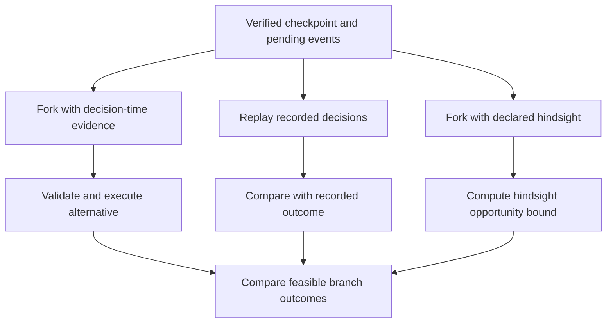

# PPC-WORLD-002 — Simulation, Time, Replay and Branches

Inspected PPC baseline: [`01027a84be5d453cbb4e2ea091e4884729918b15`](../registers/PPC-SOURCE-REGISTER.md). This commit is the original PPC source-inspection reference, not this draft's content revision or owner approval. Later linked specifications are read at the current branch revision.

**Draft 0.1 for owner review.** Companion to [PPC-WORLD-001](PPC-WORLD-001_Canonical_Enterprise_World.md). This specification answers two questions central to downstream backcasting. Can PPC reproduce a completed operating period from the information and events that produced it? Can a planner test a different decision from that period and identify exactly what changed?

The conversation establishes a logical simulation clock, hybrid event and numerical execution, explicit decision-time visibility, and reproducible branches. The ordering convention, manifest fields, fixture timings and acceptance procedures below are proposed engineering details. The owner can review them independently of the simulation library, database or solver. Fixture event times and physical quantities are `SYNTHETIC`; hypothetical interventions are `SCENARIO_ASSUMPTION`; arithmetic totals are `DERIVED`. A recorded historical outcome and a simulated alternative have different evidence and must retain their labels in reports.

## 1. Execution boundary

| Authority | Responsibility |
|---|---|
| PPC world orchestrator | Own logical time within a run, order accepted inputs, coordinate domain engines, commit causal event records, and expose a reproducible checkpoint. |
| Domain engine | Declare units, clock resolution, dependencies, valid envelope and tolerance. Initialize, advance to a boundary, apply an event, validate, expose permitted observations, and snapshot or restore its own state. |
| Simulated source application | Own the record it creates, its native ID, revisions, quality and publication schedule. Delays, outages and corrections are part of the simulated history. |
| Decision and evidence services | Reconstruct the evidence a particular role could access at a cutoff. Record alternatives, authority, approval and execution as separate events. PPC-016 supplies the evidence contract. |
| Projection and analysis services | Consume committed releases and named branches. Invalidate affected outputs, reconcile inputs and publish versioned results. The graph identifies dependencies; the qualified calculation supplies the numerical effect. |

Under [ADR-0043](../../adr/0043-refinery-v1-unit-physics-and-hybrid-clock.md), the canonical execution clock uses a deterministic **1-minute process balance step** with exact analytical or root-finding splits whenever an intra-step tank, hydraulic, or utility bound crossing occurs (`EQ-02`, `PO-01`). An optional **1-second synthetic equipment-telemetry projection layer** supplies fast-class machine tags (compressor vibration, speed) to the ICE OT plane without turning the plant mass balance into a 1-second DAE solver. Hourly scheduling and daily production accounting aggregate cleanly on UTC-to-site-business-day calendars (handling 23-hour and 25-hour DST days, `PO-11`). Each domain engine declares when it can exchange state; synchronize at the earliest event, internal constraint crossing, or declared exchange boundary. An engine that cannot advance consistently to that boundary must return a smaller valid step or stop the run with a diagnostic.

## 2. Clocks, revisions and decision-time visibility

Use one logical timeline per branch. Represent instants on a declared UTC time base with a pinned resolution. Store source timezone, offset and timestamp precision where relevant; use the site's business calendar for shifts and accounting days. Use a half-open interval `[start, end)` for sustained rates, configurations and availability. A 24-hour rate is converted using elapsed time; a local business day that crosses a daylight-saving change can have 23 or 25 elapsed hours. Host elapsed time is useful for performance monitoring only.

| Field | Question it answers |
|---|---|
| Effective or phenomenon time | When did the condition apply in the world? A lab correction can describe a sample taken earlier. |
| Observation and source-record time | When was it sampled, and when did its source record the assertion? Preserve both if they differ. |
| Publication time | When did the source release this revision, and to which audience or route? |
| Receipt and role availability | When did the consumer receive it, and when could the specified role access it through the chosen channel? One role may see a local alarm before another receives its report. |
| Decision and execution time | When did the actor choose or approve an option, and when did an authorized execution change the world? |
| Commit position | Which immutable record and revision did this branch actually commit? The position disambiguates events at the same instant and defines the snapshot boundary. |

A historical knowledge query pins release, branch, subject scope, effective time, knowledge cutoff, actor/role, channel and purpose under [INFO-001 §3](../03-enterprise-information/PPC-INFO-001_Enterprise_Ontology_Identity_and_Time.md). A source-local commit position resolves tied events within a publication; it does not replace the publication ordinal or reader cutoff. On success, return evidence IDs and availability times only for the eligible publication used. If no publication qualifies, return only `UNRESOLVED`, with no evidence ID, availability time or separate access error. An upstream timestamp or current permission alone cannot establish historical knowledge.

A 09:20 lab correction referring to an 08:00 sample can update a later reconciliation and a new backcast release. At 09:00 the planner still sees the earlier accessible revision. A sensor correction updates the assertion ledger. If a corrected *physical driving input* requires the past trajectory to be recomputed, create a separately identified restatement run from a checkpoint before its effective time. Retain the historical run and its decisions.

## 3. Event scheduling and atomic transitions

1. Choose the earliest pending boundary. Advance physical state across the elapsed interval using the constraints active during that interval. If a tank fills before the requested endpoint, stop at the crossing and process it before continuing.
2. At the boundary process causes before consequences. For independent events sharing a timestamp, apply the pinned phase policy. For the derate fixture the order is restriction or interlock, discretionary execution, source observation, publication or delivery, then decision. A decision can schedule execution at the same instant only in a **later logical round** after its prerequisites and approval exist.
3. A queue entry contains logical instant, logical round, phase, stable origin sequence and stable event ID. Order by that tuple. The stable sequence comes from a recorded input order or a deterministic producer rule, never worker arrival order. A same-instant consequence whose phase would sort before its parent advances to the next round. A missing parent is held or rejected with a diagnostic. A zero-time cycle or exceeded round limit stops the run at the last consistent commit.
4. Validate schema, authorization, state revision, route, capacity and quantities. Commit the new state, append-only event, deduplication receipt and pending output intents as one logical transition. A rejection records the violated constraint and current bound, with no physical state mutation. A concurrent writer with a stale predecessor must reload and revalidate.
5. Deliver committed outputs with stable delivery keys. Redelivery of the same scoped ID and payload returns the original receipt. A duplicate ID with a different payload is a conflict. A crash after commit but before delivery resumes from pending intents. External projections must deduplicate at their own boundary.
6. Finish the timestamp or record a precise in-progress frontier. A checkpoint identifies which events were consumed, including rounds and ties. A restart must not apply the entire final timestamp a second time.

For the worked case, the derate immediately binds the physical feed in the reduced-order model. Simultaneously requesting a higher discretionary rate fails against the new bound. The original plan, the rejected command and the physical rate remain separately observable records. Ramping behavior would require a different qualified engine and an explicit constraint transition.

## 4. Checkpoints, manifests and recovery

A checkpoint is a committed cut across the coupled simulation engines. A collection of independently recent snapshots cannot establish such a cut. Freeze or coordinate writers at a declared frontier, capture each participant at that frontier, then publish one immutable manifest. A consistent checkpoint may list downstream projections that are behind, with their watermarks; it must say which views are safe to read together.

| Manifest component | Required content for replay |
|---|---|
| Identity and parentage | World, run, branch, parent release and checkpoint; logical instant and last committed ordering key; schema version. |
| World and numerical state | Engine-state object hashes, units, model and parameter versions, numerical policy, precision and tolerances. Include solver history, timers, lag buffers and integrator state needed for restart, or a proven equivalent reconstruction method. |
| Event frontier | Consumed input offsets per source, pending queue including future commitments, deterministic sequence counters, causal links and duplicate-event receipts or references to recover them. |
| Inputs and computation | Pinned code and engine versions, initial conditions, original public-data vintages, calendars, external fixtures, approved decisions and immutable responses from nondeterministic external services. |
| Randomness | Generator algorithm and version, seed derivation policy, stream keys and counter or state per stream. Include stochastic distributions and their parameter versions. |
| Evidence and delivery | Evidence release, revision/visibility cutoffs, pending publication intents, output watermarks and branch-scoped data-product identifiers. Hidden state and role-visible records use separate access controls. |
| Publication and integrity | Schema and content digests for each participant, verification result, committed manifest identity and parent revision. R2 object locations follow PPC-013. |

Write immutable state objects first, verify counts, hashes and frontier agreement, then publish the manifest through a conditional update or a transactional catalog record. Readers discover checkpoints through committed manifests. An interrupted pre-publication write leaves unreferenced objects, never a partially visible checkpoint. If a required object fails verification, quarantine that checkpoint, restore the last verified predecessor and replay its retained inputs. Record the affected release and recovery result. Never silently substitute a nearest model version, fresh market feed or different public-data vintage.

## 5. Historical replay and scenario branches

| Mode | Inputs, permitted differences and output |
|---|---|
| Historical replay | Load a verified checkpoint and reproduce the recorded exogenous inputs, decisions and execution policy. Regenerate endogenous outcomes and compare with the recorded reference. An event classified as a driving input is consumed once; a derived event is checked against its expected record. Reapplying both creates a double effect. |
| Decision-time counterfactual | Fork a specific committed position. Change only declared interventions. Reconstruct the decision-time evidence, authorization and available alternatives. The simulator can use the physical constraints present then to test feasibility. The planner cannot use hidden truth to select the option. |
| Hindsight-feasible comparison | Explicitly allow specified later information, for example final prices or a reconciled assay. Publish its extra information and constraints. Use the result as an opportunity bound; eligibility for decision-time attribution requires a separate case. |
| Restatement | Name the superseded release, corrected input, effective interval and reason. Rebuild affected state and projections under a new run or release identity. Keep the original knowledge view available. |

The shared checkpoint below is the comparison boundary. Historical replay checks the recorded outcome. Each alternative has its own evidence policy and result.

The branch manifest identifies its parent checkpoint, fork position, model and dependency pins, changed decisions or assumptions, mechanism for sharing random disturbances, affected domains, comparison horizon and access policy. Inherit committed history through the fork and pending exogenous events known to the simulation under the declared scenario policy. Retain scheduled obligations where still valid. Recompute dependent future state and invalidate scheduled endogenous predictions whose prerequisites changed. Record each cancellation or replacement. An earlier child intervention requires an earlier fork.

Keep independent random streams for unrelated processes, keyed by stable semantic identifiers such as disturbance family, asset and event occurrence. For paired branches, share the declared exogenous draws even if the child performs an extra calculation. Simply copying a global seed can shift every later draw. Branch-specific innovations use explicitly separate streams. If stochastic policies are being compared, publish the paired seed set, replication count and uncertainty; one paired realization illustrates a mechanism only.

A branch owns its write namespace for state, events, evidence, graph projections, reports and KPI releases. Parent history may be read by immutable reference. A changed decision may require a new LP case and updated forecast; an earlier supervisor email remains the original evidence. New commentary or corrections receive new IDs and availability times. A failed or discarded branch must not move a parent release pointer or send an operational action.

## 6. Worked replay — the same compressor, two decisions

This fixture uses the nominal `40,000 bbl/day` VGO charge bound ($\text{SG}_{60/60} = 0.910 \Rightarrow 5,781.44\text{ t/day}$ per [ENG-001](../02-industrial-engineering/PPC-ENG-001_Physical_and_Numerical_Engineering.md) `EQ-01`/`EQ-05`) and the `08:10 UTC` `SCENARIO_ASSUMPTION` recycle-gas compressor speed/driver restriction lowering recycle $\text{H}_2$ circulation to 75% at fixed $R_{\min,\text{mass}} = 0.06669\text{ kg/kg}$, binding feasible HCU feed at `30,000 bbl/day` (`4,336.08 t/day`) against the `36,000 bbl/day` plan when quench and shared $\text{H}_2$ headroom are non-binding. The **08:00–09:10 interval, 08:40 fork and child request below are synthetic test choices**. Assume sufficient feed, non-binding quench and shared $\text{H}_2$ headroom (see [PPC-REVIEW-004 §3.2](../independent-review/PPC-REVIEW-004_Proof_Obligation_and_Validation_Register.md#32-worked-example-b--world-002-compressor-derate-two-stage-retry-and-shared-h2-double-allocation-po-03-po-04) for the binding-$\text{H}_2$ counterexample), constant density $\text{SG} = 0.910$, and constant rates between declared event boundaries. The integrated quantity below is HCU VGO feed (convertible identically to mass via `EQ-01`).

| Logical time (UTC) | Recorded baseline and child behavior |
|---|---|
| 08:00 | A verified baseline checkpoint has an active 36,000 bbl/day plan and physical feed rate of 36,000. |
| 08:10 | A compressor restriction binds feed at 30,000 bbl/day. A simultaneous discretionary request for 36,000 is rejected. The pre-existing plan is retained for comparison. |
| 08:12 / 08:25 | The observation is published and delivered to the planner at 08:12 in this fixture. A maintenance work order is created at 08:25. Its visibility depends on its own delivery and permissions. |
| 08:40 | Fork at the committed boundary after integration to 08:40 and before the child intervention. The baseline continues at 30,000. In the child an authorized, feasible action reduces the rate to 24,000. |
| 09:10 | Close the comparison interval and read branch-specific totals. Baseline replay from either retained checkpoint must give the same baseline total. |

| Interval | Elapsed hours | Baseline feed (bbl) | Child feed (bbl) |
|---|---:|---:|---:|
| 08:00–08:10 | 1/6 | 250 | 250 |
| 08:10–08:40 | 1/2 | 625 | 625 |
| 08:40–09:10 | 1/2 | 625 | 500 |
| **Total** | **7/6** | **1,500** | **1,375** |

The child processes **125 fewer barrels of feed** under these assumptions, all after the fork. A 09:00 planner query cannot use a correction published at 09:20. A user with access only to the historian channel cannot assume access to the work order. The comparison has a common initial state, horizon, physical model and disturbance. Product yields, customer delivery and margin need their own executable models and records.

## 7. Reproducibility and comparison criteria

**Exact comparisons.** Pin the normalization used to hash the checkpoint payload. Compare discrete states, semantic event order, scoped IDs, causal edges, decision revisions, input hashes, permissions and baseline manifest identity exactly within a replay. Exclude host-only diagnostics such as runtime duration from deterministic payloads. Across branches compare shared history and corresponding inputs by lineage; child-specific output IDs deliberately differ.

**Numerical comparisons.** For each output specify units, an independent reference, operating envelope and absolute/relative tolerance before evaluating the run. A possible per-value criterion is `|observed − reference| ≤ absolute_tolerance + relative_tolerance × |reference|`. Absolute tolerance has the output's units. Relative tolerance is dimensionless. Separately check boundary invariants, event timing and conservation. A small numeric difference that flips a constraint, decision or discrete outcome fails the discrete check. For the ledger in §6 use rational arithmetic for the reference totals. Production tolerances remain with ENG-001.

**Interpretation.** Pin the approved plan, model calibration, actual execution, evidence cutoff and economic assumptions. A changed calibration is a separate comparison from a changed operating decision. Label infeasible alternatives and incomplete data explicitly. Publish a numerical difference only after both runs pass equivalence and feasibility checks on the agreed dimensions.

## 8. Acceptance fixtures

These checks specify implementation evidence. The worked arithmetic is independently checkable now. Replay, isolation and crash tests need an implemented engine.

| ID | Stimulus | Expected result |
|---|---|---|
| W2-01 | Run the §6 baseline uninterrupted, then restore at 08:40 with pending inputs. | Both executions yield 1,500 bbl and identical ordered discrete outcomes. No event at the frontier is consumed twice. |
| W2-02 | Vary worker arrival order for the 08:10 restriction and discretionary request. Add a same-time child caused by an already committed event. | The restriction wins in both runs. The request is rejected; the caused event occurs in causal order. A zero-delay feedback cycle fails explicitly. |
| W2-03 | Query the role before and after 08:12, then introduce the later correction. | Visibility changes only upon authorized delivery. The 09:00 evidence digest is unchanged by the 09:20 correction. Hidden state is absent from both views. |
| W2-04 | Fork at 08:40, apply the 24,000 action, discard the branch and rerun from its manifest. | The child yields 1,375 bbl. Parent state, evidence, published KPIs and checkpoint digests stay unchanged. |
| W2-05 | Insert an extra unrelated sensor draw in the child. | Draws for a paired external disturbance keep the same semantic key and value. A declared branch-specific shock has distinct lineage. |
| W2-06 | Crash before manifest publication; then crash after a transition commits but before output delivery. | Partial checkpoint is invisible. Recovery from the previous manifest reproduces the state. Redelivery yields one business effect; a conflicting payload is quarantined. |
| W2-07 | Corrupt a state object or remove the pinned engineering model. | Integrity validation stops restore. Last verified checkpoint is usable only if its entire replay path can be resolved. No output is labeled reproduced without that evidence. |
| W2-08 | Fork an intervention before its authorized time or request feed above the active bound. | The request records a reason, time and limit; it creates no executed change. A valid child action does not grant permissions on its parent. |
| W2-09 | Compare the same choice under decision-time and hindsight access to an assay. | Reports name different information sets. Hindsight results do not contribute to the historical decision-quality score. |
| W2-10 | An internal tank boundary falls midway between queued events; repeat with a smaller permitted numerical step. | The engine stops at the crossing, enforces the invariant and reconciles stock. Overshooting and later clipping cannot pass the balance check. |
| W2-11 | A child changes an LP input referenced by a prior email, a pending forecast and an approved historical plan. | The child produces a linked LP revision, recomputes the affected forecast and retains the evidence and plan as originally visible. |
| W2-12 | A rate spans a local daylight-saving clock change. Aggregate the same interval by UTC and by local business day. | The sum over identical endpoints agrees. Account for the actual elapsed hours and retain the local day label and calendar version. |

## 9. Source crosswalk and handoff

Source line numbers refer to the [discussion register](../registers/PPC-Discussion-Decision-Traceability.md) and its companion CSV. The T27 competency questions have exchange-scoped IDs.

| Source | Discussion carried forward | Receiving sections |
|---|---|---|
| T27, lines 4442–4474 and 4533–4592 | Logical clock, interval advance, append-only history, branch isolation and decision-time evidence. | §§2–6; W2-01 to W2-04 |
| T34, lines 5683–5713; T125, lines 36987–37002 | Effective, recorded, available and ingested time; role-dependent knowledge. | §2; W2-03 and W2-09 |
| T35, lines 5885–6005 | Engine interface, mixed cadences, deterministic ties, validation before commit and historical versus counterfactual replay. | §§1, 3–5; W2-01, W2-02, W2-10 |
| T36, lines 6383–6415; T71, lines 14944–15058 | Computational and evidence dependencies, decision-time versus hindsight comparison, branch-specific revisions, numerical checkpoints and random-stream state. | §§4–7; W2-04, W2-05, W2-09, W2-11 |
| T73, lines 15626–15678 | Causality, temporal integrity, deterministic restart, branch isolation and independent validation. | §§3, 7–8 |
| T125, lines 36857–36916; WORLD-001 §5 | Rate bounds and engineering limits for the derate example. | §6; W2-01 and W2-04 |
| PPC-005, PPC-013, PPC-016; ADR-001/002/024/028/029/031 | Common canonical world, durable raw/snapshot manifests, hidden truth and evidence available to each role. | §§1–5, 7–8 |

ENG-001 owns qualified equations, internal-state requirements and tolerances. INT-001 owns source delivery, watermarks and recovery semantics. EVID-001 owns role-visible claims and dossiers. VERIFY-001 owns the independent execution record. Before qualifying a runtime, select a scheduler, confirm how each engine snapshots numerical state, specify externally atomic manifest publication, and test the fixture and failure cases. These choices stay open for review. In the master index authoring order, **ENG-001 — Physical and Numerical Engineering** follows the two world specifications.

[World specification](PPC-WORLD-001_Canonical_Enterprise_World.md) · [Synthetic generation](../../PPC-005_Synthetic_Data_Generation_Strategy.md) · [R2 storage and recovery](../../PPC-013_Cloudflare_R2_Durability_and_Project_Storage_Standard.md) · [Evidence and decision provenance](../../PPC-016_Evidence_Decision_Provenance_and_Evaluation_Architecture.md) · [Architecture decision register](../../PPC-REG-001_Architecture_Decision_Register.md).

The recipient-specific evidence and as-of query rule is [INFO-001 §3](../03-enterprise-information/PPC-INFO-001_Enterprise_Ontology_Identity_and_Time.md). This scenario fixes only its own observation and delivery times.

The [exchange register](../registers/PPC-Discussion-Decision-Traceability.md) routes T27, T35–36, T71 to this draft.
