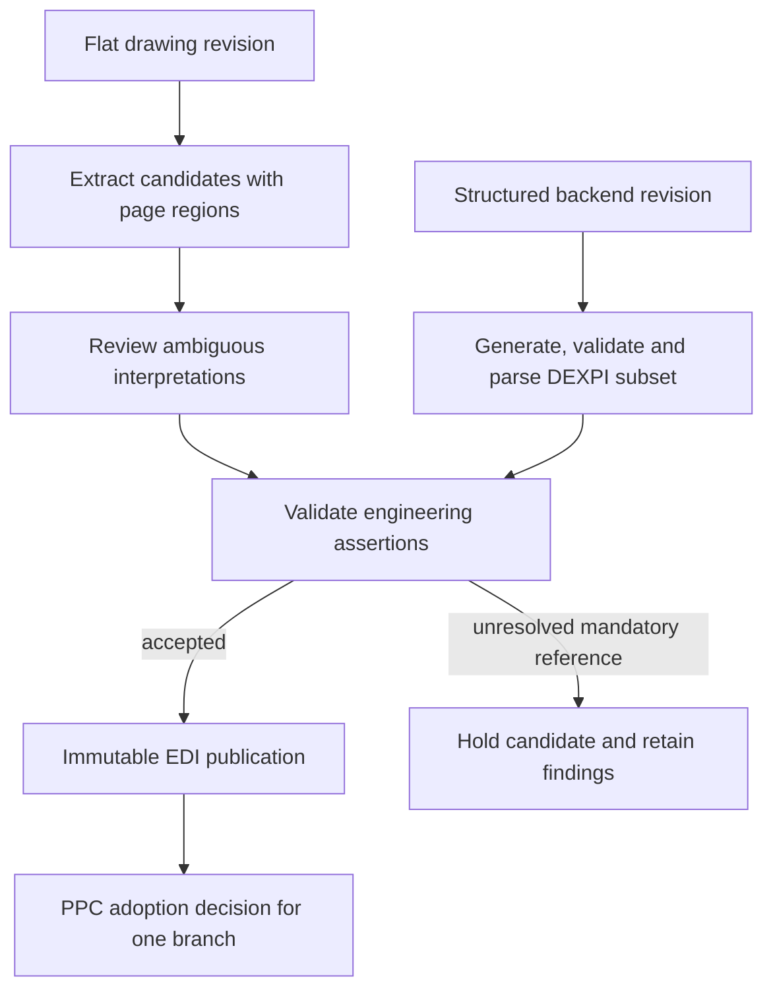

# PPC-EDI-001 — Engineering Information Integration

**Version 0.1 · Draft for independent challenge.** PPC baseline [991a9ef](https://github.com/aadehamid/pearland-petroleum-corporation/tree/991a9efc8a61d704d53033469d0908fe1fe34731). Decision question: which engineering revision can a PPC world branch adopt, and which drawing or backend records justify each connection visible to a decision maker?

## 1. Authority and rationale

A P&ID describes design intent. A drawing can show a bypass around a compressor while the valve position, available capacity and actual flow still require separate evidence. Use the following authorities when answering a planner's question about alternative routing.

| Question | Authority and evidence |
|---|---|
| What did the designer supply? | Source engineering system or drawing custodian supplies a scoped revision, approval status, rights and immutable evidence. |
| Which objects and connections survived interpretation? | Engineering Drawing Intelligence (EDI) owns the reusable mapping, validation and reviewed publication contract. Every accepted assertion points back to evidence. |
| Which configuration applies to this scenario? | PPC owns explicit adoption into a version of the [canonical world](../01-enterprise-world/PPC-WORLD-001_Canonical_Enterprise_World.md). |
| Was the bypass open and did throughput recover? | [OT-001](PPC-OT-001_Industrial_Information_Architecture.md) governs observed signals and availability. [ENG-001](PPC-ENG-001_Physical_and_Numerical_Engineering.md) governs the feasible trajectory. Graph reachability identifies a question for those authorities. |

PPC-010 and PPC-019 govern graph context and ontology reuse. The existing ADR-008 separates semantic meaning and graph traversal. ADR-031 requires temporal correctness. Under [ADR-0042](../../adr/0042-provisional-adapters-for-upstream-repositories.md) and [ADR-0053](../../adr/0053-legacy-data-quarantine-and-world-export-bundle.md), PPC integrates `Engineering_Drawing_to_Graph` (`main` @ `12a4a6a`) through a versioned provisional adapter and exports Refinery A's coherent equipment/topology manifest via `WorldExportBundle`. Older synthetic datasets created in EDI before the canonical PPC world existed are quarantined as `LEGACY_PRE_WORLD_MODEL` and are not deleted during this documents-only phase; archival or replacement follows WP-1 verification. The future approved `DS_Business_Process` release (derived from `kpi-store/1.2`, [ADR-0044](../../adr/0044-turtle-pyshacl-neo4j-serving-path.md)) governs generic process identities; its absence leaves process links pending and does not prevent inspection of an engineering connection.

## 2. Two input routes and one publication boundary

The structured route preserves typed equipment, endpoints, units and cross-sheet continuations through the declared exchange profile. Compare stable object keys, attributes and directed edges against an independent answer key. Equal counts alone can hide reversed edges. For drawings, preserve the automatic result before human correction, including page, region, orientation and coordinate system. An unreadable label, uncertain direction or continuation without a mate remains unresolved. OCR text can locate evidence. A typed assertion additionally needs a reviewed interpretation and source locator. A direct backend-to-graph loader could support diagnostics but cannot verify the exchange round trip.

## 3. Proposed PPC interface and lifecycle

| Record | Minimum fields and invariant |
|---|---|
| Source revision | Opaque source and revision IDs, predecessor or explicit baseline, facility, scope, full/delta flag, artifact digest, rights and engineering approval reference/status. Missing rows in a delta do not delete assets. |
| Object or relationship assertion | Stable scoped object ID, revision-aware tag and validity interval; subject, predicate, value with unit/basis or target, direction if established, artifact locator and evidence status. A connection needs two resolved endpoints. Unknowns carry a reason. |
| Candidate and review | Content hash, parent publication, mapping and profile versions, dependency snapshots, findings and reviewer with scope and time. Changed evidence invalidates the candidate-specific review. |
| EDI publication | Immutable ID, predecessor, source revision set, verified manifest, validation and review receipts, publication time, subject scope, scoped ordinal, supersedes-publication ID, authorization label and recipient/role-and-channel delivery receipts under [INFO-001 §3](../03-enterprise-information/PPC-INFO-001_Enterprise_Ontology_Identity_and_Time.md). Distinguish extraction acceptance from source engineering approval. |
| PPC adoption receipt | World and branch IDs, expected prior configuration, EDI publication ID and digest, source approval evidence, authorized actor, effective time, recorded time and outcome. One accepted receipt advances the configuration for its branch. |

Stage the candidate, validate references and compare against the expected base before activation. Park an out-of-order delta until its predecessor is available. Deduplicate an identical processing key and digest. Quarantine an identical event ID carrying different content. A stale base requires a fresh comparison, validation and applicable approval. A failed graph publication leaves the source revision and prior publication independently inspectable. Readers pin a single publication for a query. After interruption, compare the active receipt and content hash before retrying.

An extraction reviewer can accept an interpretation. Engineering change approval binds the candidate to its management-of-change record. PPC adoption is a separate authorized action. A drawing-only baseline without engineering approval can be inspected with that status. Before using it as an approved change base, obtain the source approval and publish a new approved revision. Restrict source drawings by rights and role, including pages linked from graph results. Keep generator-private keys and hidden scenario outcomes outside reviewer and agent evidence.

## 4. Worked cases and independent checks

**Structured round trip.** Upstream reports R0 and R1 at 17 nodes and 31 edges each, and R2 at 15 and 26. The checked differences from R1 to R2 are −2 nodes and −5 edges. R0 and R1 having equal counts is precisely why the acceptance comparison must check identities, directions and values. Upstream reports exact answer-key matches, and Rbad rejected for a missing VB endpoint. Its W-SP W0 cross-sheet example links TO-S2/B on DEMO-PID-101 to FROM-S1/B on DEMO-PID-102 using the two sheet-link rows. These are bounded upstream development results. They establish neither public-drawing accuracy nor a PPC runtime result.

**As known versus effective.** In the upstream logical-contract example a correction received at 12:00 reports valve removal effective at 09:00. A planner reconstructing an 11:00 decision must retrieve the earlier publication. A later effective-time report may show removal at 09:00 and must cite the correction. In a new `SYNTHETIC` PPC fixture, branch A accepts the corrected publication at 12:15. Branch B remains pinned to its prior configuration. A repeated delivery of A's adoption request must return the same receipt. A second payload with that request ID must produce a conflict. Record decision cutoff, source availability, publication and adoption clocks separately.

**Compressor restriction.** For the WORLD-002 derate, use a pinned configuration to trace the compressor, connected unit and instrument assignment. If the drawing labels two different valves with the same unscoped tag, retain both candidates and withhold the proposed mapping. Once resolved by namespace, revision and evidence, OT can link the observation using its assignment at sample time. A connected alternative path still needs valve-state evidence and a feasible engineering calculation before the planner can count its capacity.

## 5. Verification and open decisions

| Challenge for the independent reviewer | Expected evidence before qualification | Standing |
|---|---|---|
| Can the exact supported DEXPI subset survive a PPC round trip? | Profile/version, source and exchange manifests, type/unit/direction comparison, per-object diff and unsupported features report | Bounded upstream evidence in §4. PPC adapter and profile qualification open. |
| Can a failed mandatory endpoint or unmatched continuation invent a route? | Invalid fixture, findings, rejection or explicit unknown, stable prior publication digest | Upstream minimal invalid-reference case. PPC negative tests pending. |
| Can two writers or a restart expose a partial graph? | Concurrent candidates with same base, injected stop before and after activation, reader-pinned snapshot, retry receipt comparison | Proposed recovery test. |
| Can a late correction alter a past decision or another branch? | Run §4 against a frozen clock, capture both as-known queries and both branch manifests | Paper fixture. |
| Is flat-drawing accuracy reproducible? | Rights-cleared, separately held-out sheets, frozen truth and profile, automatic and reviewed metrics, omissions and confidence by object/edge type | GAP-005 open. No public extraction or recovery qualification. |
| Who may approve and adopt? | Named source approver, `IDENTITY_STEWARD` (`ADR-0056`, held by PPC owner until delegated in writing), and PPC world authority; denial cases, source rights and audit trail; `WP-1` authors baseline `R0` and its structured source, and `WP-2` adopts it through EDI with an identical digest | Role boundaries and `IDENTITY_STEWARD` decided ([ADR-0056](../../adr/0056-identity-steward-action-thresholds-and-refinery-a-parameters.md)); runtime negative tests pending (`WP-2`). |

Independent review should determine which PPC source revision and rights-cleared sheet pair can seed the first controlled run, which unresolved attributes block adoption for each use case, and who accepts a configuration change after a branch fork. Engineering drawing evidence does not supply a control setpoint or authorize equipment operation.

## 6. Source coverage

| November 21–25 export | Standing and section |
|---|---|
| T37–38, lines 6504–6917 | Exploration of P&IDs and public data. §§1–2 and 5 retain topology, evidence and licensing questions. |
| T39–42, lines 6918–7265 | Mixed direction and proposals on reuse, access and naming. §§1–3 assign the specialist boundary. |
| T43–44, lines 7266–7476 | Company data clarification. §§1 and 4 distinguish coherent PPC operational history from reusable engineering fixtures. |
| T84, lines 18840–19093 | OCR and indexing exploration. §§2 and 5 retain page evidence and an evaluation obligation. Tool selection remains open. |

The [discussion register](../registers/PPC-Discussion-Decision-Traceability.md) and [source locators](../registers/PPC-Discussion-Source-Locators.csv) identify the original exchanges. Pinned upstream evidence: [logical contracts](https://github.com/aadehamid/Engineering_Drawing_to_Graph/blob/12a4a6a6f715c7db76a26d763cb1938d6cf0cc05/docs/LIONG-005-data-contracts.md), [current evaluation evidence](https://github.com/aadehamid/Engineering_Drawing_to_Graph/blob/12a4a6a6f715c7db76a26d763cb1938d6cf0cc05/docs/LIONG-010-evaluation.md), [runbook](https://github.com/aadehamid/Engineering_Drawing_to_Graph/blob/12a4a6a6f715c7db76a26d763cb1938d6cf0cc05/docs/LIONG-011-build-runbook.md). Read those results at their pinned revision. No runtime qualification was executed for this specification.

The [exchange register](../registers/PPC-Discussion-Decision-Traceability.md) routes T37–44, T84 to this draft.
