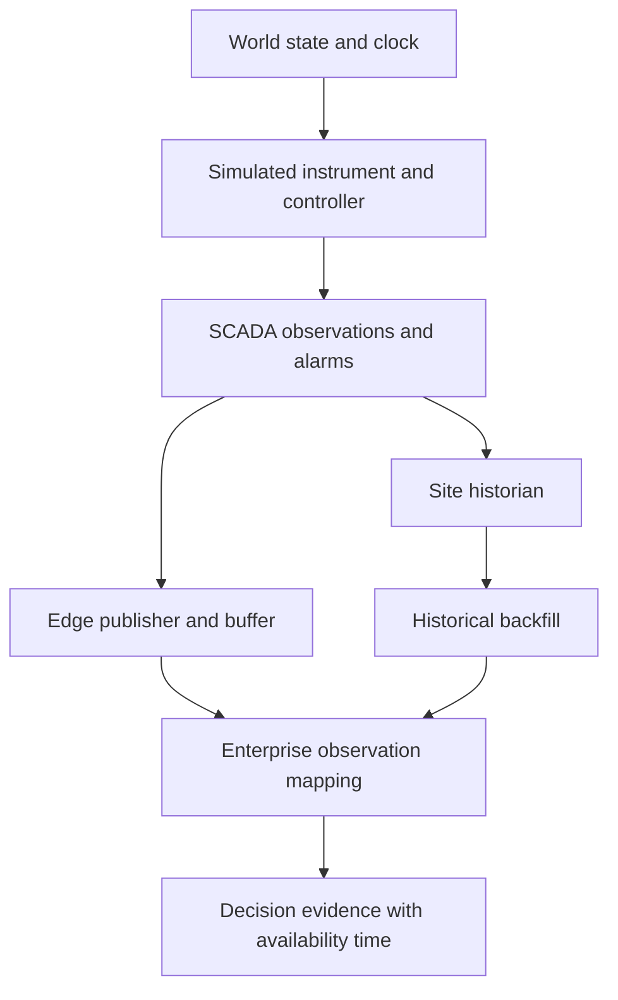

# PPC-OT-001 — Industrial Information Architecture

**Draft for review.** Baseline [PPC at 35cdd80](https://github.com/aadehamid/pearland-petroleum-corporation/tree/35cdd808b30b2c2f9d3332de0fd425c35c4aa4fe). Decision question: when a compressor restricts hydrocracker feed, which observations could the operator and planner see, what equipment did they describe, and how much confidence should each place in them? PPC fixture signals and values below are `SYNTHETIC`. Unit conversions and integrated totals are `DERIVED`. The upstream ICE row counts and cadence are source-reported test facts, not PPC observations.

## 1. Authority and scope

[WORLD-001](../01-enterprise-world/PPC-WORLD-001_Canonical_Enterprise_World.md) owns fictional physical state. [ENG-001](PPC-ENG-001_Physical_and_Numerical_Engineering.md) specifies its proposed capacity constraints. [WORLD-002](../01-enterprise-world/PPC-WORLD-002_Simulation_Time_Replay_and_Branches.md) defines simulation time, evidence cutoffs, and branch isolation. OT instruments sample that world. SCADA records alarms and operator actions. Historians record observations. PPC-006 governs source ownership; PPC-010 governs graph context. A change of alarm state or an inferred equipment condition cannot authorize a change of plant state.

ADR-024 makes controlled source imperfections intentional. ADR-008 separates semantic meaning from operational graph traversal. T54's owner prompt calls for validating physics and events. T55 records the owner's restriction on paid historian licenses. The transport, historian and normalization designs below are proposals for review. The [ADR register](../../PPC-REG-001_Architecture_Decision_Register.md) remains authoritative. Product selection, engineering acceptance and runtime qualification remain open.

## 2. From physical state to evidence

This logical diagram shows live and historical routes. Define one primary producer per signal series. If a backfill overlaps live delivery, reconcile the original observation keys. A controller runs its local logic during an enterprise outage. An HMI can submit an operator request. Route that request through the world intervention contract with actor, branch, effective time, authority, constraint check and receipt. Retain requested, accepted, executed and rejected actions separately.

| Boundary | Proposed contract | Failure behavior |
|---|---|---|
| Instrument → site acquisition | Bind source namespace, stable address, value type, native unit and quality to the observation. Record sampling and publication policies separately. | An unknown address enters quarantine. A Bad measurement stays Bad even when the value looks plausible. |
| OPC UA → edge adapter | Use an authorized read subscription. Capture source/server timestamps and native status when supplied. Pin endpoint identity and address mapping revision. | On session loss, mark the source unavailable and reconcile the gap after reconnect. Record missing timestamps explicitly. |
| Edge → MQTT distribution | Broker transports messages. Sparkplug is a proposed profile for metric definitions and session lifecycle. Record publisher identity and session context before decoding aliases. | Discard an unbound alias from the qualified stream, preserve the raw message, recover definitions on rebirth and reconcile the interval. |
| Historian → governed history | Preserve source time, quality changes, native unit, correction lineage and extraction window. Identify compression/deadband policy. | A missing sample stays missing. Label interpolation, carry-forward and backfill as derived or historical. |
| Enterprise → decision product | Map to a governed measurement identity, quantity, asset assignment and equipment hierarchy effective at observation time. Expose time of availability to the consuming role. | A missing or overlapping mapping holds enterprise publication for the affected record. Source history remains accessible. |

## 3. Observation contract and ICE dependency

The pinned [ICE Level-0 contract](https://github.com/aadehamid/scada_harmonization/blob/1467e9278a9fa50d80618a296297eb40cd4416c2/docs/LSC-004_Level_0_Contract.md) defines a long-form row with `ts_utc`, `friendly_name`, `source_column`, `source_dataset`, `value`, `quality` and `quality_reason`. Its datasets are TEP and IIoT. Its TEP replay cadence is 180 seconds. Physical meaning awaits the mapping table. Its [handoff](https://github.com/aadehamid/scada_harmonization/blob/1467e9278a9fa50d80618a296297eb40cd4416c2/HANDOFF.md) records mapping YAML, Sparkplug and the second plant as outstanding at that revision. PPC needs a separately reviewed adapter or upstream contract version for a PPC-native source. Assigning a fictional refinery record the TEP dataset label would corrupt provenance.

| PPC extension proposed for the adapter envelope | Why the reviewer needs it |
|---|---|
| Run, world/branch, site, source system, stable observation key, revision and prior revision | Distinguish redelivery from a correction and prevent a counterfactual from leaking into baseline evidence. |
| Native address, instrument assignment, observed property, value, unit, basis and native status | Preserve the source claim and support comparisons of like quantities. The tag, instrument and installed equipment each have a distinct identity. |
| Sample time, source/server record times where available, receipt time and first authorized availability | Quantify delay and reconstruct the decision as it could have been made. Preserve the original clock domain, synchronization status and uncertainty. |
| Effective mapping interval, time the mapping was recorded, conversion version and quality interpretation | Reproduce an old published result after a tag reassignment or correction. Keep original and normalized fields together. |
| Delivery ID, publisher session, sequence where supported, payload digest and historical/live flag | Recover a buffered record without introducing a second observation. Equal key and different payload requires explicit revision or investigation. |

Site normalization resolves native aliases and units to site measurement identity. Enterprise normalization links that identity to a common property, quantity basis and time-valid equipment role. ISA-95 provides hierarchy context; the UNS supplies a distribution path. Neither provides the mapping release or historical assignment. EDI supplies evidence for equipment configuration. INFO-001 and GRAPH-001 will specify semantic and projection rules. The separate DS_Business_Process release is upstream of enterprise process mapping. Pending release identifiers must remain explicit dependencies.

## 4. Worked observations

**Compressor derate.** In independent fixture `OT-DELAY-01`, using the WORLD-002 §6 physical plan but a different observation delivery schedule, the plan remains 36,000 bbl/day. At 08:10 a restriction caps executed feed at 30,000. The 08:40 fork is a distinct decision boundary. For this `SYNTHETIC` observation fixture, a flow indication samples 1,250 bbl/h at 08:12, reaches the site historian at 08:13 and first reaches the planner at 08:16. At the same reference basis, 1,250 × 24 = 30,000 bbl/day. The four-minute sample-to-planner delay makes the sample unavailable to an 08:15 planning decision. Its later arrival can support a revised decision. One point cannot establish sustained throughput, compressor causality, product yield or margin. A late alarm acknowledgement records a human action and leaves the original observation intact.

**Equivalent signals across sites.** For a mapping test only, two fictional adapters report temperatures of 212 °F and 100 °C. Conversion gives (212 − 32) × 5/9 = 100 °C. Retain distinct source, measurement and asset IDs even when quantity and normalized value match. A tag reassigned at noon resolves to its old instrument for an 11:59 sample delivered at 12:03. An overlapping assignment fails uniqueness. This fixture adds no operating site to the charter.

**Deadband and gap.** For a new four-sample fixture use 100.0, 100.2, 100.6, 100.6 °C; the final sample changes from Good to Bad. With a proposed inclusive 0.5 °C threshold against the last emitted value, the first and third values publish. Publish the fourth quality transition even though its value is unchanged. Three records are expected. A disconnect immediately after the first publication needs a separate gap marker or session-state record. A quiet signal and a disconnected signal cannot be distinguished by the last numeric value alone.

## 5. Tool choices and qualification

T53 proposes FUXA and comparisons with Rapid SCADA Community and Scada-LTS. T54 proposes Mosquitto and asyncua, with Sparkplug lifecycle tests. T55 proposes a PostgreSQL/TimescaleDB Apache prototype and comparison with Apache IoTDB and QuestDB. T56 proposes versioned Python/Pydantic mappings and evaluation of integration/buffering tools. T59–61 explore edge inference and durable agent state. The no-paid-runtime constraint applies to the evaluated industrial stack. Exact versions, licenses, feature availability and recovery characteristics require verification before selection. Keep edge inference advisory and retain deterministic local behavior when a model is offline.

| Acceptance fixture | Required observable result | Present evidence |
|---|---|---|
| OT-01. Unit and time-valid identity | §4 temperature values agree on the same basis. Reassignment, incompatible unit and ambiguous identity produce distinct dispositions. | Conversion checked; mapping release pending. |
| OT-02. Quality and compression | §4 deadband emits three records, including the quality transition. Querying an empty interval returns a gap with coverage metadata. | Hand-worked sequence; historian behavior untested. |
| OT-03. Partition, restart and backfill | Persist buffered records across restart. Reconcile identical live/backfill observations once; flag payload conflicts and expose any unrecoverable loss. | Proposed evidence: source counts and keys, checksums, delivery log and reconciled export. |
| OT-04. Alarm and evidence cutoff | Reproduce raise, acknowledge and return-to-normal times independently. In `OT-DELAY-01`, the planner at 08:15 cannot use the 08:16 record on replay. WORLD-002 §6 and `SCN-A-T125` use their own 08:12 delivery. | Timeline checked; replay and permissions untested. |
| OT-05. Session and control isolation | Recover metric definitions after publisher restart. Unauthorized write attempts produce no world transition. Enterprise/edge outage leaves the local loop active. | Proposed tests; no deployed broker, hardware or isolation evidence. |
| OT-06. Numerical comparison | Compare qualified historian aggregates with independent interval integration on a common basis. Record sample coverage, quality exclusions and approximation. | ENG-001 and WORLD-002 supply paper references. A single instantaneous reading cannot qualify an interval total. |

## 6. Decisions and evidence still needed

GAP-004 remains open. Which ICE mapping release will PPC consume, and who accepts unresolved or time-overlapping assignments? Which source owns a measurement when OPC UA and historian routes overlap? Which signals always retain raw samples, and what are their deadband, retention, quality and clock-skew policies? What outage duration must the edge buffer survive, and what loss marker reaches planners when it fills? The owner and OT reviewer should record the policy, affected signals, acceptance fixture and evidence before any qualification claim. Original diagrams and screenshots referenced in the discussion remain subject to the attachment limitations in the register.

| Original discussion | Section and disposition |
|---|---|
| T53 lines 9623–9629, 9705–9707, 9720–9725 | §§2, 5. Alarm lifecycle and candidate HMI choices. |
| T54 lines 9739–9747, 10095–10104 | §§1–2, 5. Owner validation direction; transport and lifecycle choices proposed. |
| T55 lines 10294–10304, 10519–10526 | §§2–5. Observation history, quality, original/correction lineage, deadband and historian licensing. |
| T56 lines 10929–10937; T57 lines 11088–11094 | §§2–3, 5–6. Site/enterprise normalization proposal, quality and authority requirements, ISA-95 context. |
| T58 lines 11388–11437; T59–61 lines 11555–12282 | §§4–5. Integrated derate proposal and later edge-model exploration. §4 sample values and delays are new fixtures. |

[Discussion register](../registers/PPC-Discussion-Decision-Traceability.md) · [Detailed source locators](../registers/PPC-Discussion-Source-Locators.csv) · [Architecture registry](../00-master-index/PPC-ARCH-000_Master_Architecture_Index_and_Authority_Baseline.md)
