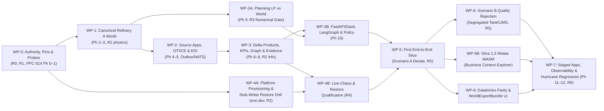

# PPC-PLAN-001 — Detailed Implementation Work Packages and Readiness Plan

Inspected PPC baseline: `ef4eb08fd09298a8fe64cff4bac52242f6d6b5f6` (reconciled on branch `docs/first-principles-refinery-grill`, 2026-11-26; revised after external Codex and Claude reviews).

| Control | Value |
|---|---|
| ID / status | `PPC-PLAN-001` / Reconciled implementation plan (`v1.1.0`, 2026-11-26) for owner Phase 0 authorization |
| Authority | Reconciles [PPC-014](../../PPC-014_Implementation_Roadmap_and_Build_Runbook.md), [ARCH-000](../00-master-index/PPC-ARCH-000_Master_Architecture_Index_and_Authority_Baseline.md), [ADR-0040](../../adr/0040-staged-mechanistic-refinery-model-and-closed-flowsheet.md)–[ADR-0053](../../adr/0053-legacy-data-quarantine-and-world-export-bundle.md), and [PPC-REVIEW-001](../independent-review/PPC-REVIEW-001_Document_Coverage_and_Transcript_Audit.md)–[004](../independent-review/PPC-REVIEW-004_Proof_Obligation_and_Validation_Register.md) |
| Contract | Reconciled architecture and gates → bounded, agent-neutral implementation packages |

## 1. Readiness boundary and authorization gate

This document is the single reconciled implementation plan aligning `PPC-014` phases (Phases 0–12) and `ARCH-000 §10` readiness gates (`R0`–`R6`) with `ADR-0040`–`0053`. **This plan authorizes no code, simulator, prototype, dataset generation, or infrastructure deployment.** Phase 0 begins only after separate explicit owner authorization following review of this reconciled package.

Distinguish five non-interchangeable states: `PROPOSED` (draft spec), `DECIDED` (owner ADR recorded with quoted words), `IMPLEMENTED` (code exists), `VERIFIED` (independent oracle/formal checks executed and recorded), and `QUALIFIED` (signed release over exact code, data, and environment digests). **Design readiness** (`R0`–`R1`) is separate from **runtime qualification** (`R2`–`R6`). Every work package starts `NOT_STARTED`.

## 2. Critical dependency path and parallel tracks

- **Critical path:** `WP-0 → WP-1 → WP-2 → WP-3 → WP-3B → WP-5 → WP-6 → WP-7`.
- **Parallel tracks:**
  - `WP-4A` (platform provisioning, secret isolation, backup wiring, and synthetic stub-writer restore drill) runs in parallel with `WP-1`–`WP-3`; `WP-4B` (`R4` live chaos/restore qualification killing real outbox and Delta writers) runs once `WP-3` delivers live writers and gates `WP-5`.
  - `WP-3A` (deliberately reduced Pyomo Planning LP vs mechanistic World Kernel benchmarks for `R3`) runs in parallel with `WP-2`–`WP-3` once `WP-1` world schemas freeze, and gates `WP-3B`.
  - `WP-5B` (Slice 1.5 Relate WASM explorer), `WP-6` (Scenario B quality rejection), and `WP-8` (Databricks Free Edition synced-copy parity + `WorldExportBundle` v1 certification) run in parallel after `WP-5` passes `R5`.
- **What must wait for owner approvals, probes, or calibration:**
  - `WP-0` blocks Phase 0 code until the owner resolves the WP-0 gate items ([PPC-REVIEW-003 §3](../independent-review/PPC-REVIEW-003_System_and_Decision_Register.md#open-owner-decisions-required-in-wp-0-before-phase-0-code)):
    1. **Proposed `ADR-0040` flowsheet closure:** Option A (add SMR, Catalytic Reformer, and FCC Selective HDS as declared bounded interfaces plus terminal 10 vol% ethanol) vs Option B (external boundary imports for pipeline $\text{H}_2$, reformate/alkylate, and terminal ethanol, exporting heavy naphtha).
    2. **Clarification of `ADR-0045` / `ADR-0051`:** Confirm T86 Databricks Free Edition synced-copy ingest path, `exe.dev` RAM sizing (`16 GB` two-VM split with ClickHouse-backed Langfuse v3 vs `12 GB` lightweight OTel collector in Slice 1), and Cloudflare D1 retention (with R2 export backups) vs consolidating workflow state into PostgreSQL.
    3. **Governance parameters:** Named steward for identity conflicts, numeric `AUTO_EXECUTE` vs `REQUIRE_APPROVAL` thresholds, and Refinery A v1 synthetic parameter ranges/owners. (Numeric calibration sign-off itself moves to the **`WP-1` exit gate** once the world engine produces trajectories.)
  - Binding generalized process IRIs waits for the separate upstream `ds-business-process/1.0` release (`ADR-0042`, `0044`); provisional adapters unblock `WP-1`–`WP-6`.
  - Archiving or deleting `LEGACY_PRE_WORLD_MODEL` objects waits until `WP-1` passes all conservation and replay gates (`ADR-0053`).

## 3. Detailed work-package specifications (`WP-0` through `WP-8`)

### WP-0 — Governance Closure, Upstream Pins, and Core Storage Probes (`R0`, `R1`, `PPC-014` Phases 0–1)

- **Objective & boundaries:** Close the WP-0 owner gate items, pin upstream repository commits into provisional adapters (`ADR-0042`), quarantine `LEGACY_PRE_WORLD_MODEL` R2 prefixes (`ADR-0053`), verify `delta-rs` (`aws_conditional_put="etag"`) single-writer locking and Databricks Free Edition ingest constraints (T86), and stand up local Docker Compose parity matching `exe.dev`. No refinery simulator logic yet.
- **Predecessors & blocking decisions:** Separate owner authorization to start Phase 0; gated on the WP-0 owner items in §2.
- **Accountable role & upstream owners:** PPC Platform/Architecture Lead; upstream owners of EPM (`511a9e8d`), ICE (`30c20c3`), EDI (`12a4a6a`), ECE (`750b398`), and `ds-business-process/1.0` (pending).
- **Governing IDs:** `ARCH-000 §8`, `PPC-013`, `PPC-017`, `PLATFORM-001`, `PPC-REVIEW-003 §2–3`; `ADR-0041`, `0042`, `0045`, `0051`, `0053`.
- **Inputs, outputs & affected components:** Inputs: reconciled docs, R2 credentials (secret store), upstream repo hashes. Outputs: repo scaffold (`schemas/`, `semantic/`, `infra/`), AML core models, `ReleaseManifest` JSON Schema, `WorldExportBundle` observable/hidden split schema, R2 prefix map (`raw/`, `delta/`, `cache/`, `manifests/`, `exports/world_bundle/observable/`, `evaluation/hidden/`, `legacy_quarantine/`), and local Compose stack.
- **Ordered implementation tasks:**
  1. Record owner dispositions on `ADR-0040` Option A/B, `ADR-0045`/`0051` sizing/D1/Free-Edition clarifications, steward role, policy thresholds, and parameter-range ownership.
  2. Create versioned provisional adapter manifests pinning EPM, ICE, EDI, and ECE commits.
  3. Provision R2 prefixes with separate restricted credentials for `evaluation/hidden/`.
  4. Verify `delta-rs` (`deltalake`) writes to R2 with `aws_conditional_put="etag"`, Dagster concurrency pool = 1 per table, DuckDB read-only queries, a negative dual-writer conflict test, and a Databricks Free Edition synced-copy ingest probe (T86).
  5. Stand up local Docker Compose parity stack matching the chosen `exe.dev` VM layout.
- **Verification method & independent oracle:** Schema validation tests, R2 access-denial negative test for `evaluation/hidden/`, dual-writer Delta conflict rejection test, Databricks Free Edition ingest smoke test.
- **Acceptance evidence & exit criteria (`R0`, `R1`):** Signed WP-0 ADRs/checklist, passing conflict/permission/ingest probes, zero invented upstream approvals.

### WP-1 — Canonical Refinery A v1 World Kernel and Public Data Conditioning (`PPC-014` Phases 2–3, `R2` physics)

- **Objective & boundaries:** Ingest pinned public observations (EIA, NOAA/NHC, EPA, PHMSA) to R2 raw, and implement the deterministic Refinery A v1 canonical world kernel (`WORLD-001`, `WORLD-002`, `ENG-001`) with 1-minute process steps, exact intra-step bound crossings, and branchable checkpoints. Publishes immutable **Canonical World Snapshots** under `evaluation/hidden/` only (never `WorldExportBundle` v1, which waits for `WP-8` after observable records exist).
- **Predecessors & blocking decisions:** `WP-0`; relies on `ADR-0040` (with WP-0 flowsheet closure), `0043`, `0049`, `0050`, `0053`.
- **Accountable role & upstream owners:** Refinery Process Modeling & Simulation Engineer; public data feeds (EIA/NOAA/EPA/PHMSA).
- **Governing IDs:** `WORLD-001`, `WORLD-002`, `ENG-001`, `PPC-REVIEW-002` (`EQ-01`–`EQ-08`), `PPC-REVIEW-004` (`PO-01`, `PO-02`, `PO-04`, `PO-05`, `PO-06`, `PO-07`, `PO-09`, `PO-11`, `PO-12`).
- **Inputs, outputs & affected components:** Inputs: pinned public feed vintages, synthetic crude assays, approved parameter ranges. Outputs: `generators/` Python+SciPy world engine, Quint state-machine spec, Python+Z3+Hypothesis test suite, immutable world snapshots and manifests under `evaluation/hidden/`.
- **Ordered implementation tasks:**
  1. Implement public API ingestion landing raw EIA/NOAA/EPA/PHMSA payloads and vintages to R2.
  2. Implement `EQ-01` rational density/mass basis and `EQ-02`/`EQ-03` tank (including segregated hold tank `TK-101H`), transit, Churchill/Colebrook/Darcy–Weisbach hydraulics, and ANSI/HI 9.6.7 pump curves with exact root-finding intra-step crossings (`t*`).
  3. Implement `EQ-04` CDU/VDU zero-sum TBP cut separation, `EQ-05` HCU polytropic compressor + mass-basis $R_{\min,\text{mass}}$ + quench duty + $P_{\text{H2}}$ purity + lumped conversion/H2 stoichiometry, `EQ-06` Lee, Chen, Huang, & Pan (1989) 4-lump FCC with inlet CCR split + heat/coke balance, `EQ-07` shared H2/utility header with feed-dependent DHT (routing LCO/kero/AGO) and WP-0 H2/octane closure units, and `EQ-08` conservative + nonlinear blending (Chevron RVP, Healy RT-70, Wickey–Chittenden flash, Hu–Burns cloud, ASTM D975 cetane, refinery BOB `>= 84.2 / >= 88.6` + terminal E10) with `QUALITY_HOLD`/`RELEASE` states.
  4. Implement deterministic `WORLD-002` hybrid clock, semantic-keyed paired RNG streams, atomic R2 checkpoints, and branch fork/replay.
  5. Execute Quint (`PO-01`, `PO-09`) and Python+Z3+Hypothesis (`PO-01`, `02`, `04`–`07`, `11`) verification suites.
  6. Obtain process/controls engineer numeric calibration sign-off (`PO-12`, `PPC-REVIEW-004 §4`); only after WP-1 passes, authorize archival/retirement of `LEGACY_PRE_WORLD_MODEL` data (`ADR-0053`).
- **Verification method & independent oracle:** Quint/Apalache model checking; Z3 symbolic proofs (`11,800 → 12,200 → 11,700 bbl` tank counterexample; `75 t/day` shared-H2 counterexample); exact Python rational oracles (`PPC-REVIEW-002 §3`); step-refinement (`60 s / 10 s / 1 s`) and 23/25-hour DST parity; published GPSA/Riazi/Lee/Gary–Handwerk/EIA benchmark sign-off (`PO-12`).
- **Acceptance evidence & exit criteria:** Zero failures across `PO-01`, `02`, `04`–`07`, `09`, `11`, `12`; bit-for-bit checkpoint replay and branch isolation digests; signed process-engineer calibration approval.

### WP-2 — Distributed Source Systems, OT/ICE Plane, EDI Adoption, and Atomic Outbox/NATS/Staging Integration (`PPC-014` Phases 4–5)

- **Objective & boundaries:** Materialize realistic, deliberately imperfect source records from WP-1 world transitions into independent operational stores (OT OPC UA/MQTT Sparkplug B/TimescaleDB, SQLite Refinery/LIMS, PostgreSQL CTRM, MySQL Logistics), adopt EDI structured topology, and transport IT events via transactional outboxes + NATS JetStream + atomic Postgres Silver staging and `InboxReceipt` commits (`ADR-0046`, `PPC-REVIEW-003 §4`). Integration code never reads hidden canonical world truth.
- **Predecessors & blocking decisions:** `WP-1`; relies on `ADR-0042`, `0046`, `0047`, `0053`; gated on WP-0 identity-conflict steward assignment.
- **Accountable role & upstream owners:** OT/IT Integration Engineer; ICE (`scada_harmonization`) and EDI (`Engineering_Drawing_to_Graph`) provisional adapters.
- **Governing IDs:** `OT-001`, `EDI-001`, `INT-001`, `PPC-REVIEW-003 §4`; `PO-03`, `PO-08`.
- **Inputs, outputs & affected components:** Inputs: WP-1 world transition streams. Outputs: `source-systems/{commercial,logistics,refinery}/`, OT publishers (`asyncua`, `Mosquitto` Sparkplug B, TimescaleDB + 1 s compressor telemetry projection), EDI adoption handler, `OutboxEntry`, atomic Postgres Silver staging + `InboxReceipt` service, NATS JetStream streams, Dagster raw/staging assets.
- **Ordered implementation tasks:**
  1. Implement source materializers with realistic ID/timezone/unit/delay imperfections across SQLite (Refinery/LIMS), Postgres (CTRM), MySQL (Logistics), and OT (OPC UA/Sparkplug B/TimescaleDB).
  2. Implement EDI structured DEXPI candidate staging, review receipt, and branch-scoped PPC adoption (`EDI-001 §3`).
  3. Implement atomic source DB + `OutboxEntry`, NATS JetStream transport, and single-transaction Postgres Silver staging + `InboxReceipt` consumer with conflict quarantine (`INT-001 §2`).
  4. Implement Dagster raw landing assets to R2 with OpenLineage manifests.
  5. Execute Quint protocol verification (`PO-03`) across both Crash Point 1 (before NATS ack) and Crash Point 2 (between Postgres staging and R2 Delta commit).
- **Verification method & independent oracle:** Fault injection at source commit, outbox publish, Postgres staging+receipt commit, NATS ack, and Delta commit; duplicate `M1` movement (`INT-RETRY-01`); conflicting digest quarantine; broker disconnect/rebirth (`OT-03`); deadband + Bad quality transition (`OT-02`); ambiguous tag rejection (`OT-01`); EDI directed graph diff.
- **Acceptance evidence & exit criteria:** `PO-03` Quint pass, zero duplicate business effects across both crash points, passing `OT-01`–`OT-06` logs, verified absence of hidden-truth imports in integration code.

### WP-3 — Governed Information: Delta Data Products, KPI Store, Semantic/Neo4j Graph, and Reader-as-of Evidence (`PPC-014` Phases 6–8, `R2` info)

- **Objective & boundaries:** Publish Silver/Gold Delta Lake tables on R2 via `delta-rs` (`aws_conditional_put="etag"`, idempotent `txnAppId`/`txnVersion`, Dagster concurrency pool = 1) queried read-only by DuckDB (`ADR-0045`), build EPM-aligned tall KPI facts with T100 measure-class decomposition (`DATA-001`), run Git Turtle + `pyshacl` → Neo4j Community projections (`ADR-0044`), and build the reader-as-of evidence corpus (`INFO-001 §3`, `EVID-001`).
- **Predecessors & blocking decisions:** `WP-2`; relies on `ADR-0042`, `0044`, `0045`, `0047`. Generalized process bindings remain pending until `ds-business-process/1.0` releases.
- **Accountable role & upstream owners:** Data & Knowledge Graph Engineer; EPM (`511a9e8d`) and ECE (`750b398`) provisional adapters.
- **Governing IDs:** `INFO-001`, `GRAPH-001`, `DATA-001`, `EVID-001`, `PPC-016`, `PPC-017`, `PPC-018`; `PO-03`, `PO-08`.
- **Inputs, outputs & affected components:** Inputs: WP-2 Postgres Silver staging and raw extracts, EPM Turtle/SHACL bundle, ECE contracts. Outputs: `lakehouse/delta/` tables + `ReleaseManifest` publisher, GX DQ suite, `semantic/` Turtle + `pyshacl` validator, `graph/neo4j/` snapshot loader, `pgvector` evidence index, reader-as-of query engine.
- **Ordered implementation tasks:**
  1. Implement idempotent `delta-rs` Silver/Gold publication from Postgres staging with `txnAppId`/`txnVersion`, `aws_conditional_put="etag"`, and Dagster concurrency pool = 1 per table.
  2. Implement EPM tall KPI Store with `KPI`, `OPERATIONAL_METRIC`, and `MARKET_INDICATOR` measure classes, decomposition links, atomic `ReleaseManifest` cuts, and `RETRACTED` (`L1/X1`) handling.
  3. Implement Git Turtle + `rdflib`/`pyshacl` validation and idempotent Cypher `MERGE` loader into branch-scoped Neo4j `GraphSnapshot` projections with RDF-to-LPG loss report.
  4. Implement `INFO-001 §3` reader-as-of selection (returning strictly `UNRESOLVED` on access/eligibility failure and `UNKNOWN` only on epistemic gaps) plus structured-to-unstructured evidence corpus generation (`PPC-018`).
- **Verification method & independent oracle:** Quint `PO-08` non-interference proof, executable `INFO-001 §3` P0/P1/P2 and `DATA-001 §2` L1/X1 runtime tests, EPM SHACL/competency queries, RDF↔Neo4j round-trip diff, restricted-path side-channel test, hidden-truth isolation check.
- **Acceptance evidence & exit criteria (`R2`):** Zero temporal or permission leaks, passing SHACL/competency/GX suites, exact KPI recomputation parity, signed `ReleaseManifest` digests.

### WP-3A — Planning LP vs World Kernel and Performance Intelligence Gate (`PPC-014` Phase 9, `R3`)

- **Objective & boundaries:** Build the **deliberately reduced Pyomo + HiGHS Planning LP** (delta-base yield vectors, linear blend indices, vintage-pinned lagged assays) plus IPOPT nonlinear verification cases and three-way fair-backcasting attribution (`EQ-09`, `UC-3`, `ADR-0048`) tracked in MLflow. Independently verify LP recommendations against `WP-1` mechanistic physics before any numbers enter the UI (`R3` hard gate).
- **Predecessors & blocking decisions:** `WP-1` (runs in parallel with `WP-2`–`WP-3`); relies on `ADR-0048`, `0049`, `0050`.
- **Accountable role & upstream owners:** Operations Research & Analytics Engineer.
- **Governing IDs:** `ANALYTICS-001`, `ENG-001 §5`, `PPC-REVIEW-002` (`EQ-05`–`EQ-09`), `PPC-REVIEW-004` (`PO-05`, `PO-06`, `PO-07`, `PO-12`).
- **Inputs, outputs & affected components:** Inputs: `WP-1` assays, lagged planning vectors, inventories, contracts, market prices, evidence cutoffs. Outputs: `intelligence/optimization/` Pyomo LP/NLP models, `ModelRun` lifecycle service, `UC-3` backcasting attribution engine, MLflow artifacts on R2.
- **Ordered implementation tasks:**
  1. Formulate the deliberately reduced Pyomo + HiGHS Planning LP (linear delta-base yields, linear blend indices, lagged assays) covering crude slate, CDU/VDU cut swing, FCC/HCU bounds, shared H2 header, tank bounds, and margin (`EQ-09`).
  2. Add IPOPT NLP check cases for nonlinear Chevron RVP / RT-70 octane / FCC heat-balance verification.
  3. Implement `ModelRun` state machine and three-way backcasting attribution (`LP calibration effect`, `decision-time opportunity`, `execution/exogenous residual`), proving non-zero measurable calibration attribution against `WP-1` world truth (`PO-12`).
  4. Feed recommended LP setpoints back into `WP-1` transient physics to prove closed-loop execution feasibility.
- **Verification method & independent oracle:** Known feasible/infeasible fixtures (`30,001 bbl/day` rejected; `75 t/day` H2 cap binds), solver tolerance & seed replay, non-zero `UC-3` calibration attribution check, closed-loop `WP-1` feasibility test.
- **Acceptance evidence & exit criteria (`R3`):** Passing `ENG-V07`/`ENG-V08`, measurable `UC-3` LP calibration error, zero recommended schedules violating `WP-1` physics.

### WP-3B — Bounded FastAPI/Dash Workspace, LangGraph Agents, and Policy Gate (`PPC-014` Phase 10)

- **Objective & boundaries:** Implement the FastAPI context API, Plotly Dash Slice 1 workspace (`ADR-0047`, `0052`), LangGraph stateful approval workflow with Pydantic-typed tool contracts, service-side policy-as-code (using WP-0 workflow-state store choice: D1 or Postgres), and OpenTelemetry tracing (`ADR-0048`). Starts **only after `WP-3A` passes `R3`**.
- **Predecessors & blocking decisions:** `WP-3` and `WP-3A` (`R3` passed); gated on WP-0 policy-threshold and workflow-state decisions.
- **Accountable role & upstream owners:** Full-Stack / Agent Platform Engineer.
- **Governing IDs:** `UX-001`, `AGENT-001`, `EVID-001`, `PPC-012`; `PO-08`, `PO-10`.
- **Inputs, outputs & affected components:** Inputs: `WP-3` Delta/Neo4j/evidence APIs, `WP-3A` Pyomo service, policy rules. Outputs: `automation/` LangGraph + Pydantic tools + policy gate, FastAPI backend, `apps/dash/` Slice 1 workspace, workflow state store, OTel tracing collector.
- **Ordered implementation tasks:**
  1. Build FastAPI role/cutoff-enforcing API serving `WorkspaceRequest` → `InvestigationResult` cards (separating `POTENTIAL_EXPOSURE` graph paths from model-quantified cards and T100 KPI decomposition).
  2. Build service-side policy engine enforcing `ActionProposal` → `ActionAuthorization` → `ActionReceipt` with exact payload digest binding and one-time idempotency keys (`AGENT-001 §1`).
  3. Build LangGraph workflow with Pydantic-typed read/simulate/recommend tools and redacted OTel traces.
  4. Build bounded Plotly Dash Slice 1 workspace (event view, exposure/KPI cards, branch comparison, approval queue, saved as-of investigation).
  5. Execute Quint verification on the approval/execution state machine (`PO-10`).
- **Verification method & independent oracle:** Quint `PO-10` pass; API negative security tests (mutated payload, expired approval, cross-branch approval, unauthorized role, hidden-truth access denied, restricted trace leak test); golden agent evaluation cases.
- **Acceptance evidence & exit criteria:** Zero policy bypasses or hidden-truth leaks, exact `ActionReceipt` idempotency, saved investigation replay matches pinned cutoff.

### WP-4A / WP-4B — Platform Provisioning (`exe.dev` + R2) and Live Per-Store Recovery Qualification (`R4`)

- **Objective & boundaries:** Split cleanly into two stages to avoid a circular dependency: **`WP-4A`** provisions the Slice 1 `exe.dev` persistent VM(s) wired to Cloudflare R2 (`ADR-0051`, sizing matrix in `PPC-REVIEW-003 §2`), enforces secret isolation, and runs a baseline per-store backup/restore drill against synthetic stub writers; **`WP-4B`** executes the live `R4` chaos/restore qualification against the real `WP-2`/`WP-3` outbox and `delta-rs` writers, proving `RPO`, outbox-sequence gap detection (`RECOVERY_GAP`), and `RTO <= 1 hour` for Slice 1 data volumes (`<= 5 GB` compressed) before Slice 1 integration.
- **Predecessors & blocking decisions:** `WP-4A` depends on `WP-0` (runs in parallel with `WP-1`–`WP-3`, gated on WP-0 `exe.dev` VM/Langfuse sizing and D1 disposition). `WP-4B` depends on `WP-4A` and `WP-3`, and gates `WP-5`.
- **Accountable role & upstream owners:** Platform / DevOps Engineer.
- **Governing IDs:** `PLATFORM-001`, `PPC-013`, `PPC-REVIEW-003 §2`; `ADR-0051`.
- **Inputs, outputs & affected components:** Inputs: Compose/VM manifests, R2 bucket, secret store, and (for `WP-4B`) live `WP-2`/`WP-3` outbox and `delta-rs` writers. Outputs: `infra/` deployment configs, `ServiceDescriptor`/`BackupManifest` automation, per-store backups (Postgres WAL + basebackup, MySQL binlog/dump, SQLite Litestream, Neo4j offline `neo4j-admin dump`, D1 export if retained, NATS outbox re-derivation proof), post-restore outbox-sequence vs `InboxReceipt` gap checker, restore runbook.
- **Ordered implementation tasks:**
  1. (`WP-4A`) Provision `exe.dev` VM(s) matching the approved WP-0 RAM sizing table (`PPC-REVIEW-003 §2`) and enforce least-privilege credentials separating world truth (`evaluation/hidden/`), integration, retrieval, and approval execution.
  2. (`WP-4A`) Wire per-store backups to R2 and pass a baseline restore drill using synthetic stub writers.
  3. (`WP-4B`, after `WP-3`) Execute the full live chaos/restore drill across every active store: kill real workers mid-outbox and mid-Delta commit, corrupt local Postgres/MySQL/SQLite/Neo4j state, restore from R2 backups/manifests, verify outbox-sequence vs `InboxReceipt` gap detection, single business effect, and `RTO <= 1 hour`.
- **Verification method & independent oracle:** Timed restore drill log for every store, pre/post restore state and Delta manifest hash equality, outbox-vs-`InboxReceipt` reconciliation check, failed-secret and denied-route penetration tests, VM RAM/CPU telemetry under Slice 1 load.
- **Acceptance evidence & exit criteria (`R4`):** Signed `BackupManifest` restore evidence across all active stores meeting `RPO` and `RTO <= 1 hour`, verified access isolation.

### WP-5 — First End-to-End Vertical Slice: Scenario A Hydrocracker Compressor Derate (`UC-1`, `UC-3`, `R5`)

- **Objective & boundaries:** Connect the full physical-to-decision chain end to end on `exe.dev` + R2 for Scenario A (`SCN-A-T125`, frozen `30,000 bbl/day` compressor-circulation cap under normal `170.00 t/day` plant $\text{H}_2$ supply, plus separate SMR-turndown boundary sub-case `SCN-A-H2CONT`): physical compressor restriction (`EQ-05`) → H2 circulation/quench/shared-header bound (`EQ-07`) → ULSD yield & tank trajectory (`EQ-02`/`EQ-08`) → OT/Sparkplug B/TimescaleDB (`OT-DELAY-01` & `08:12` fixture) → EDI topology → Neo4j `POTENTIAL_EXPOSURE` contracts → Planning LP response & `UC-3` backcasting (`EQ-09`) → EPM KPI decomposition → Dash workspace + LangGraph recommendation → policy-gated approval → isolated branch execution & replay.
- **Predecessors & blocking decisions:** `WP-3B` and `WP-4B` (`R2`, `R3`, `R4` passed).
- **Accountable role & upstream owners:** Cross-functional PPC Integration Lead.
- **Governing IDs:** `SCENARIO-001 §2`, `WORLD-001 §5`, `WORLD-002 §6`, `ENG-001 §4`, `VERIFY-001`; `PO-01`–`PO-12`.
- **Inputs, outputs & affected components:** Frozen `SCN-A-T125` manifest; outputs: full `RunEvidence` bundle, baseline vs child branch diffs, KPI decomposition report, `UC-3` backcast dossier, negative-test logs.
- **Ordered implementation tasks:**
  1. Freeze `SCN-A-T125` manifest (pinned world, assays, adapters, cutoffs, seeds).
  2. Run uninterrupted baseline (`08:00`–`09:10` and 6-hour shift), `08:40` checkpoint restart, and child intervention branch (including shared-H2 contention).
  3. Execute full adverse battery: ambiguous tag, missing EDI adoption, delayed OT (`08:15` vs `08:16`), duplicate retry across both crash points, `30,001 bbl/day` infeasible command, unauthorized approval attempt, sibling-branch contamination.
  4. Produce signed `RunEvidence` and independent reviewer verdict.
- **Verification method & independent oracle:** Independent analytical/Z3/Quint oracles (`WORLD-01`–`08`, `W2-01`–`12`, `OT-01`–`06`).
- **Acceptance evidence & exit criteria (`R5`):** 100% pass across positive, adverse, and replay suites with zero temporal or hidden-truth leaks; signed `QUALIFIED` verdict for Slice 1.

### WP-5B — Slice 1.5 Business-Facing Relate WASM Context Explorer (`UC-4`, `ADR-0052`)

- **Objective & boundaries:** Deliver browser-based Relate WASM as the business-facing **Interactive Enterprise Context Explorer** (`EA09D-D09`, `EA07C-D10`) consuming server-filtered graph packages from FastAPI so business users explore relationships, scenario diffs, and KPI decompositions locally in the browser.
- **Predecessors & blocking decisions:** `WP-5` (`R5` Slice 1 passed); relies on `ADR-0052`.
- **Accountable role & upstream owners:** Frontend / Graph UX Engineer.
- **Governing IDs:** `UX-001`, `GRAPH-001`, `ADR-0052`; `PO-08`.
- **Inputs, outputs & affected components:** Inputs: FastAPI authorized graph-package endpoint + Slice 1 snapshots. Outputs: Relate WASM browser explorer integrated with agent context, Cypher parity test suite, permission-redaction negative tests.
- **Ordered implementation tasks:**
  1. Build server-side permission-filtered graph-package serializer (filtering strictly before browser packaging).
  2. Embed Relate WASM explorer for entity exploration, baseline-vs-branch diff, KPI-to-metric trace, and agent context handoff.
  3. Verify `POTENTIAL_EXPOSURE` vs model-quantified UI badges and Cypher parity against Neo4j Community (`SEM-OT-08`).
- **Verification method & independent oracle:** Browser Cypher parity vs Neo4j Community, restricted-edge byte-inspection side-channel test, browser refresh/as-of replay test.
- **Acceptance evidence & exit criteria:** Zero unauthorized bytes in browser package, exact Cypher parity on supported subset, signed UX gate approval.

### WP-6 — Second Vertical Slice: Scenario B Crude-Quality Rejection & Delayed Lab Correction (`UC-2`, `R5`)

- **Objective & boundaries:** Prove end-to-end segregated-tank receipt (`TK-101H`), LIMS, logistics, CTRM, and restatement coherence (`SCENARIO-001 §3`, `PPC-REVIEW-003 §4` Walkthroughs A & B): scaled `500 bbl` receipt → failed LIMS assay → `QUALITY_HOLD` → delayed passing correction `P2` → restatement `L2` without altering earlier `10:00` planner decision replay → duplicate ticket rejection across atomic staging and Delta publication.
- **Predecessors & blocking decisions:** `WP-5` (runs in parallel with `WP-5B` and `WP-8`).
- **Accountable role & upstream owners:** Commercial & Data Integration Lead.
- **Governing IDs:** `SCENARIO-001 §3`, `INT-001 §3`, `INFO-001 §3`, `DATA-001 §2–3`, `EVID-001 §3`; `PO-03`, `PO-07`, `PO-08`.
- **Inputs, outputs & affected components:** Frozen Scenario B manifest; outputs: reconciled LIMS/CTRM/Logistics/Delta/KPI/dossier `RunEvidence`.
- **Ordered implementation tasks:**
  1. Execute segregated `TK-101H` receipt, `09:00/09:20/09:30` failed assay, `10:00` planner decision, and `12:00/12:30/13:00` passing correction across MySQL, SQLite LIMS, Postgres CTRM, NATS, Postgres staging, Delta, and Neo4j.
  2. Inject duplicate ticket `M1` across both crash points, conflicting payload digest, out-of-order LIMS revisions, retracted release `L1/X1`, unavailable downstream finance, and restricted assay access.
  3. Verify `10:00` dossier replay reproduces `P1` and never leaks `P2`.
- **Verification method & independent oracle:** `INFO-001 §3` & `DATA-001 §2` oracles, `INT-RETRY-01` conservation check, Quint `PO-03`/`PO-08` runtime parity.
- **Acceptance evidence & exit criteria (`R5`):** Zero duplicate receipts, zero temporal leakage across delayed lab correction, clean restatement lineage.

### WP-8 — Databricks Free Edition Parity & Certified `WorldExportBundle` v1 Handoff (`UC-6`, `ADR-0045`, `0053`)

- **Objective & boundaries:** Prove cross-engine equivalence by syncing/ingesting PPC's R2 Delta Gold/KPI tables into **Databricks Free Edition workspace-managed Delta tables** (per T86, since Free Edition lacks custom R2 external locations; documenting paid-tier Unity Catalog external-location Approach A and managed migration Approach B), and assemble + certify **`WorldExportBundle` v1** strictly split into `observable/` (for EPM, ICE, EDI, ECE) and `hidden_truth/` (restricted under `evaluation/hidden/`).
- **Predecessors & blocking decisions:** `WP-5` (runs after `WP-2`/`WP-3` observable records and `WP-5` Slice 1 pass so `observable/` bundle artifacts exist before certification).
- **Accountable role & upstream owners:** Lakehouse & Cross-Repo Integration Lead; sister-repo owners (EPM, ICE, EDI, ECE).
- **Governing IDs:** `DATA-001`, `PLATFORM-001`, `PPC-015`, `ADR-0045`, `0053`.
- **Inputs, outputs & affected components:** R2 Delta tables + WP-2/WP-3 observable records + WP-1 hidden snapshot. Outputs: Databricks Free Edition cross-engine parity report (`EA03C-11`), certified `WorldExportBundle` v1 (`observable/` + separate `hidden_truth/`), sister-repo smoke tests.
- **Ordered implementation tasks:**
  1. Copy/ingest R2 Delta Gold/KPI tables into Databricks Free Edition workspace-managed Delta and recompute Slice 1 KPIs and constituent operational metrics.
  2. Diff DuckDB vs Databricks row-level results, null policies, and threshold statuses (`SEM-10`, `EA03C-11`).
  3. Assemble `WorldExportBundle` v1 strictly separating `observable/` (ICE OT L0 tag schedule & observations, EDI structured topology manifest, EPM KPI/process fixtures, ECE role-scoped evidence corpus) from `hidden_truth/` (`evaluation/hidden/` credentials only).
  4. Verify sister-repo ingestion contracts load `observable/` cleanly with zero access to `hidden_truth/`.
- **Verification method & independent oracle:** Row-by-row DuckDB vs Databricks parity diff; automated credential/leak check confirming zero canonical-truth fields in `observable/`; sister-repo contract schema checks.
- **Acceptance evidence & exit criteria:** Zero unexplained DuckDB/Databricks KPI drift; certified `WorldExportBundle` v1 with verified observable/hidden separation.

### WP-7 — Staged Enterprise Applications, Observability, and Full Hurricane Regression (`UC-4`, `UC-5`, `PPC-014` Phases 11–12, `R6`)

- **Objective & boundaries:** Activate staged baseline components (`ADR-0047`: Twenty CRM, ERPNext O2C/finance, OpenMetadata catalog, Apache Superset BI, Grafana OSS, full ClickHouse-backed Langfuse v3 if deferred from Slice 1, optional Kafka/Debezium swap benchmark), bind approved `DS_Business_Process` ontology once released (`ADR-0044`), and execute the full Gulf Coast Hurricane regression (`SCENARIO-001 §4`, `UC-5`) plus blind agent evaluation (`PPC-016` goals).
- **Predecessors & blocking decisions:** `WP-5B`, `WP-6`, `WP-8`; generalized process conformance gated on upstream `ds-business-process/1.0` release.
- **Accountable role & upstream owners:** PPC Program Owner & QA/Evaluation Lead.
- **Governing IDs:** `PPC-001`, `PPC-009`, `PPC-014` Phases 11–12, `PPC-016`, `PPC-018`, `SCENARIO-001 §4`, `VERIFY-001`.
- **Inputs, outputs & affected components:** All active + staged apps, NOAA/EIA hurricane vintage, blind hidden evaluation set (`evaluation/hidden/`). Outputs: full `R6` release package, Grafana/OpenMetadata dashboards, Superset scorecards, hurricane & blind-agent evaluation report.
- **Ordered implementation tasks:**
  1. Stand up Twenty CRM, ERPNext, OpenMetadata (wired to GX + OpenLineage), Superset (reading governed KPI views only), and Grafana OSS.
  2. Adopt released `ds-business-process/1.0` mappings and run EPM process-conformance evaluation (`PPC-017`).
  3. Run Scenario C Hurricane end-to-end (NOAA advisory → exposure → probabilistic PyMC capacity loss → ULSD/terminal inventory → customer OTIF/Margin-at-Risk → Pyomo alternatives → policy approval → execution → outcome → learning case) and blind ECE agent scoring.
- **Verification method & independent oracle:** Full `VERIFY-001` 6-family regression + `PPC-016` blind evaluation metrics (zero hidden-truth leakage, zero temporal leakage, claim-level provenance coverage).
- **Acceptance evidence & exit criteria (`R6`):** Signed release qualification covering `UC-1`–`UC-6` with reproducible digests and zero unresolved critical defects.

## 4. Extending fidelity and Refinery B without replacing canonical world history

Later phases — higher-fidelity tray-by-tray distillation, dynamic reactor bed quench models, full internal SMR/Reformer/Claus models, the staged **Refinery B** multi-refinery expansion (`T21`, post-WP-7, requiring its own ADR once Refinery A passes `R6`), or an optional Kafka/Debezium IT swap — extend PPC without rewriting historical canonical runs:

1. Every world checkpoint and `ReleaseManifest` pins an immutable `model_release_id`, `equation_set_version`, and `world_version` (`WORLD-002 §4`, `ENG-001 §2`).
2. Adding a deeper mechanistic unit kernel increments `model_release_id` and creates a **new versioned run or comparative branch** (`Restatement` or `Recalibrated` case under `WORLD-002 §5`), keeping historical checkpoints, source records, and past `DecisionDossier` views bit-for-bit reproducible under their original pinned model version.
3. Because every Refinery A object carries a `site_id` from `WP-1` (`WORLD-001 §1`), Refinery B enters additively through a new adopted EDI configuration revision without breaking existing canonical entity IDs.

## 5. Crosswalk to `PPC-014` and traceability

`WP-0` executes `PPC-014` Phases 0–1 (`R0`, `R1`); `WP-1` executes Phases 2–3 (`R2` physics); `WP-2` executes Phases 4–5; `WP-3` executes Phases 6–8 (`R2` info); `WP-3A` executes Phase 9 (`R3`); `WP-3B` executes Phase 10; `WP-4A`/`WP-4B` provision `exe.dev`+R2 and qualify `R4`; `WP-5`/`WP-5B`/`WP-6`/`WP-8` qualify `R5`, Databricks parity, and certified `WorldExportBundle` v1; `WP-7` executes Phases 11–12 (`R6`).

The [exchange register](../registers/PPC-Discussion-Decision-Traceability.md) routes T21, T34, T46–47, T63–65, T76–77, T93, T122–124, T126–130, T136–145 to this draft.

[INFO-001 §3](../03-enterprise-information/PPC-INFO-001_Enterprise_Ontology_Identity_and_Time.md) owns the complete P0/P1/P2 publication rows, source-record times, recipient availability and reader-as-of rule used by this draft.
