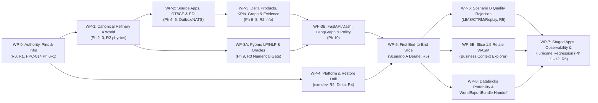

# PPC-PLAN-001 — Detailed Implementation Work Packages and Readiness Plan

Inspected PPC baseline: `ef4eb08fd09298a8fe64cff4bac52242f6d6b5f6` (reconciled on branch `docs/first-principles-refinery-grill`, 2026-11-26).

| Control | Value |
|---|---|
| ID / status | `PPC-PLAN-001` / Reconciled implementation plan (`v1.0.0`, 2026-11-26) for owner Phase 0 authorization |
| Authority | Reconciles [PPC-014](../../PPC-014_Implementation_Roadmap_and_Build_Runbook.md), [ARCH-000](../00-master-index/PPC-ARCH-000_Master_Architecture_Index_and_Authority_Baseline.md), [ADR-0040](../../adr/0040-staged-mechanistic-refinery-model-and-closed-flowsheet.md)–[ADR-0053](../../adr/0053-legacy-data-quarantine-and-world-export-bundle.md), and [PPC-REVIEW-001](../independent-review/PPC-REVIEW-001_Document_Coverage_and_Transcript_Audit.md)–[004](../independent-review/PPC-REVIEW-004_Proof_Obligation_and_Validation_Register.md) |
| Contract | Reconciled architecture and gates → bounded, agent-neutral implementation packages |

## 1. Readiness boundary and authorization gate

This document is the single reconciled implementation plan aligning `PPC-014` phases (Phases 0–12) and `ARCH-000 §10` readiness gates (`R0`–`R6`) with the revised architecture (`ADR-0040`–`0053`). **This plan authorizes no code, simulator, prototype, dataset generation, or infrastructure deployment.** Phase 0 begins only after separate explicit owner authorization following review of this reconciled package.

Distinguish five non-interchangeable states: `PROPOSED` (draft spec), `DECIDED` (owner ADR recorded with quoted words), `IMPLEMENTED` (code exists), `VERIFIED` (independent oracle/formal checks executed and recorded), and `QUALIFIED` (signed release over exact code, data, and environment digests). **Design readiness** (closing `R0`–`R1`) is completely separate from **runtime qualification** (`R2`–`R6`). Every work package below starts `NOT_STARTED`.

## 2. Critical dependency path and parallel tracks

- **Critical path:** `WP-0 → WP-1 → WP-2 → WP-3 → WP-3B → WP-5 → WP-6 → WP-7`.
- **Parallel tracks:**
  - `WP-4` (platform provisioning, secrets, single-writer Delta-on-R2 verification, and backup/restore drill) runs in parallel with `WP-1`–`WP-3B` and joins before `WP-5`.
  - `WP-3A` (Pyomo/HiGHS/IPOPT modeling and independent engineering benchmarks for `R3`) runs in parallel with `WP-2`–`WP-3` once `WP-1` world schemas freeze, and gates `WP-3B`.
  - `WP-5B` (Slice 1.5 Relate WASM explorer), `WP-6` (Scenario B quality rejection), and `WP-8` (Databricks Free Edition portability + `WorldExportBundle` sister-repo handoff) run in parallel after `WP-5` passes `R5`.
- **What must wait for external approvals, data, or calibration:**
  - `WP-0` blocks Phase 0 code until the owner closes four remaining micro-decisions: (1) named steward for identity conflicts, (2) numeric volume/dollar thresholds for `AUTO_EXECUTE` vs `REQUIRE_APPROVAL`, (3) `exe.dev` VM RAM/CPU sizing, and (4) synthetic Refinery A calibration parameter sign-off (`PPC-REVIEW-004 §4`).
  - Binding generalized process IRIs waits for the separate upstream `ds-business-process/1.0` release (`ADR-0042`, `0044`); provisional adapters unblock `WP-1`–`WP-6` without blocking on upstream calendars.
  - Retiring `LEGACY_PRE_WORLD_MODEL` objects in R2 and EDI waits until `WP-1` passes all conservation and replay gates (`ADR-0053`).

## 3. Detailed work-package specifications (`WP-0` through `WP-8`)

### WP-0 — Governance Closure, Upstream Pins, and Core Storage Foundation (`R0`, `R1`, `PPC-014` Phases 0–1)

- **Objective & boundaries:** Close the four remaining WP-0 micro-decisions, pin immutable upstream repository commits into provisional adapters (`ADR-0042`), quarantine `LEGACY_PRE_WORLD_MODEL` R2 prefixes (`ADR-0053`), and stand up local Docker Compose + R2 bucket prefixes for core stores. No refinery simulator logic yet.
- **Predecessors & blocking decisions:** Separate owner authorization to start Phase 0; relies on `ADR-0040`–`0053`; blocked on the four WP-0 micro-decisions listed in §2 (steward role, policy thresholds, `exe.dev` sizing, synthetic calibration sign-off).
- **Accountable role & upstream owners:** PPC Platform/Architecture Lead; upstream owners of EPM (`511a9e8d`), ICE (`30c20c3`), EDI (`12a4a6a`), ECE (`750b398`), and `ds-business-process/1.0` (pending).
- **Governing IDs:** `ARCH-000 §8`, `PPC-013`, `PPC-017`, `PLATFORM-001`; `ADR-0041`, `0042`, `0045`, `0051`, `0053`.
- **Inputs, outputs & affected components:** Inputs: reconciled docs, R2 credentials (secret store), upstream repo hashes. Outputs: repo scaffold (`schemas/`, `semantic/`, `infra/`), AML core models, `ReleaseManifest` JSON Schema, `WorldExportBundle` schema, R2 prefix map (including `legacy_quarantine/`), and local Compose stack (Postgres+TimescaleDB+pgvector, MySQL, SQLite, NATS JetStream, Mosquitto, Neo4j Community, DuckDB).
- **Ordered implementation tasks:**
  1. Record owner sign-off on the four WP-0 micro-decisions in `docs/adr/`.
  2. Create versioned provisional adapter manifests pinning EPM, ICE, EDI, and ECE commits.
  3. Create Cloudflare R2 prefixes (`raw/`, `delta/`, `cache/`, `manifests/`, `exports/world_bundle/`, `evaluation/hidden/`, `legacy_quarantine/`) with separate hidden-evaluation credentials.
  4. Verify single-writer Delta Lake write/read from Python/DuckDB to R2 (`ADR-0045`).
  5. Stand up local Docker Compose parity stack matching `exe.dev` topology (`ADR-0051`).
- **Verification method & independent oracle:** Schema validation tests (`jsonschema`/Pydantic), R2 access-control negative test (agent role denied `evaluation/hidden/`), Delta-on-R2 round-trip digest check.
- **Acceptance evidence & exit criteria (`R0`, `R1`):** Signed WP-0 checklist, passing schema/permission tests, verified R2 Delta read/write digest, zero invented upstream approvals.

### WP-1 — Canonical Refinery A v1 World Kernel and Public Data Conditioning (`PPC-014` Phases 2–3, `R2` physics)

- **Objective & boundaries:** Ingest pinned public observations (EIA, NOAA/NHC, EPA, PHMSA) to R2 raw, and implement the deterministic Refinery A v1 canonical world kernel (`WORLD-001`, `WORLD-002`, `ENG-001`) with 1-minute process steps, exact intra-step bound crossings, and branchable checkpoints. Does not expose source applications or UI yet.
- **Predecessors & blocking decisions:** `WP-0`; relies on `ADR-0040`, `0043`, `0049`, `0050`, `0053`; gated on process-engineer sign-off on synthetic calibration parameters (`PPC-REVIEW-004 §4`).
- **Accountable role & upstream owners:** Refinery Process Modeling & Simulation Engineer; public data feeds (EIA/NOAA/EPA/PHMSA).
- **Governing IDs:** `WORLD-001`, `WORLD-002`, `ENG-001`, `PPC-REVIEW-002` (`EQ-01`–`EQ-08`), `PPC-REVIEW-004` (`PO-01`, `PO-02`, `PO-04`, `PO-05`, `PO-06`, `PO-07`, `PO-09`, `PO-11`, `PO-12`).
- **Inputs, outputs & affected components:** Inputs: pinned public feed vintages, synthetic crude assays, calibrated unit parameters, disturbance scenarios. Outputs: `generators/` Python+SciPy world engine, Quint spec for event/branch state machine, Z3+Hypothesis conservation test suite, immutable checkpoints and manifests on R2, and certified `WorldExportBundle` v1.
- **Ordered implementation tasks:**
  1. Implement public API ingestion Workers/scripts landing raw EIA/NOAA/EPA/PHMSA payloads + vintages to R2.
  2. Implement `EQ-01` density/mass basis and `EQ-02`/`EQ-03` tank, transit, and pipe/pump hydraulic control volumes with exact root-finding intra-step crossing splits (`t*`).
  3. Implement `EQ-04` CDU/VDU TBP cut-point separation, `EQ-05` HCU polytropic recycle-compressor and kinetic/H2 closure, `EQ-06` FCC 4-lump kinetic + coke/heat balance, `EQ-07` shared H2/utility header network, and `EQ-08` conservative + nonlinear blending with `QUALITY_HOLD`/`RELEASE` states.
  4. Implement deterministic `WORLD-002` hybrid clock, semantic-keyed paired RNG streams, atomic checkpoint manifests on R2, and branch fork/replay.
  5. Implement Quint model (`PO-01`, `PO-09`) and Python+Z3+Hypothesis verification suite (`PO-01`, `PO-02`, `PO-04`–`PO-07`, `PO-11`).
  6. Generate `WorldExportBundle` v1 for sister repositories; only after WP-1 passes, authorize archival/retirement of `LEGACY_PRE_WORLD_MODEL` data (`ADR-0053`).
- **Verification method & independent oracle:** Quint/Apalache model checking; Z3 symbolic conservation & intermediate-overflow proofs (including the `11,800 → 12,200 → 11,700 bbl` tank counterexample and `75 t/day` shared-H2 counterexample); analytical hand oracles (`ENG-001 §4`); step-refinement (`60 s / 10 s / 1 s`) and 23/25-hour DST parity; published GPSA/Riazi/Gary–Handwerk/EIA benchmark check (`PO-12`).
- **Acceptance evidence & exit criteria:** Zero failures across `PO-01`, `02`, `04`–`07`, `09`, `11`, `12`; bit-for-bit checkpoint replay and branch isolation digests; signed process-engineer benchmark review.

### WP-2 — Distributed Source Systems, OT/ICE Plane, EDI Adoption, and IT Outbox/NATS Integration (`PPC-014` Phases 4–5)

- **Objective & boundaries:** Materialize realistic, deliberately imperfect source records from the canonical world into independent operational stores (OT OPC UA/MQTT Sparkplug B/TimescaleDB, SQLite Refinery/LIMS, PostgreSQL CTRM, MySQL Logistics), adopt EDI structured topology, and transport IT events via transactional outboxes + NATS JetStream + Dagster (`ADR-0046`). Integration code is strictly forbidden from reading canonical world truth.
- **Predecessors & blocking decisions:** `WP-1`; relies on `ADR-0042`, `0046`, `0047`, `0053`; gated on WP-0 identity-conflict steward assignment.
- **Accountable role & upstream owners:** OT/IT Integration Engineer; ICE (`scada_harmonization`) and EDI (`Engineering_Drawing_to_Graph`) provisional adapters.
- **Governing IDs:** `OT-001`, `EDI-001`, `INT-001`, `PPC-REVIEW-003 §3`; `PO-03`, `PO-08`.
- **Inputs, outputs & affected components:** Inputs: `WP-1` world transitions and `WorldExportBundle` tag/topology schedules. Outputs: `source-systems/{commercial,logistics,refinery}/`, OT publishers (`asyncua` + `Mosquitto` Sparkplug B + TimescaleDB), EDI adoption handler, `OutboxEntry`/`InboxReceipt` pipelines, NATS JetStream streams, Dagster assets, raw R2 landing archives.
- **Ordered implementation tasks:**
  1. Implement source materializers with realistic ID/timezone/unit/delay imperfections across SQLite (Refinery/LIMS), Postgres (CTRM), MySQL (Logistics), and OT (OPC UA/Sparkplug B/TimescaleDB + 1 s compressor telemetry projection).
  2. Implement EDI structured DEXPI candidate staging, review receipt, and branch-scoped PPC adoption (`EDI-001 §3`).
  3. Implement atomic DB transaction + `OutboxEntry`, NATS JetStream publisher/consumer with `InboxReceipt` deduplication and conflict quarantine (`INT-001 §2`).
  4. Implement Dagster ingestion/reconciliation assets writing immutable raw extracts and OpenLineage manifests to R2.
  5. Implement Quint protocol check (`PO-03`) for crash-before-ack retry and payload conflict.
- **Verification method & independent oracle:** Fault-injection suite (crash after commit before publish, crash after apply before ack, duplicate `M1` movement `INT-RETRY-01`, conflicting digest quarantine, broker disconnect/rebirth, deadband + Bad quality transition `OT-02`, ambiguous tag rejection `OT-01`, EDI round-trip node/edge direction diff).
- **Acceptance evidence & exit criteria:** `PO-03` Quint pass, zero duplicate physical/stock effects on retry, `OT-01`–`OT-06` and `INT-001 §4` logs/digests, verified absence of canonical-truth imports in integration code.

### WP-3 — Governed Information: Delta Data Products, KPI Store, Semantic/Neo4j Graph, and Reader-as-of Evidence (`PPC-014` Phases 6–8, `R2` info)

- **Objective & boundaries:** Build Silver/Gold Delta Lake tables on R2 queried by DuckDB (`ADR-0045`), EPM-aligned tall KPI facts with T100 measure-class decomposition (`DATA-001`), Git Turtle + `pyshacl` → Neo4j Community instance graph (`ADR-0044`), and role/time-scoped evidence corpus & decision dossiers (`INFO-001 §3`, `EVID-001`).
- **Predecessors & blocking decisions:** `WP-2`; relies on `ADR-0042`, `0044`, `0045`, `0047`. Generalized process bindings remain explicitly pending until `ds-business-process/1.0` releases (`ADR-0042`, `0044`).
- **Accountable role & upstream owners:** Data & Knowledge Graph Engineer; EPM (`511a9e8d`) and ECE (`750b398`) provisional adapters.
- **Governing IDs:** `INFO-001`, `GRAPH-001`, `DATA-001`, `EVID-001`, `PPC-016`, `PPC-017`, `PPC-018`; `PO-08`.
- **Inputs, outputs & affected components:** Inputs: WP-2 raw extracts/events, EPM Turtle/SHACL bundle, ECE evidence contracts. Outputs: `lakehouse/delta/` tables + `ReleaseManifest` publisher, Great Expectations DQ suite, `semantic/` Turtle + `pyshacl` validator, `graph/neo4j/` snapshot loader, `pgvector` evidence index, reader-as-of query service implementing `INFO-001 §3`.
- **Ordered implementation tasks:**
  1. Implement Silver identity crosswalks (preserving disagreement) and Gold Delta data products + EPM tall KPI Store with `KPI`/`OPERATIONAL_METRIC`/`MARKET_INDICATOR` measure classes and decomposition links.
  2. Implement atomic `ReleaseManifest` publication and `RETRACTED` event handling (`DATA-001 §2` L1/X1 contract) with GX conservation/grain checks.
  3. Implement Git Turtle + `rdflib`/`pyshacl` build-time validation and idempotent Cypher `MERGE` loader into branch-scoped `GraphSnapshot` projections in Neo4j Community (emitting RDF-to-LPG loss report).
  4. Implement `INFO-001 §3` reader-as-of selection engine (enforcing data, receipt, and historical grant cutoffs; returning strictly `UNRESOLVED` on access/eligibility failure and `UNKNOWN` only on epistemic gaps) + structured-to-unstructured evidence corpus generator (`PPC-018`).
- **Verification method & independent oracle:** Quint non-interference proof (`PO-08`), `INFO-001 §3` P0/P1/P2 & `DATA-001 §2` L1/X1 executable runtime tests (matching independent oracle), EPM SHACL/competency queries, RDF↔Neo4j round-trip diff, restricted-path side-channel negative test, hidden-truth isolation check.
- **Acceptance evidence & exit criteria (`R2`):** Zero temporal or permission leaks, passing SHACL/competency/GX suites, exact KPI recomputation parity, signed `ReleaseManifest` digests.

### WP-3A — Numerical Optimization and Performance Intelligence Gate (`PPC-014` Phase 9, `R3`)

- **Objective & boundaries:** Build the Pyomo + HiGHS (extending to IPOPT) refinery optimization and fair-backcasting engine (`EQ-09`, `ADR-0048`) tracked in MLflow, independently verified against `WP-1` physics before any numerical results enter the business UI (`R3` hard gate).
- **Predecessors & blocking decisions:** `WP-1` (runs in parallel with `WP-2`–`WP-3`); relies on `ADR-0048`, `0049`, `0050`.
- **Accountable role & upstream owners:** Operations Research & Analytics Engineer.
- **Governing IDs:** `ANALYTICS-001`, `ENG-001 §5`, `PPC-REVIEW-002` (`EQ-05`–`EQ-09`), `PPC-REVIEW-004` (`PO-05`, `PO-06`, `PO-07`, `PO-12`).
- **Inputs, outputs & affected components:** Inputs: `WP-1` assays, unit envelopes, inventories, contracts, market prices, evidence cutoffs. Outputs: `intelligence/optimization/` Pyomo models, `ModelRun` lifecycle service, fair-backcasting attribution engine (`UC-3`), MLflow tracking artifacts on R2.
- **Ordered implementation tasks:**
  1. Formulate Refinery A v1 Pyomo LP (HiGHS) covering crude slate, CDU/VDU cut swing, FCC/HCU bounds, shared H2 header, blending indices, tank bounds, and commercial margin (`EQ-09`).
  2. Add IPOPT NLP extension for nonlinear Chevron RVP / RT-70 octane / FCC heat-balance verification cases.
  3. Implement `ModelRun` state machine (`DRAFT → VALIDATED|INFEASIBLE|OUT_OF_ENVELOPE|FAILED → RELEASED → SUPERSEDED`) and three-way backcasting attribution (LP calibration vs decision-time opportunity vs execution residual).
  4. Benchmark Pyomo optimums by feeding recommended setpoints back into `WP-1` transient physics to prove execution feasibility.
- **Verification method & independent oracle:** Known feasible/infeasible LP/NLP fixtures (`30,001 bbl/day` rejected; `75 t/day` H2 cap binds), solver tolerance & seed replay, closed-loop feasibility check in `WP-1`, holdout backtest.
- **Acceptance evidence & exit criteria (`R3`):** Passing `ENG-V07`/`ENG-V08`, zero solver optimums violating `WP-1` physics, documented calibration/uncertainty bounds.

### WP-3B — Bounded FastAPI/Dash Workspace, LangGraph Agents, and Policy Gate (`PPC-014` Phase 10)

- **Objective & boundaries:** Implement the FastAPI context API, Plotly Dash Slice 1 decision workspace (`ADR-0047`, `0052`), LangGraph stateful approval workflow with Pydantic-typed tool contracts, service-side policy-as-code + Cloudflare D1 workflow state, and OpenTelemetry → self-hosted Langfuse tracing (`ADR-0048`). Starts **only after `WP-3A` passes `R3`**.
- **Predecessors & blocking decisions:** `WP-3` and `WP-3A` (`R3` passed); gated on WP-0 policy-threshold sign-off.
- **Accountable role & upstream owners:** Full-Stack / Agent Platform Engineer.
- **Governing IDs:** `UX-001`, `AGENT-001`, `EVID-001`, `PPC-012`; `PO-08`, `PO-10`.
- **Inputs, outputs & affected components:** Inputs: `WP-3` Delta/Neo4j/evidence APIs, `WP-3A` Pyomo service, policy rules. Outputs: `automation/` LangGraph + Pydantic tools + policy gate, FastAPI backend, `apps/dash/` Slice 1 workspace, D1 state store, self-hosted Langfuse OTel collector.
- **Ordered implementation tasks:**
  1. Build FastAPI role/cutoff-enforcing API serving `WorkspaceRequest` → `InvestigationResult` cards (strictly separating `POTENTIAL_EXPOSURE` graph paths from model-quantified cards and KPI decomposition).
  2. Build service-side policy engine enforcing `ActionProposal` → `ActionAuthorization` → `ActionReceipt` with exact payload digest binding and one-time idempotency keys (`AGENT-001 §1`).
  3. Build LangGraph workflow with Pydantic-typed read/simulate/recommend tools and OTel → self-hosted Langfuse traces (redacting restricted payloads).
  4. Build bounded Plotly Dash Slice 1 workspace (event view, exposure/KPI cards, branch comparison, approval queue, saved as-of investigation).
  5. Run Quint verification on the approval/execution state machine (`PO-10`).
- **Verification method & independent oracle:** Quint `PO-10` pass; API negative security tests (mutated payload, expired approval, cross-branch approval, unauthorized role, hidden-truth access denied, restricted trace leak test); golden agent evaluation cases.
- **Acceptance evidence & exit criteria:** Zero policy bypasses or hidden-truth leaks, exact `ActionReceipt` idempotency, saved investigation replay matches pinned cutoff.

### WP-4 — Platform Deployment (`exe.dev` + R2) and Recovery Qualification (`R4`)

- **Objective & boundaries:** Deploy the Slice 1 operational runtime onto `exe.dev` persistent VMs wired to Cloudflare R2 (`ADR-0051`), verify secret isolation and VM memory/CPU sizing, and execute a live backup/restore drill proving `RPO` and `RTO <= 1 hour` before Slice 1 integration.
- **Predecessors & blocking decisions:** `WP-0` (runs in parallel with `WP-1`–`WP-3B`); gated on WP-0 `exe.dev` VM sizing decision.
- **Accountable role & upstream owners:** Platform / DevOps Engineer.
- **Governing IDs:** `PLATFORM-001`, `PPC-013`; `ADR-0051`.
- **Inputs, outputs & affected components:** Inputs: Compose/VM manifests, R2 bucket, secret store. Outputs: `infra/` deployment configs, `ServiceDescriptor`/`BackupManifest` automation, `neo4j-admin dump` + Postgres WAL backup jobs to R2, restore runbook.
- **Ordered implementation tasks:**
  1. Provision `exe.dev` persistent VM(s) with bounded memory limits for Neo4j Community (`/data` persistent mount), Postgres/TimescaleDB/pgvector, MySQL, NATS JetStream, Mosquitto, FastAPI, Dash, and self-hosted Langfuse.
  2. Enforce least-privilege credentials separating world truth, integration, retrieval, approval execution, and hidden evaluation (`evaluation/hidden/`).
  3. Run chaos/restore drill (`PLATFORM-001 §2` fixture): kill worker mid-outbox, corrupt local Neo4j/Postgres state, restore from R2 manifests + WAL + offline dump, verify single business effect and `RTO <= 1 hour`.
- **Verification method & independent oracle:** Timed restore drill log, pre/post restore state and Delta manifest hash equality, failed-secret and denied-route penetration checks, VM resource telemetry under Slice 1 load.
- **Acceptance evidence & exit criteria (`R4`):** Signed `BackupManifest` restore evidence meeting `RPO` (zero committed checkpoint/outbox loss) and `RTO <= 1 hour`, verified access isolation.

### WP-5 — First End-to-End Vertical Slice: Scenario A Hydrocracker Compressor Derate (`UC-1`, `UC-3`, `R5`)

- **Objective & boundaries:** Connect the full physical-to-decision chain end to end on the qualified `exe.dev` + R2 platform for Scenario A (`SCN-A-T125`): physical recycle-compressor speed restriction → H2 circulation/shared-header bound (`EQ-05`/`EQ-07`) → ULSD yield & tank trajectory (`EQ-02`/`EQ-08`) → OT/Sparkplug B/TimescaleDB observation (`OT-DELAY-01` & `08:12` fixture) → EDI topology → Neo4j `POTENTIAL_EXPOSURE` contracts → Pyomo feasible response & fair backcasting (`EQ-09`) → EPM KPI impact → Dash workspace + LangGraph recommendation → policy-gated approval → isolated branch execution & replay.
- **Predecessors & blocking decisions:** `WP-3B` and `WP-4` (`R2`, `R3`, `R4` passed).
- **Accountable role & upstream owners:** Cross-functional PPC Integration Lead.
- **Governing IDs:** `SCENARIO-001 §2`, `WORLD-001 §5`, `WORLD-002 §6`, `ENG-001 §4`, `VERIFY-001`; `PO-01`–`PO-12`.
- **Inputs, outputs & affected components:** Frozen `SCN-A-T125` manifest; outputs: full `RunEvidence` bundle, baseline vs child branch diffs, KPI decomposition report, backcast dossier, negative-test logs.
- **Ordered implementation tasks:**
  1. Freeze `SCN-A-T125` manifest (pinned world, assays, EPM/ICE/EDI/ECE adapters, cutoffs, seeds).
  2. Execute uninterrupted baseline (`08:00`–`09:10` and 6-hour shift), `08:40` checkpoint restart, and child intervention branch (including shared-H2 contention case).
  3. Execute full adverse battery: ambiguous tag, missing EDI adoption, delayed OT (`08:15` vs `08:16`), duplicate derate/movement retry, `30,001 bbl/day` infeasible command, unauthorized approval attempt, sibling-branch contamination.
  4. Produce signed `RunEvidence` and independent reviewer verdict.
- **Verification method & independent oracle:** Independent analytical/Z3/Quint oracles for every numeric, temporal, graph, KPI, and policy output (`WORLD-01`–`08`, `W2-01`–`12`, `OT-01`–`06`).
- **Acceptance evidence & exit criteria (`R5`):** 100% pass across positive, adverse, and replay suites with zero temporal or hidden-truth leaks; signed `QUALIFIED` verdict for Slice 1.

### WP-5B — Slice 1.5 Business-Facing Relate WASM Context Explorer (`UC-4`, `ADR-0052`)

- **Objective & boundaries:** Deliver browser-based Relate WASM as the business-facing **Interactive Enterprise Context Explorer** (`EA09D-D09`, `EA07C-D10`) consuming server-filtered graph packages from FastAPI so business users can explore relationships, scenario diffs, and KPI decompositions locally in the browser without weakening authorization or conflating connectivity with calculations.
- **Predecessors & blocking decisions:** `WP-5` (`R5` Slice 1 passed); relies on `ADR-0052`.
- **Accountable role & upstream owners:** Frontend / Graph UX Engineer.
- **Governing IDs:** `UX-001`, `GRAPH-001`, `ADR-0052`; `PO-08`.
- **Inputs, outputs & affected components:** Inputs: FastAPI authorized graph-package endpoint + Slice 1 snapshots. Outputs: Relate WASM browser module integrated with agent investigation context, Cypher parity test suite, permission-redaction negative tests.
- **Ordered implementation tasks:**
  1. Build server-side permission-filtered graph-package serializer (filtering strictly before browser packaging).
  2. Embed Relate WASM explorer for entity exploration, baseline-vs-branch diff, KPI-to-metric trace, and agent context handoff.
  3. Verify `POTENTIAL_EXPOSURE` vs model-quantified UI badges and Cypher parity against Neo4j Community (`SEM-OT-08`).
- **Verification method & independent oracle:** Browser Cypher parity vs Neo4j Community, restricted-edge side-channel test (restricted contract absent from packaged bytes, counts, and UI), browser refresh/as-of replay test, performance benchmark.
- **Acceptance evidence & exit criteria:** Zero unauthorized bytes in browser package, exact Cypher parity on supported subset, signed UX gate approval.

### WP-6 — Second Vertical Slice: Scenario B Crude-Quality Rejection & Delayed Lab Correction (`UC-2`, `R5`)

- **Objective & boundaries:** Prove end-to-end commercial, LIMS, logistics, CTRM, and restatement coherence (`SCENARIO-001 §3`, `PPC-REVIEW-003 §3` Walkthroughs A & B): 500 bbl receipt → failed LIMS assay → `QUALITY_HOLD` vs physical stock → delayed passing correction `P2` → restatement `L2` without altering earlier `10:00` planner decision replay → duplicate ticket rejection.
- **Predecessors & blocking decisions:** `WP-5` (runs in parallel with `WP-5B` and `WP-8`).
- **Accountable role & upstream owners:** Commercial & Data Integration Lead.
- **Governing IDs:** `SCENARIO-001 §3`, `INT-001 §3`, `INFO-001 §3`, `DATA-001 §2–3`, `EVID-001 §3`; `PO-03`, `PO-07`, `PO-08`.
- **Inputs, outputs & affected components:** Frozen Scenario B manifest; outputs: reconciled LIMS/CTRM/Logistics/Delta/KPI/dossier `RunEvidence`.
- **Ordered implementation tasks:**
  1. Execute `500 bbl` receipt, `09:00/09:20/09:30` failed assay, `10:00` planner decision, and `12:00/12:30/13:00` passing correction across MySQL, SQLite LIMS, Postgres CTRM, NATS, Delta, and Neo4j.
  2. Inject duplicate ticket `M1`, conflicting payload digest, out-of-order LIMS revisions, retracted release `L1/X1`, unavailable downstream finance, and restricted assay access.
  3. Verify `10:00` dossier replay reproduces `P1` and never leaks `P2`.
- **Verification method & independent oracle:** `INFO-001 §3` & `DATA-001 §2` oracles, `INT-RETRY-01` conservation check, Quint `PO-03`/`PO-08` runtime parity.
- **Acceptance evidence & exit criteria (`R5`):** Zero duplicate receipts, zero temporal leakage across delayed lab correction, clean restatement lineage.

### WP-8 — Databricks Free Edition Portability & Cross-Repository `WorldExportBundle` Handoff (`UC-6`, `ADR-0045`, `0053`)

- **Objective & boundaries:** Prove cross-engine equivalence by reading PPC's R2 Delta Lake tables in Databricks Free Edition (and preparing promotion to paid Databricks tiers + Databricks AI/BI per `ADR-0045`, `EA06A-D06`), and validate `WorldExportBundle` consumption in EPM, ICE, EDI, and ECE without cross-repo truth shortcuts (`ADR-0041`, `0053`).
- **Predecessors & blocking decisions:** `WP-5`; relies on `ADR-0042`, `0045`, `0053`.
- **Accountable role & upstream owners:** Lakehouse & Cross-Repo Integration Lead; sister-repo owners (EPM, ICE, EDI, ECE).
- **Governing IDs:** `DATA-001`, `PLATFORM-001`, `PPC-015`, `ADR-0045`, `0053`.
- **Inputs, outputs & affected components:** R2 Delta tables + `WorldExportBundle` v1; outputs: Databricks Free Edition cross-engine parity report (`EA03C-11`), sister-repo consumption smoke tests.
- **Ordered implementation tasks:**
  1. Mount/ingest R2 Delta Gold/KPI tables in Databricks Free Edition and recompute Slice 1 KPIs and constituent metrics.
  2. Compare DuckDB vs Databricks row-level results, null policies, and threshold statuses (`SEM-10`, `EA03C-11`).
  3. Verify ICE L0/tag schedule, EDI structured topology manifest, EPM KPI/process fixtures, and ECE role-scoped evidence fixtures load cleanly from `WorldExportBundle` v1.
- **Verification method & independent oracle:** Exact row-by-row DuckDB vs Databricks parity diff within declared tolerances; sister-repo contract schema checks.
- **Acceptance evidence & exit criteria:** Zero unexplained DuckDB/Databricks KPI drift; passing cross-repo bundle ingestion contracts.

### WP-7 — Staged Enterprise Applications, Observability, and Full Hurricane Regression (`UC-4`, `UC-5`, `PPC-014` Phases 11–12, `R6`)

- **Objective & boundaries:** Activate staged baseline components (`ADR-0047`: Twenty CRM, ERPNext O2C/finance, OpenMetadata catalog, Apache Superset BI, Grafana OSS, optional Kafka/Debezium swap benchmark if desired), bind approved `DS_Business_Process` ontology once released (`ADR-0044`), and execute the full Gulf Coast Hurricane regression (`SCENARIO-001 §4`, `UC-5`) plus blind agent evaluation (`PPC-016` goals).
- **Predecessors & blocking decisions:** `WP-5B`, `WP-6`, `WP-8`; relies on `ADR-0044`, `0047`, `0049`; generalized process conformance gated on upstream `ds-business-process/1.0` release.
- **Accountable role & upstream owners:** PPC Program Owner & QA/Evaluation Lead.
- **Governing IDs:** `PPC-001`, `PPC-009`, `PPC-014` Phases 11–12, `PPC-016`, `PPC-018`, `SCENARIO-001 §4`, `VERIFY-001`.
- **Inputs, outputs & affected components:** All active + staged apps, NOAA/EIA hurricane vintage, blind hidden evaluation set (`evaluation/hidden/`). Outputs: full `R6` release package, Grafana/OpenMetadata dashboards, Superset scorecards, hurricane & blind-agent evaluation report.
- **Ordered implementation tasks:**
  1. Stand up Twenty CRM, ERPNext, OpenMetadata (wired to GX + OpenLineage), Superset (reading governed KPI views only), and Grafana OSS.
  2. Adopt released `ds-business-process/1.0` mappings and run EPM process-conformance evaluation (`PPC-017`).
  3. Run Scenario C Hurricane end-to-end (NOAA advisory → exposure → probabilistic PyMC capacity loss → ULSD/terminal inventory → customer OTIF/Margin-at-Risk → Pyomo alternatives → policy approval → execution → outcome → learning case) and blind ECE agent scoring.
- **Verification method & independent oracle:** Full `VERIFY-001` 6-family regression + `PPC-016` blind evaluation metrics (zero hidden-truth leakage, zero temporal leakage, claim-level provenance coverage).
- **Acceptance evidence & exit criteria (`R6`):** Signed release qualification covering `UC-1`–`UC-6` with reproducible digests and zero unresolved critical defects.

## 4. Extending fidelity without replacing canonical world history

Later phases (higher-fidelity tray-by-tray distillation, dynamic reactor bed quench models, full Claus/hydrotreater internal models, additional refineries, or a Kafka/Debezium IT swap) extend PPC **without rewriting historical canonical runs**:

1. Every world checkpoint and `ReleaseManifest` pins an immutable `model_release_id`, `equation_set_version`, and `world_version` (`WORLD-002 §4`, `ENG-001 §2`).
2. Adding a deeper mechanistic unit kernel increments `model_release_id` and creates a **new versioned run or comparative branch** (`Restatement` or `Recalibrated` case under `WORLD-002 §5`), leaving historical baseline checkpoints, source records, and past `DecisionDossier` views bit-for-bit reproducible under their original pinned model version.
3. Because every Refinery A object carries a `site_id` from `WP-1` (`WORLD-001 §1`), a second refinery enters additively through a new adopted EDI configuration revision without breaking existing canonical entity IDs.

## 5. Crosswalk to `PPC-014` and traceability

`WP-0` executes `PPC-014` Phases 0–1 (`R0`, `R1`); `WP-1` executes Phases 2–3 (`R2` physics); `WP-2` executes Phases 4–5; `WP-3` executes Phases 6–8 (`R2` info); `WP-3A` executes Phase 9 (`R3`); `WP-3B` executes Phase 10; `WP-4` qualifies `R4`; `WP-5`/`WP-5B`/`WP-6`/`WP-8` qualify `R5` and cross-repo/Databricks portability; `WP-7` executes Phases 11–12 (`R6`).

The [exchange register](../registers/PPC-Discussion-Decision-Traceability.md) routes T21, T34, T46–47, T63–65, T76–77, T93, T122–124, T126–130, T136–145 to this draft.

[INFO-001 §3](../03-enterprise-information/PPC-INFO-001_Enterprise_Ontology_Identity_and_Time.md) owns the complete P0/P1/P2 publication rows, source-record times, recipient availability and reader-as-of rule used by this draft.
