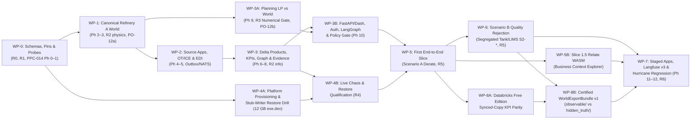

# PPC-PLAN-001 — Detailed Implementation Work Packages and Readiness Plan

Inspected PPC baseline: `ef4eb08fd09298a8fe64cff4bac52242f6d6b5f6` (reconciled on `main` @ `a192662` and finalized after Claude Fable 2 owner-stand-in review, 2026-11-26).

| Control | Value |
|---|---|
| ID / status | `PPC-PLAN-001` / Implementation-ready plan (`v1.2.0`, 2026-11-26) awaiting owner Phase 0 authorization |
| Authority | Reconciles [PPC-014](../../PPC-014_Implementation_Roadmap_and_Build_Runbook.md), [ARCH-000](../00-master-index/PPC-ARCH-000_Master_Architecture_Index_and_Authority_Baseline.md), [ADR-0040](../../adr/0040-staged-mechanistic-refinery-model-and-closed-flowsheet.md)–[ADR-0056](../../adr/0056-identity-steward-action-thresholds-and-refinery-a-parameters.md), and [PPC-REVIEW-001](../independent-review/PPC-REVIEW-001_Document_Coverage_and_Transcript_Audit.md)–[004](../independent-review/PPC-REVIEW-004_Proof_Obligation_and_Validation_Register.md) |
| Contract | Reconciled architecture, closed design gates, and repository contracts → bounded, agent-neutral implementation packages |

## 1. Readiness boundary, signatures, and authorization gate

This document is the single reconciled implementation plan aligning `PPC-014` phases (Phases 0–12) and `ARCH-000 §10` readiness gates (`R0`–`R6`) with `ADR-0040`–`0056`. **This plan authorizes no code, simulator, prototype, dataset generation, or infrastructure deployment.** Phase 0 begins only after separate explicit authorization from Hamid Adesokan.

Distinguish six non-interchangeable states: `PROPOSED` (draft spec), `DECIDED` (owner or owner-delegated stand-in ADR recorded with verbatim words), `IMPLEMENTED` (code exists), `VERIFIED` (independent oracle/formal checks executed and recorded), `QUALIFIED_PROVISIONAL` (all PPC gates passed while one or more upstream repositories run on commit-pinned provisional adapters under `ADR-0042`), and `QUALIFIED` (all upstream dependencies are approved upstream releases). **Design readiness** (`R0`–`R1`) is separate from **runtime qualification** (`R2`–`R6`). Every work package starts `NOT_STARTED`.

**Definitions of "signed" and "independent reviewer" (`C10`):**
- A **signed** evidence artifact or gate verdict is an owner-approved pull request on a Git-tracked, digest-bearing evidence or manifest file recording the exact code, schema, fixture, and environment digests.
- An **independent reviewer** is a human reviewer or external model that did not author the verified code, fixture, or benchmark report.

## 2. Critical dependency path, gating tracks, and repository path map

- **Critical path:** `WP-0 → WP-1 → WP-2 → WP-3 → WP-3B → WP-5 → WP-6 → WP-8B → WP-7`.
- **Mandatory gating parallel tracks (`C15`):**
  - `WP-3A` (deliberately reduced Pyomo Planning LP vs mechanistic World Kernel benchmarks for `R3` / `PO-12b`) runs in parallel with `WP-2`–`WP-3` once `WP-1` completes, and **gates `WP-3B` and `WP-5`**.
  - `WP-4A` (12 GB `exe.dev` provisioning, secret isolation, backup wiring with 60 s sync op-budget check, and synthetic stub-writer restore drill) runs in parallel with `WP-1`–`WP-3`; `WP-4B` (`R4` live chaos/restore qualification killing real outbox and `delta-rs` writers) runs once `WP-3` delivers live writers and **gates `WP-5`**.
  - `WP-5B` (Slice 1.5 Relate WASM explorer), `WP-6` (Scenario B quality rejection), and `WP-8A` (Dagster-driven Databricks Free Edition synced-copy parity) run in parallel after `WP-5` passes `R5`; `WP-8B` (certified `WorldExportBundle` v1 including Scenario B ECE dossiers) runs after `WP-6` and `WP-8A`.
- **Closed design-time gates vs items explicitly reserved for Hamid Adesokan:**
  - All three design-time `WP-0` owner gates are **closed** via owner-delegated stand-in rulings (`Claude Fable 2`, `2026-11-26`, [PPC-REVIEW-003 §3](../independent-review/PPC-REVIEW-003_System_and_Decision_Register.md#closed-wp-0-owner-gates-adr-00540056-and-items-reserved-for-hamid-adesokan)): [ADR-0054](../../adr/0054-refinery-a-flowsheet-closure-option-a-and-design-basis.md) (Option A flowsheet closure, 180k bbl/day design basis, H2 header identity), [ADR-0055](../../adr/0055-slice1-hosting-observability-postgres-workflow-and-databricks-sync.md) (12 GB `exe.dev` + lightweight OTel Collector to R2 `telemetry/otel/`, PostgreSQL workflow state with no D1, Dagster-driven Databricks Free Edition synced copy), and [ADR-0056](../../adr/0056-identity-steward-action-thresholds-and-refinery-a-parameters.md) (`IDENTITY_STEWARD`, numeric `AUTO_EXECUTE` / Tier 1 / Tier 2 / `ESCALATE` / `PROHIBITED` thresholds, and Refinery A v1 parameter ranges).
  - **Reserved explicitly for Hamid Adesokan:** (1) explicit Phase 0 authorization before `WP-0` execution starts; (2) live LLM endpoint selection before `WP-3B` starts (`WP-0`–`WP-3A` and golden tests run against a configured endpoint adapter with recorded responses); (3) `PO-12a` numeric calibration sign-off at `WP-1` exit (`G3-d`).
  - Binding generalized process IRIs waits for the separate upstream `ds-business-process/1.0` release (`ADR-0042`, `0044`); commit-pinned provisional adapters unblock `WP-1`–`WP-6` (`QUALIFIED_PROVISIONAL`).
  - Archiving or deleting any `LEGACY_PRE_WORLD_MODEL` object waits for `WP-1` verification **and** per-prefix owner approval (`ADR-0053`, `C8`), except the pre-world-model `lagos-chem-l0` R2 bucket inventoried and retired on 2026-11-27 by explicit owner decision ([ADR-0057](../../adr/0057-two-bucket-r2-hidden-isolation-and-legacy-bucket-retirement.md)).

### 2.1 Authoritative repository path map (`C4`)

Implementation work packages write exclusively to these repository paths (`lakehouse/delta/` supersedes placeholder `lakehouse/ducklake/`):

| Directory / path | Owner WP | Contents |
|---|---|---|
| `schemas/` | `WP-0` | Executable JSON Schemas & policy YAML (`release_manifest`, `world_export_bundle`, `source_event`, `outbox_entry`, `inbox_receipt`, `model_run`, 5 action objects, `scenario_case`, `provisional_adapter_manifest`, `policy_thresholds.yaml`) |
| `fixtures/golden/` | `WP-0`, `WP-1`, `WP-3A`, `WP-5`, `WP-6` | `refinery_a_design_basis.yaml`, `refinery_a_ot_tags.yaml`, `wp3a_release_manifest.json`, frozen `SCN-A-T125` / `SCN-A-H2CONT` / `SCN-B` manifests and external oracle outputs |
| `generators/` | `WP-1` | Python+SciPy Canonical Refinery A v1 World Kernel (`EQ-01`–`EQ-08`), commercial world generator, hybrid clock, checkpoints, branches, public EIA/NOAA/EPA/PHMSA ingest |
| `source-systems/{commercial,logistics,refinery}/` | `WP-2` | Postgres CTRM, MySQL Logistics, SQLite Refinery/LIMS materializers and transactional outbox writers |
| `ot/` | `WP-2` | OPC UA (`asyncua`), MQTT Sparkplug B (`Mosquitto`), TimescaleDB historian, 1 s compressor telemetry projection, ICE provisional adapter |
| `integration/` | `WP-2`, `WP-3` | NATS JetStream consumers, atomic Postgres Silver staging + `InboxReceipt` service, EDI adoption handler, Dagster orchestration assets |
| `lakehouse/delta/` | `WP-3`, `WP-8A` | `delta-rs` Silver/Gold/KPI table publishers (`aws_conditional_put="etag"`), DuckDB read-only views, GX DQ suite, Databricks Free Edition sync job |
| `semantic/` and `graph/neo4j/` | `WP-0`, `WP-3` | Git Turtle + `rdflib`/`pyshacl` validation, EPM/ECE provisional adapters, Neo4j Community Cypher `MERGE` loader, `pgvector` evidence corpus |
| `intelligence/optimization/` | `WP-3A` | Deliberately reduced Pyomo + HiGHS Planning LP, IPOPT NLP checks, `ModelRun` service, `UC-3` three-way backcasting, MLflow tracking |
| `api/`, `policy/`, `automation/` | `WP-3B` | FastAPI backend with signed JWT/session RBAC against Postgres `users`/`role_assignments`, service-side `ADR-0056` policy gate, LangGraph + Pydantic tools + recorded-response test adapter |
| `apps/dash/` and `apps/relate-wasm/` | `WP-3B`, `WP-5B` | Plotly Dash Slice 1 workspace (`WP-3B`); Relate WASM Slice 1.5 Context Explorer (`WP-5B`) |
| `verification/quint/` and `verification/z3/` | `WP-1`–`WP-6` | Quint (Apalache/TLC) specs (`PO-01`, `03`, `04`, `07`, `08`, `09`, `10`) and Python/Z3/Hypothesis/analytical oracle suites |
| `infra/` | `WP-0`, `WP-4A`, `WP-4B`, `WP-7` | Docker Compose parity files, `exe.dev` 12 GB VM manifests, OTel Collector config, per-store backup/restore scripts, `RECOVERY_GAP` checker |

## 3. Detailed work-package specifications (`WP-0` through `WP-8B`)

### WP-0 — Schemas, Upstream Pins, Runtime Freezes, and Core Storage Probes (`R0`, `R1`, `PPC-014` Phases 0–1)

- **Objective & boundaries:** Materialize all executable JSON Schemas under `schemas/` (`B11`), pin upstream repository commits into provisional adapters (`ADR-0042`), freeze runtime clock/PRNG/cadence parameters (`C11`), write a manifest inventory of legacy R2 objects (`C8`; amended for `lagos-chem-l0` retirement by [ADR-0057](../../adr/0057-two-bucket-r2-hidden-isolation-and-legacy-bucket-retirement.md), preserving all other live ICE L0 prefixes untouched), verify `delta-rs` (`aws_conditional_put="etag"`) single-writer locking and Databricks Free Edition synced-copy ingest via Dagster (`ADR-0055`), and stand up local Docker Compose parity matching the 12 GB `exe.dev` layout. No refinery simulator logic yet.
- **Predecessors & blocking decisions:** Explicit Phase 0 authorization from Hamid Adesokan. All design-time `WP-0` owner gates are already closed (`ADR-0054`–`0056`); two-bucket R2 isolation and `lagos-chem-l0` retirement are decided in [ADR-0057](../../adr/0057-two-bucket-r2-hidden-isolation-and-legacy-bucket-retirement.md).
- **Accountable role & upstream owners:** PPC Platform/Architecture Lead; upstream owners of EPM (`511a9e8d`), ICE (`1467e92`), EDI (`12a4a6a`), ECE (`750b398`), and `ds-business-process/1.0` (pending).
- **Governing IDs:** `ARCH-000 §8`, `PPC-013`, `PPC-017`, `PLATFORM-001`, `PPC-REVIEW-003 §2–3`; `ADR-0041`, `0042`, `0045`, `0051`, `0053`, `0054`, `0055`, `0056`, `0057`.
- **Inputs, outputs & affected components:** Inputs: reconciled docs, R2 credentials (secret store), upstream repo hashes. Outputs:
  1. Executable contract schemas under `schemas/` (`B11`): `release_manifest.schema.json`, `world_export_bundle.schema.json`, `source_event.schema.json`, `outbox_entry.schema.json`, `inbox_receipt.schema.json`, `model_run.schema.json`, `tool_request.schema.json`, `tool_response.schema.json`, `action_proposal.schema.json`, `action_authorization.schema.json`, `action_receipt.schema.json`, `scenario_case.schema.json`, `provisional_adapter_manifest.schema.json`, and `policy_thresholds.yaml` (encoding `ADR-0056` `G3-b`).
  2. Runtime configuration freeze (`C11`): PRNG algorithm/version (e.g. `numpy.random.Philox` / `PCG64` pinned version), site time zone (`America/Chicago`), business-day start hour, and analytical business release cadence.
  3. R2 prefix map (`raw/`, `delta/`, `cache/`, `manifests/`, `telemetry/otel/`, `exports/world_bundle/observable/`, `evaluation/hidden/`) plus manifest-only `LEGACY_PRE_WORLD_MODEL` inventory (`C8`).
  4. `semantic/` scaffold, AML core models, and `infra/` local Docker Compose parity matching the 12 GB `exe.dev` topology (`ADR-0055`, no D1, lightweight OTel Collector).
- **Ordered implementation tasks:**
  1. Author and validate all 13 JSON Schemas plus `policy_thresholds.yaml` under `schemas/`.
  2. Create versioned provisional adapter manifests pinning EPM (`511a9e8d`), ICE (`1467e92`), EDI (`12a4a6a`), and ECE (`750b398`) commits and freeze PRNG, site time zone, business-day start, and release cadence.
  3. Inventory existing R2 prefixes into a `LEGACY_PRE_WORLD_MODEL` manifest (amended by [ADR-0057](../../adr/0057-two-bucket-r2-hidden-isolation-and-legacy-bucket-retirement.md) to retire the inventoried `lagos-chem-l0` bucket while leaving any other live ICE L0 prefixes untouched) and provision separate restricted credentials and bucket (`pearland-petroleum-hidden`) for `evaluation/hidden/`.
  4. Verify `delta-rs` (`deltalake`) writes to R2 with `aws_conditional_put="etag"`, Dagster concurrency pool = 1 per table, DuckDB read-only queries, a negative dual-writer conflict test, and the Dagster-driven Databricks Free Edition synced-copy ingest probe (`ADR-0055` `G2-a`; if no mechanism works, stop and raise an ADR).
  5. Stand up local Docker Compose parity stack matching the 12 GB `exe.dev` layout (`ADR-0055`).
- **Verification method & independent oracle:** Automated JSON Schema validation tests across valid/invalid payloads, R2 access-denial negative test for `evaluation/hidden/`, dual-writer Delta conflict rejection test, Databricks Free Edition ingest smoke test.
- **Acceptance evidence & exit criteria (`R0`, `R1`):** Owner-approved PR (`signed`) over all 13 `schemas/` files, runtime freeze config, legacy inventory manifest (`ADR-0053`, amended for `lagos-chem-l0` retirement by [ADR-0057](../../adr/0057-two-bucket-r2-hidden-isolation-and-legacy-bucket-retirement.md)), and passing conflict/permission/ingest probes; zero invented upstream approvals.

### WP-1 — Canonical Refinery A v1 World Kernel, Commercial World, and Public Data Conditioning (`PPC-014` Phases 2–3, `R2` physics)

- **Objective & boundaries:** Ingest pinned public observations (EIA, NOAA/NHC, EPA, PHMSA) to R2 raw; materialize the Refinery A v1 design basis (`fixtures/golden/refinery_a_design_basis.yaml`), baseline engineering configuration `CFG-0` and its structured DEXPI source (`B7`, `N5`), native OT tag schedule (`fixtures/golden/refinery_a_ot_tags.yaml`, `B10`), and commercial canonical world (`B10`: 12 customers, contracts, nominations, 3 terminals `TERM-01`..`03`, priced boundary sinks, pinned prices, across a Slice 1 history horizon of **30-day warm-up + 12-month synthetic history**); and implement the deterministic Refinery A v1 world kernel (`EQ-01`–`EQ-08`) with 1-minute process steps, exact intra-step bound crossings, and branchable checkpoints. Publishes immutable **Canonical World Snapshots** under `evaluation/hidden/world_version=.../` only (never `WorldExportBundle` v1, which waits for `WP-8B`).
- **Predecessors & blocking decisions:** `WP-0`; relies on `ADR-0040`, `0043`, `0049`, `0050`, `0053`, `0054`, `0056`.
- **Accountable role & upstream owners:** Refinery Process Modeling & Simulation Engineer; public data feeds (EIA/NOAA/EPA/PHMSA).
- **Governing IDs:** `WORLD-001`, `WORLD-002`, `ENG-001`, `PPC-REVIEW-002` (`EQ-01`–`EQ-08`), `PPC-REVIEW-004` (`PO-01`, `PO-02`, `PO-04`, `PO-05`, `PO-06`, `PO-07`, `PO-09`, `PO-11`, `PO-12a`).
- **Inputs, outputs & affected components:** Inputs: `WP-0` schemas and runtime freeze, pinned public feed vintages, `ADR-0054`/`0056` design basis and parameter bounds. Outputs: `fixtures/golden/refinery_a_design_basis.yaml`, `fixtures/golden/refinery_a_ot_tags.yaml`, baseline configuration `CFG-0` + structured DEXPI source, `generators/` Python+SciPy physical + commercial world engine, `verification/quint/` and `verification/z3/` suites, immutable world snapshots under `evaluation/hidden/world_version=.../`.
- **Ordered implementation tasks:**
  1. Implement public API ingestion landing raw EIA/NOAA/EPA/PHMSA payloads and vintages to R2.
  2. Materialize `fixtures/golden/refinery_a_design_basis.yaml` (180k bbl/day slate, 3 assays 30/50/20, tank register `TK-101`–`TK-402` + `TK-101H`, `EQ-03` hydraulic transfer paths and pipe/pump curves), baseline engineering configuration `CFG-0` + structured DEXPI source (`B7`), native OT tag schedule (`B10`), and commercial canonical world entities (12 customers, contracts, nominations, 3 terminals, priced boundary sinks, pinned prices, 30-day warm-up + 12-month horizon).
  3. Implement `EQ-01` rational density/mass basis and `EQ-02`/`EQ-03` tank, transit, Churchill/Colebrook/Darcy–Weisbach hydraulics, and ANSI/HI 9.6.7 pump curves with exact root-finding intra-step crossings (`t*`).
  4. Implement `EQ-04` CDU/VDU zero-sum TBP cut separation, `EQ-05` HCU polytropic compressor + $R_{\min,\text{mass}}$ + quench + $P_{\text{H2}}$ purity + selectivity scaling, `EQ-06` Lee/Chen/Huang/Pan (1989) 4-lump FCC + `ADR-0056` lump/sulfur splits + heat/coke balance, `EQ-07` Option A H2/utility header (`SMR + Reformer - NHT - FCC HDS`) and bounded interfaces (`SMR`, `NHT`, `Reformer`, `FCC HDS`, `DHT`, `SRU`, `Steam/Power`, `Terminal E10`), and `EQ-08` conservative + nonlinear blending (Chevron RVP, Maples/Fahim RT-70 octane, Wickey–Chittenden flash, Hu–Burns cloud, ASTM D975 cetane, refinery BOB `>= 84.2 / >= 88.6` + terminal E10) with `QUALITY_HOLD`/`RELEASE` states.
  5. Implement deterministic `WORLD-002` hybrid clock, semantic-keyed paired RNG streams, atomic R2 checkpoints, and branch fork/replay.
  6. Execute Quint (`PO-01`, `PO-09`) and Python+Z3+Hypothesis (`PO-01`, `02`, `04`–`07`, `11`) verification suites, and compile the `PO-12a` plausibility benchmark report prepared by an independent process-engineering reviewer (not the kernel author) for Hamid Adesokan's sign-off (`ADR-0056` `G3-d`). Only after `WP-1` passes may per-prefix archival/retirement of `LEGACY_PRE_WORLD_MODEL` data be proposed to the owner (`ADR-0053`, `C8`).
- **Verification method & independent oracle:** Quint/Apalache model checking; Z3 symbolic proofs (`11,800 → 12,200 → 11,700 bbl` tank counterexample; `75 t/day` shared-H2 counterexample); exact Python rational and RT-70 oracles (`PPC-REVIEW-002 §3`); step-refinement (`60 s / 10 s / 1 s`, `<= 1e-9` tank, `<= 1e-4` nonlinear units) and 23/25-hour DST parity; `PO-12a` plausibility benchmark report.
- **Acceptance evidence & exit criteria:** Zero failures across `PO-01`, `02`, `04`–`07`, `09`, `11`, `PO-12a` (`ENG-V01`–`ENG-V07`); bit-exact checkpoint replay on one pinned environment digest and within declared tolerance across environments (`C6`); Hamid Adesokan's owner-approved PR signing `PO-12a`.

### WP-2 — Distributed Source Systems, OT/ICE Plane, EDI Adoption, and Atomic Outbox/NATS/Staging Integration (`PPC-014` Phases 4–5)

- **Objective & boundaries:** Materialize realistic, deliberately imperfect source records from `WP-1` physical and commercial world transitions into independent operational stores (OT OPC UA/MQTT Sparkplug B/TimescaleDB using `fixtures/golden/refinery_a_ot_tags.yaml`, SQLite Refinery/LIMS, PostgreSQL CTRM, MySQL Logistics), pass `WP-1`'s structured `CFG-0` engineering source through EDI and adopt it into PPC with an identical digest (`B7`), and transport IT events via transactional outboxes + NATS JetStream + atomic Postgres Silver staging and `InboxReceipt` commits (`ADR-0046`, `PPC-REVIEW-003 §4`). Integration code never reads hidden canonical world truth.
- **Predecessors & blocking decisions:** `WP-1`; relies on `ADR-0042`, `0046`, `0047`, `0053`, `0056` (`IDENTITY_STEWARD`).
- **Accountable role & upstream owners:** OT/IT Integration Engineer; ICE (`industrial-context-engineering`, formerly `scada_harmonization`, @ `1467e92`) and EDI (`engineering-drawing-intelligence`, formerly `Engineering_Drawing_to_Graph`, @ `12a4a6a`) provisional adapters.
- **Governing IDs:** `OT-001`, `EDI-001`, `INT-001`, `PPC-REVIEW-003 §4`; `PO-03`, `PO-08`.
- **Inputs, outputs & affected components:** Inputs: `WP-1` physical/commercial transition streams, `CFG-0` structured DEXPI source, `refinery_a_ot_tags.yaml`. Outputs: `source-systems/{commercial,logistics,refinery}/`, `ot/` publishers (`asyncua`, `Mosquitto` Sparkplug B, TimescaleDB + 1 s compressor telemetry projection), `integration/` EDI adoption handler, `OutboxEntry`, atomic Postgres Silver staging + `InboxReceipt` service, NATS JetStream streams, Dagster raw/staging assets.
- **Ordered implementation tasks:**
  1. Implement source materializers with realistic ID/timezone/unit/delay imperfections across SQLite (Refinery/LIMS), Postgres (CTRM), MySQL (Logistics), and OT (OPC UA/Sparkplug B/TimescaleDB).
  2. Pass `WP-1`'s structured DEXPI source through the EDI provisional adapter (`12a4a6a`), record review receipt and branch-scoped PPC adoption (`EDI-001 §3`), and verify the adopted configuration digest matches `CFG-0` identically (`B7`).
  3. Implement atomic source DB + `OutboxEntry`, NATS JetStream transport, and single-transaction Postgres Silver staging + `InboxReceipt` consumer with conflict quarantine (`IDENTITY_STEWARD` resolution, `INT-001 §2`).
  4. Implement Dagster raw landing assets to R2 with OpenLineage manifests.
  5. Execute Quint protocol verification (`PO-03`) across both Crash Point 1 (before NATS ack) and Crash Point 2 (between Postgres staging and R2 Delta commit).
- **Verification method & independent oracle:** Fault injection at source commit, outbox publish, Postgres staging+receipt commit, NATS ack, and Delta commit; duplicate movement (`INT-RETRY-01`); conflicting digest quarantine; broker disconnect/rebirth (`OT-03`); deadband + Bad quality transition (`OT-02`); ambiguous tag rejection (`OT-01`); EDI directed graph and `CFG-0` digest match.
- **Acceptance evidence & exit criteria:** `PO-03` Quint pass, zero duplicate business effects across both crash points, identical `CFG-0` adopted digest, passing `OT-01`–`OT-06` logs, verified absence of hidden-truth imports in integration code.

### WP-3 — Governed Information: Delta Data Products, KPI Store, Semantic/Neo4j Graph, and Reader-as-of Evidence (`PPC-014` Phases 6–8, `R2` info)

- **Objective & boundaries:** Publish Silver/Gold Delta Lake tables on R2 via `delta-rs` (`aws_conditional_put="etag"`, idempotent `txnAppId`/`txnVersion`, Dagster concurrency pool = 1) queried read-only by DuckDB (`ADR-0045`), build EPM-aligned tall KPI facts with T100 measure-class decomposition (`DATA-001`), run Git Turtle + `pyshacl` → Neo4j Community projections (`ADR-0044`), and build the reader-as-of evidence corpus (`INFO-001 §3`, `EVID-001`).
- **Predecessors & blocking decisions:** `WP-2`; relies on `ADR-0042`, `0044`, `0045`, `0047`. Generalized process bindings remain pending until `ds-business-process/1.0` releases.
- **Accountable role & upstream owners:** Data & Knowledge Graph Engineer; EPM (`511a9e8d`) and ECE (`750b398`) provisional adapters.
- **Governing IDs:** `INFO-001`, `GRAPH-001`, `DATA-001`, `EVID-001`, `PPC-016`, `PPC-017`, `PPC-018`; `PO-03`, `PO-08`.
- **Inputs, outputs & affected components:** Inputs: `WP-2` Postgres Silver staging and raw extracts, EPM Turtle/SHACL bundle, ECE contracts. Outputs: `lakehouse/delta/` tables + `ReleaseManifest` publisher, GX DQ suite, `semantic/` Turtle + `pyshacl` validator, `graph/neo4j/` snapshot loader, `pgvector` evidence index, reader-as-of query engine.
- **Ordered implementation tasks:**
  1. Implement idempotent `delta-rs` Silver/Gold publication from Postgres staging with `txnAppId`/`txnVersion`, `aws_conditional_put="etag"`, and Dagster concurrency pool = 1 per table.
  2. Implement EPM tall KPI Store with `KPI`, `OPERATIONAL_METRIC`, and `MARKET_INDICATOR` measure classes, decomposition links, atomic `ReleaseManifest` cuts, and `RETRACTED` (`L1/X1`) handling.
  3. Implement Git Turtle + `rdflib`/`pyshacl` validation and idempotent Cypher `MERGE` loader into branch-scoped Neo4j `GraphSnapshot` projections with RDF-to-LPG loss report.
  4. Implement `INFO-001 §3` reader-as-of selection (returning strictly `UNRESOLVED` on access/eligibility/mapping failure and `UNKNOWN` only on epistemic gaps) plus structured-to-unstructured evidence corpus generation (`PPC-018`).
- **Verification method & independent oracle:** Quint `PO-08` non-interference proof, executable `INFO-001 §3` P0/P1/P2 and `DATA-001 §2` L1/X1 runtime tests, EPM SHACL/competency queries, RDF↔Neo4j round-trip diff, restricted-path side-channel test, hidden-truth isolation check.
- **Acceptance evidence & exit criteria (`R2`):** Zero temporal or permission leaks, passing SHACL/competency/GX suites, exact KPI recomputation parity, signed `ReleaseManifest` digests.

### WP-3A — Planning LP vs World Kernel and Performance Intelligence Gate (`PPC-014` Phase 9, `R3`)

- **Objective & boundaries:** Build the **deliberately reduced Pyomo + HiGHS Planning LP** (delta-base yield vectors, linear blend indices, vintage-pinned lagged assays) plus IPOPT nonlinear verification cases and three-way fair-backcasting attribution (`EQ-09`, `UC-3`, `ADR-0048`) tracked in MLflow, pinning `fixtures/golden/wp3a_release_manifest.json` (`C16`) so `WP-3A` runs cleanly in parallel with `WP-2`/`WP-3`. Independently verify LP recommendations against `WP-1` mechanistic physics before any numbers enter the UI (`R3` hard gate).
- **Predecessors & blocking decisions:** `WP-1` (runs in parallel with `WP-2`–`WP-3`, **gating `WP-3B` and `WP-5`**); relies on `ADR-0048`, `0049`, `0050`, `0056`.
- **Accountable role & upstream owners:** Operations Research & Analytics Engineer.
- **Governing IDs:** `ANALYTICS-001`, `ENG-001 §5–6`, `PPC-REVIEW-002` (`EQ-05`–`EQ-09`), `PPC-REVIEW-004` (`PO-05`, `PO-06`, `PO-07`, `PO-12b`).
- **Inputs, outputs & affected components:** Inputs: `WP-1` assays, commercial contracts/prices, lagged planning vectors, inventories, `fixtures/golden/wp3a_release_manifest.json` (`C16`). Outputs: `intelligence/optimization/` Pyomo LP/NLP models, `ModelRun` lifecycle service, `UC-3` backcasting attribution engine, MLflow artifacts on R2.
- **Ordered implementation tasks:**
  1. Formulate the deliberately reduced Pyomo + HiGHS Planning LP (linear delta-base yields, linear blend indices, lagged assays; feasibility tolerance `1e-7`) covering crude slate, CDU/VDU cut swing, FCC/HCU bounds, shared H2 header, tank bounds, and margin (`EQ-09`).
  2. Add IPOPT NLP check cases (tolerance `1e-8`) for nonlinear Chevron RVP / Maples-Fahim RT-70 octane / FCC heat-balance verification.
  3. Implement `ModelRun` state machine and three-way backcasting attribution (`LP calibration effect`, `decision-time opportunity`, `execution/exogenous residual`), proving non-zero measurable calibration attribution against `WP-1` world truth (`PO-12b`, `ENG-V08a`).
  4. Feed recommended LP setpoints back into `WP-1` transient physics to prove closed-loop execution feasibility.
- **Verification method & independent oracle:** Known feasible/infeasible fixtures (`30,001 bbl/day` rejected; `75 t/day` `SCN-A-H2CONT` H2 cap binds), solver tolerance & seed replay, non-zero `UC-3` calibration attribution check (`PO-12b`), closed-loop `WP-1` feasibility test.
- **Acceptance evidence & exit criteria (`R3`):** Passing `ENG-V08a` and `PO-12b`, measurable `UC-3` LP calibration error, zero recommended schedules violating `WP-1` physics.

### WP-3B — Bounded FastAPI/Dash Workspace, Authentication, LangGraph Agents, and Policy Gate (`PPC-014` Phase 10)

- **Objective & boundaries:** Implement the FastAPI context API with signed JWT/session authentication backed by PostgreSQL `users`/`role_assignments` (`B14`), Plotly Dash Slice 1 workspace (`ADR-0047`, `0052`), LangGraph stateful approval workflow persisted in **PostgreSQL on `exe.dev`** (no D1, `ADR-0055`), Pydantic-typed tool contracts, service-side policy-as-code enforcing `ADR-0056` numeric tiers and `PROHIBITED` -> `DENIED`, and lightweight OpenTelemetry Collector shipping hourly OTLP JSON to R2 `telemetry/otel/` (queried by DuckDB for trace-leak tests). Golden tests run against recorded model responses; live LLM endpoint is selected by Hamid Adesokan before `WP-3B` starts. Starts **only after `WP-3A` passes `R3`**.
- **Predecessors & blocking decisions:** `WP-3` and `WP-3A` (`R3` passed); live LLM endpoint choice from Hamid Adesokan (recorded-response adapter supports offline/CI testing).
- **Accountable role & upstream owners:** Full-Stack / Agent Platform Engineer.
- **Governing IDs:** `UX-001`, `AGENT-001`, `EVID-001`, `PPC-012`, `ADR-0055`, `ADR-0056`; `ENG-V08b`, `PO-08`, `PO-10`.
- **Inputs, outputs & affected components:** Inputs: `WP-3` Delta/Neo4j/evidence APIs, `WP-3A` Pyomo service, `schemas/policy_thresholds.yaml`. Outputs: `api/` FastAPI + JWT/session RBAC, `policy/` service-side gate, `automation/` LangGraph + Pydantic tools + recorded-response test adapter, `apps/dash/` Slice 1 workspace, Postgres workflow/approval/checkpoint tables, lightweight OTel Collector config.
- **Ordered implementation tasks:**
  1. Build FastAPI authentication/RBAC (Argon2id password hashes, signed JWT/session tokens, `api/seed_users.py` seeding fixture accounts for every role into PostgreSQL `users`/`role_assignments`, server-side session role enforcement, `proposer != approver`, `N10`) and role/cutoff-enforcing API serving `WorkspaceRequest` → `InvestigationResult` cards (separating `POTENTIAL_EXPOSURE` graph paths from model-quantified cards and T100 KPI decomposition).
  2. Build service-side PostgreSQL ACID policy engine enforcing `ADR-0056` `G3-b` numeric tiers, `PROHIBITED` -> `DENIED`, and `ActionProposal` → `ActionAuthorization` → `ActionReceipt` with exact payload digest binding and one-time idempotency keys (`AGENT-001 §1`).
  3. Build LangGraph workflow persisted in PostgreSQL with Pydantic-typed read/simulate/recommend tools, author deterministic recorded model-response fixtures under `fixtures/golden/agent_recorded_responses/` (`N10`, unblocking CI/golden tests before Hamid picks the live LLM endpoint), and ship redacted OTel JSON traces to R2 `telemetry/otel/`.
  4. Build bounded Plotly Dash Slice 1 workspace (event view, exposure/KPI cards, branch comparison, approval queue, saved as-of investigation).
  5. Execute Quint verification on the approval/execution state machine (`PO-10`) and run `ENG-V08b` (`PO-08` cutoff + `PO-10` authorization).
- **Verification method & independent oracle:** Quint `PO-10` pass; `ENG-V08b` pass; API negative security tests (forged role header, proposer self-approval, `PROHIBITED` action denial, mutated payload, expired approval, cross-branch approval, hidden-truth access denied, DuckDB query over R2 `telemetry/otel/` proving zero restricted-trace leaks); golden agent evaluation cases using recorded responses.
- **Acceptance evidence & exit criteria:** Zero policy bypasses or hidden-truth/trace leaks, passing `ENG-V08b` and `PO-10`, exact `ActionReceipt` idempotency, saved investigation replay matches pinned cutoff.

### WP-4A / WP-4B — Platform Provisioning (`exe.dev` 12 GB + R2) and Live Per-Store Recovery Qualification (`R4`)

- **Objective & boundaries:** Split cleanly into two stages to avoid a circular dependency: **`WP-4A`** provisions the Slice 1 **12 GB single `exe.dev` VM** (or `8 GB` stores + `4 GB` apps two-VM fallback with identical Compose files if `exe.dev` cannot allocate 12 GB on one VM; no local Ollama; no D1; `ADR-0055`) wired to Cloudflare R2, enforces secret isolation, verifies the `60-second` Litestream/WAL sync cadence against the Cloudflare R2 free-tier monthly write-operation allowance (`C9`), and runs a baseline per-store backup/restore drill against synthetic stub writers; **`WP-4B`** executes the live `R4` chaos/restore qualification against the real `WP-2`/`WP-3` outbox and `delta-rs` writers, proving `RPO`, outbox-sequence gap detection (`RECOVERY_GAP`), and `RTO <= 1 hour` for Slice 1 data volumes (`<= 5 GB` compressed) before Slice 1 integration.
- **Predecessors & blocking decisions:** `WP-4A` depends on `WP-0` (runs in parallel with `WP-1`–`WP-3`, governed by `ADR-0055`). `WP-4B` depends on `WP-4A` and `WP-3`, and **gates `WP-5`**.
- **Accountable role & upstream owners:** Platform / DevOps Engineer.
- **Governing IDs:** `PLATFORM-001`, `PPC-013`, `PPC-REVIEW-003 §2`; `ADR-0051`, `ADR-0055`.
- **Inputs, outputs & affected components:** Inputs: `infra/` Compose/VM manifests, R2 bucket, secret store, and (for `WP-4B`) live `WP-2`/`WP-3` outbox and `delta-rs` writers. Outputs: `infra/` deployment configs, `ServiceDescriptor`/`BackupManifest` automation, per-store backups (Postgres WAL + basebackup, MySQL binlog/dump, SQLite Litestream 60 s sync, Neo4j offline `neo4j-admin dump`, NATS outbox re-derivation proof), R2 write-op budget report (`C9`), post-restore outbox-sequence vs `InboxReceipt` `RECOVERY_GAP` checker, restore runbook.
- **Ordered implementation tasks:**
  1. (`WP-4A`) Provision the 12 GB `exe.dev` VM (or `8 GB + 4 GB` fallback, `ADR-0055`) and enforce least-privilege credentials separating world truth (`evaluation/hidden/`), integration, retrieval, and approval execution.
  2. (`WP-4A`) Wire per-store backups to R2 on a 60-second sync cadence, run an R2 free-tier write-operation budget check (`C9`), and pass a baseline restore drill using synthetic stub writers.
  3. (`WP-4B`, after `WP-3`) Execute the full live chaos/restore drill across every active store: kill real workers mid-outbox and mid-Delta commit, corrupt local Postgres/MySQL/SQLite/Neo4j state, restore from R2 backups/manifests, verify `RECOVERY_GAP` detection, single business effect, and `RTO <= 1 hour`.
- **Verification method & independent oracle:** Timed restore drill log for every store, pre/post restore state and Delta manifest hash equality, outbox-vs-`InboxReceipt` reconciliation check, R2 free-tier op-budget report, failed-secret and denied-route penetration tests, VM RAM/CPU telemetry under Slice 1 load.
- **Acceptance evidence & exit criteria (`R4`):** Signed `BackupManifest` restore evidence across all active stores meeting `RPO` and `RTO <= 1 hour`, verified access isolation and R2 free-tier op compliance.

### WP-5 — First End-to-End Vertical Slice: Scenario A Hydrocracker Compressor Derate (`UC-1`, `UC-3`, `R5`)

- **Objective & boundaries:** Connect the full physical-to-decision chain end to end on `exe.dev` + R2 for Scenario A (`SCN-A-T125`, frozen `30,000 bbl/day` compressor-circulation cap under normal `170.00 t/day` plant $\text{H}_2$ supply, plus separate SMR-turndown boundary sub-case `SCN-A-H2CONT`): physical compressor restriction (`EQ-05`) → H2 circulation/quench/shared-header bound (`EQ-07`) → ULSD yield & tank trajectory (`EQ-02`/`EQ-08`) → OT/Sparkplug B/TimescaleDB (`OT-DELAY-01` & `08:12` fixture) → EDI topology → Neo4j `POTENTIAL_EXPOSURE` contracts → Planning LP response & `UC-3` backcasting (`EQ-09`) → EPM KPI decomposition → Dash workspace + LangGraph recommendation → policy-gated approval → isolated branch execution & replay.
- **Predecessors & blocking decisions:** `WP-3B` and `WP-4B` (`R2`, `R3`, `R4` passed).
- **Accountable role & upstream owners:** Cross-functional PPC Integration Lead.
- **Governing IDs:** `SCENARIO-001 §2`, `WORLD-001 §5`, `WORLD-002 §6`, `ENG-001 §4`, `VERIFY-001`; `PO-01`–`PO-12b`.
- **Inputs, outputs & affected components:** Frozen `SCN-A-T125` manifest plus external oracle file (`fixtures/golden/scn_a_t125_oracle.json`, `C17`); outputs: full `RunEvidence` bundle, baseline vs child branch diffs, KPI decomposition report, `UC-3` backcast dossier, negative-test logs.
- **Ordered implementation tasks:**
  1. Freeze `SCN-A-T125` and `SCN-A-H2CONT` manifests (pinned world, assays, adapters, cutoffs, seeds) and freeze independently calculated oracle expected values (tank trajectory, exposed contracts, pinned prices, and KPI values computed outside the kernel, `C17`).
  2. Run uninterrupted baseline (`08:00`–`09:10` and 6-hour shift), `08:40` checkpoint restart, and child intervention branch (plus `SCN-A-H2CONT` shared-H2 contention).
  3. Execute full adverse battery: ambiguous tag, missing EDI adoption, delayed OT (`08:15` vs `08:16`), duplicate retry across both crash points, `30,001 bbl/day` infeasible command, `PROHIBITED` / unauthorized approval attempt, sibling-branch contamination.
  4. Produce signed `RunEvidence` and independent reviewer verdict.
- **Verification method & independent oracle:** Independent analytical/Z3/Quint oracles (`WORLD-01`–`08`, `W2-01`–`12`, `OT-01`–`06`) and frozen `scn_a_t125_oracle.json`.
- **Acceptance evidence & exit criteria (`R5`):** 100% pass across positive, adverse, and replay suites with zero temporal or hidden-truth leaks; signed **`QUALIFIED_PROVISIONAL`** verdict (`VERIFY-001 §3`, reflecting commit-pinned upstream provisional adapters) for Slice 1.

### WP-5B — Slice 1.5 Business-Facing Relate WASM Context Explorer (`UC-4`, `ADR-0052`)

- **Objective & boundaries:** Deliver browser-based Relate WASM as the business-facing **Interactive Enterprise Context Explorer** (`EA09D-D09`, `EA07C-D10`) consuming server-filtered graph packages from FastAPI so business users explore relationships, scenario diffs, and KPI decompositions locally in the browser.
- **Predecessors & blocking decisions:** `WP-5` (`R5` Slice 1 passed); relies on `ADR-0052`.
- **Accountable role & upstream owners:** Frontend / Graph UX Engineer.
- **Governing IDs:** `UX-001`, `GRAPH-001`, `ADR-0052`; `PO-08`.
- **Inputs, outputs & affected components:** Inputs: FastAPI authorized graph-package endpoint + Slice 1 snapshots. Outputs: `apps/relate-wasm/` browser explorer integrated with agent context, Cypher parity test suite, permission-redaction negative tests.
- **Ordered implementation tasks:**
  1. Build server-side permission-filtered graph-package serializer (filtering strictly before browser packaging).
  2. Embed Relate WASM explorer for entity exploration, baseline-vs-branch diff, KPI-to-metric trace, and agent context handoff.
  3. Verify `POTENTIAL_EXPOSURE` vs model-quantified UI badges and Cypher parity against Neo4j Community (`SEM-OT-08`).
- **Verification method & independent oracle:** Browser Cypher parity vs Neo4j Community, restricted-edge byte-inspection side-channel test, browser refresh/as-of replay test.
- **Acceptance evidence & exit criteria:** Zero unauthorized bytes in browser package, exact Cypher parity on supported subset, signed UX gate approval.

### WP-6 — Second Vertical Slice: Scenario B Crude-Quality Rejection & Delayed Lab Correction (`UC-2`, `R5`)

- **Objective & boundaries:** Prove end-to-end segregated-tank receipt (`TK-101H`), LIMS, logistics, CTRM, and restatement coherence using Scenario B's dedicated `S2-*` identifiers (`SCENARIO-001 §3`, `PPC-REVIEW-003 §4` Walkthroughs A & B): scaled `500 bbl` receipt `S2-M1` → failed LIMS assay `S2-P1` (`09:30` receipt `S2-R1`) → `QUALITY_HOLD` + analytical cut `S2-L1` (`09:50` receipt) → `10:00` planner decision `S2-D1` → delayed passing correction `S2-P2` (`13:00` receipt `S2-R2`) → restatement `S2-L2` (`13:15`) without altering `10:00` `S2-D1` replay → duplicate ticket rejection across atomic staging and Delta publication.
- **Predecessors & blocking decisions:** `WP-5` (runs in parallel with `WP-5B` and `WP-8A`).
- **Accountable role & upstream owners:** Commercial & Data Integration Lead.
- **Governing IDs:** `SCENARIO-001 §3`, `INT-001 §3`, `INFO-001 §3`, `DATA-001 §2–3`, `EVID-001 §3`; `PO-03`, `PO-07`, `PO-08`.
- **Inputs, outputs & affected components:** Frozen Scenario B manifest (`S2-*` table); outputs: reconciled LIMS/CTRM/Logistics/Delta/KPI/dossier `RunEvidence` (`QUALIFIED_PROVISIONAL`).
- **Ordered implementation tasks:**
  1. Execute segregated `TK-101H` receipt `S2-M1`, `09:00/09:20/09:30` failed assay `S2-P1`/`S2-R1`, `09:45/09:50` release `S2-L1`, `10:00` planner decision `S2-D1`, and `12:00/12:30/13:00` passing correction `S2-P2`/`S2-R2` + `13:10/13:15` `S2-L2` across MySQL, SQLite LIMS, Postgres CTRM, NATS, Postgres staging, Delta, and Neo4j.
  2. Inject duplicate ticket `S2-M1` across both crash points, conflicting payload digest, out-of-order LIMS revisions, retracted release (`DATA-001 §2` `L1/X1`), unavailable downstream finance, and restricted assay access.
  3. Verify `10:00` dossier `S2-D1` replay reproduces `S2-P1` and `S2-L1` and never leaks `S2-P2` or `S2-L2`.
- **Verification method & independent oracle:** `SCENARIO-001 §3`, `INFO-001 §3`, and `DATA-001 §2` oracles, `INT-RETRY-01` conservation check, Quint `PO-03`/`PO-08` runtime parity.
- **Acceptance evidence & exit criteria (`R5`):** Zero duplicate receipts, zero temporal leakage across delayed lab correction, clean restatement lineage, signed `QUALIFIED_PROVISIONAL` verdict.

### WP-8A — Databricks Free Edition Synced-Copy KPI Parity (`UC-6`, `ADR-0045`, `ADR-0055`)

- **Objective & boundaries:** Prove cross-engine equivalence by running a Dagster job on `exe.dev` (never a laptop, using the mechanism validated in `WP-0`, `ADR-0055` `G2-a`) to copy PPC's pinned R2 Delta Gold/KPI tables into **Databricks Free Edition workspace-managed Delta tables**, recomputing Slice 1 KPIs and constituent operational metrics, and diffing row-level outputs against DuckDB. Paid Databricks Unity Catalog external locations remain documented only.
- **Predecessors & blocking decisions:** `WP-5` (runs in parallel with `WP-5B` and `WP-6`).
- **Accountable role & upstream owners:** Lakehouse Engineer.
- **Governing IDs:** `DATA-001`, `PLATFORM-001`, `ADR-0045`, `ADR-0055`.
- **Inputs, outputs & affected components:** Pinned R2 Delta Gold/KPI tables from `WP-5`; outputs: `lakehouse/delta/` Databricks sync Dagster asset and signed DuckDB-vs-Databricks cross-engine parity report (`EA03C-11`, `SEM-10`).
- **Ordered implementation tasks:**
  1. Run the `exe.dev` Dagster job copying pinned Slice 1 R2 Delta Gold/KPI tables into Databricks Free Edition workspace-managed tables.
  2. Recompute Slice 1 KPIs, constituent operational metrics, null handling, and threshold statuses in Databricks Free Edition.
  3. Diff DuckDB vs Databricks row-level results (`SEM-10`, `EA03C-11`).
- **Verification method & independent oracle:** Automated row-by-row DuckDB vs Databricks parity diff.
- **Acceptance evidence & exit criteria:** Zero unexplained DuckDB/Databricks KPI drift; signed parity report.

### WP-8B — Certified `WorldExportBundle` v1 Handoff (`UC-6`, `ADR-0053`, `B13`)

- **Objective & boundaries:** Assemble and certify **`WorldExportBundle` v1** conforming to `schemas/world_export_bundle.schema.json`, strictly partitioned into `observable/` (ICE OT L0 tag schedule & observations, EDI structured topology manifest, EPM KPI/process fixtures, and Scenario A + Scenario B ECE role-scoped evidence dossiers) and `hidden_truth/` (restricted under `evaluation/hidden/`), and verify sister-repo smoke loads. Runs **after `WP-6` and `WP-8A`** so Scenario B dossier fixtures exist before bundle certification (`B13`).
- **Predecessors & blocking decisions:** `WP-6` and `WP-8A`.
- **Accountable role & upstream owners:** Cross-Repo Integration Lead; sister-repo owners (EPM, ICE, EDI, ECE).
- **Governing IDs:** `PPC-015`, `ADR-0053`, `schemas/world_export_bundle.schema.json`.
- **Inputs, outputs & affected components:** `WP-2`/`WP-3`/`WP-5`/`WP-6` observable records + `WP-1` hidden snapshots; outputs: certified `WorldExportBundle` v1 (`exports/world_bundle/observable/` + `evaluation/hidden/`), sister-repo smoke-test logs, automated leak-audit report.
- **Ordered implementation tasks:**
  1. Assemble `WorldExportBundle` v1 strictly separating `observable/` from `hidden_truth/`.
  2. Run automated credential and field-level leak checks proving zero canonical-truth fields appear in `observable/`.
  3. Execute sister-repo schema/ingestion smoke tests for EPM, ICE, EDI, and ECE reading `observable/` only.
- **Verification method & independent oracle:** Schema validation against `schemas/world_export_bundle.schema.json`, automated hidden-truth leak scan, sister-repo contract smoke checks.
- **Acceptance evidence & exit criteria:** Signed certified `WorldExportBundle` v1 manifest with verified `observable/` vs `hidden_truth/` separation and passing sister-repo smoke checks.

### WP-7 — Staged Enterprise Applications, Langfuse v3, Approved Upstream Releases, and Full Hurricane Regression (`UC-4`, `UC-5`, `PPC-014` Phases 11–12, `R6`)

- **Objective & boundaries:** Activate staged baseline components (`ADR-0047`, `ADR-0055`: Twenty CRM, ERPNext O2C/finance, OpenMetadata catalog, Apache Superset BI, Grafana OSS, ClickHouse-backed self-hosted Langfuse v3 expanding `exe.dev` to a 16 GB two-VM layout, optional Kafka/Debezium swap benchmark), replace commit-pinned provisional adapters with approved upstream releases (`DS_Business_Process`, ICE mapping, ECE schemas), pin the NOAA hurricane vintage, and execute the full Gulf Coast Hurricane regression (`SCENARIO-001 §4`, `UC-5`) plus blind agent evaluation (`PPC-016` goals) to earn full **`QUALIFIED`** status.
- **Predecessors & blocking decisions:** `WP-5B`, `WP-6`, `WP-8B`; full `QUALIFIED` verdict gated on approved upstream `ds-business-process/1.0`, ICE, and ECE releases.
- **Accountable role & upstream owners:** PPC Program Owner & QA/Evaluation Lead.
- **Governing IDs:** `PPC-001`, `PPC-009`, `PPC-014` Phases 11–12, `PPC-016`, `PPC-018`, `SCENARIO-001 §4`, `VERIFY-001`.
- **Inputs, outputs & affected components:** All active + staged apps, pinned NOAA/EIA hurricane vintage, blind hidden evaluation set (`evaluation/hidden/`). Outputs: full `R6` release package, Grafana/OpenMetadata/Langfuse v3 dashboards, Superset scorecards, hurricane & blind-agent evaluation report.
- **Ordered implementation tasks:**
  1. Expand `exe.dev` to 16 GB two-VM layout and stand up Twenty CRM, ERPNext, OpenMetadata (wired to GX + OpenLineage), Superset (reading governed KPI views only), Grafana OSS, and ClickHouse-backed Langfuse v3.
  2. Adopt released `ds-business-process/1.0`, ICE, and ECE packages and run EPM process-conformance evaluation (`PPC-017`).
  3. Pin the NOAA hurricane vintage and run Scenario C Hurricane end-to-end (NOAA advisory → exposure → probabilistic PyMC capacity loss → ULSD/terminal inventory → customer OTIF/Margin-at-Risk → Pyomo alternatives → policy approval → execution → outcome → learning case) and blind ECE agent scoring.
- **Verification method & independent oracle:** Full `VERIFY-001` 6-family regression + `PPC-016` blind evaluation metrics (zero hidden-truth leakage, zero temporal leakage, claim-level provenance coverage).
- **Acceptance evidence & exit criteria (`R6`):** Owner-signed `QUALIFIED` release covering `UC-1`–`UC-6` with reproducible digests and zero unresolved critical defects.

## 4. Extending fidelity and Refinery B without replacing canonical world history

Later phases — higher-fidelity tray-by-tray distillation, dynamic reactor bed quench models, full internal SMR/Reformer/Claus models, the staged **Refinery B** multi-refinery expansion (`T21`, post-WP-7, requiring its own ADR once Refinery A passes `R6`), or an optional Kafka/Debezium IT swap — extend PPC without rewriting historical canonical runs:

1. Every world checkpoint and `ReleaseManifest` pins an immutable `model_release_id`, `equation_set_version`, and `world_version` (`WORLD-002 §4`, `ENG-001 §2`).
2. Adding a deeper mechanistic unit kernel increments `model_release_id` and creates a **new versioned run or comparative branch** (`Restatement` or `Recalibrated` case under `WORLD-002 §5`), keeping historical checkpoints, source records, and past `DecisionDossier` views bit-exact on their pinned environment digest.
3. Because every Refinery A object carries a `site_id` from `WP-1` (`WORLD-001 §1`), Refinery B enters additively through a new adopted EDI configuration revision without breaking existing canonical entity IDs.

## 5. Crosswalk to `PPC-014` and traceability

`WP-0` executes `PPC-014` Phases 0–1 (`R0`, `R1`); `WP-1` executes Phases 2–3 (`R2` physics, `PO-12a`); `WP-2` executes Phases 4–5; `WP-3` executes Phases 6–8 (`R2` info); `WP-3A` executes Phase 9 (`R3`, `PO-12b`); `WP-3B` executes Phase 10; `WP-4A`/`WP-4B` provision 12 GB `exe.dev`+R2 and qualify `R4`; `WP-5`/`WP-5B`/`WP-6`/`WP-8A`/`WP-8B` qualify `R5` (`QUALIFIED_PROVISIONAL`), Databricks parity, and certified `WorldExportBundle` v1; `WP-7` executes Phases 11–12 (`R6`, `QUALIFIED`).

The [exchange register](../registers/PPC-Discussion-Decision-Traceability.md) routes T21, T34, T46–47, T63–65, T76–77, T93, T122–124, T126–130, T136–145 to this draft.

[INFO-001 §3](../03-enterprise-information/PPC-INFO-001_Enterprise_Ontology_Identity_and_Time.md) owns the complete P0/P1/P2 publication rows, source-record times, recipient availability and reader-as-of rule used by this draft.
