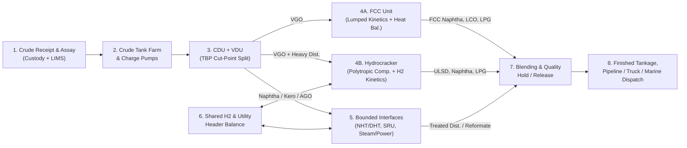

# PPC-REVIEW-002 — Governing Refinery Equations, Control Volumes, and Shift Trace

| Document control | Value |
|---|---|
| Artifact ID | `PPC-REVIEW-002` |
| Version / date | `1.0.0` / `2026-11-26` |
| Governing ADRs | [ADR-0040](../../adr/0040-staged-mechanistic-refinery-model-and-closed-flowsheet.md), [ADR-0043](../../adr/0043-refinery-v1-unit-physics-and-hybrid-clock.md), [ADR-0049](../../adr/0049-v1-business-use-cases.md) |
| Linked specifications | [PPC-ENG-001](../02-industrial-engineering/PPC-ENG-001_Physical_and_Numerical_Engineering.md), [PPC-WORLD-001](../01-enterprise-world/PPC-WORLD-001_Canonical_Enterprise_World.md), [PPC-WORLD-002](../01-enterprise-world/PPC-WORLD-002_Simulation_Time_Replay_and_Branches.md), [PPC-VERIFY-001](../07-scenarios-verification/PPC-VERIFY-001_Verification_and_Release_Qualification.md), [PPC-SCENARIO-001](../07-scenarios-verification/PPC-SCENARIO-001_Golden_Enterprise_Scenarios.md) |
| Scope | Documents and paper mathematics only. No executable simulator is implemented, calibrated, or qualified here. |

## 1. End-to-end shift trace across Refinery A v1

Refinery A v1 ([ADR-0040](../../adr/0040-staged-mechanistic-refinery-model-and-closed-flowsheet.md)) is the minimum physically closed Gulf Coast flowsheet supporting use cases `UC-1` through `UC-6` ([ADR-0049](../../adr/0049-v1-business-use-cases.md)). A single 12-hour shift traces material, elements (sulfur, hydrogen), energy, and operating decisions across eight coupled control-volume stages on the hybrid 1-minute process / exact-event-split clock ([ADR-0043](../../adr/0043-refinery-v1-unit-physics-and-hybrid-clock.md)):

### Physical boundaries and explicit v1 exclusions

| Stage / boundary | v1 fidelity class | Decisions supported | Behaviors explicitly outside v1 scope |
|---|---|---|---|
| Crude receipt & LIMS assay | Exact custody mass + temperature-corrected reference volume + revisioned assay lot | UC-2 crude rejection, UC-4 crude-slate swing, UC-3 backcasting | Online near-infrared analyzer dynamics; vapor flashing during marine unloading |
| Crude/intermediate/finished tankage & transfer headers | Transient mass + component balance with exact intra-step bound-crossing root finding; Darcy-Weisbach hydraulic head/pump bounds | UC-1/UC-2/UC-5 tank limits, intermediate overfill detection, pump-swap routing | Thermal stratification inside tanks; water-bottom emulsification; transient water-hammer surges |
| CDU + VDU | Assay TBP/D86 cut-point separation with cut-point shift, overlap factor, Watson K, API gravity, and cut sulfur distribution | UC-4 max-distillate vs max-gasoline cut swing; UC-2 crude quality impact on VGO/distillate | Tray-by-tray rigorous MESH vapor-liquid equilibrium; pumparound fouling dynamics |
| Hydrocracker (HCU) + recycle-gas compressor | Polytropic centrifugal compressor head/capacity curve coupled to H2 circulation, H2 partial pressure, lumped conversion, and H2 stoichiometry | UC-1 compressor derate (replacing linear 0.75 cap); UC-3/UC-4 ULSD yield & H2 header trade-off | Multi-bed axial temperature profiles; catalyst cycle-length deactivation over years |
| FCC | Weekman–Nace lumped severity kinetics + reactor-regenerator coke/heat balance bounded by air-blower coke burn | UC-4 gasoline vs LCO swing; UC-3 LP calibration vs actual conversion | Riser hydrodynamics/slip velocity; NOx/SOx flue-gas scrubbers |
| Shared H2 & utilities (fuel gas, steam, power) | Plant-wide header network balance (producers minus committed consumers = allocable headroom) | UC-1 H2 contention between HCU and hydrotreaters; UC-5 utility-loss propagation | Steam-header pressure wave dynamics; electrical grid frequency transients |
| Hydrotreating (NHT/DHT), SRU, Steam/Power | Declared bounded mass, sulfur, H2, and utility interface units (fixed calibrated conversion + H2/utility intensity per mode) | Closes plant mass, sulfur, H2, and variable operating cost without simulating every minor column | Internal Claus converter thermodynamics; hydrotreater reactor bed quench loops |
| Product blending & quality release | Mass-basis sulfur and density; nonlinear Chevron RVP, Ethyl RT-70 octane, Wickey-Chittenden flash, Hu-Burns/Riazi cloud, and cetane index; explicit quality hold/release state | UC-1/UC-2/UC-4/UC-5 spec compliance, giveaway minimization, quality hold vs dispatch | Inline blend-header analyzer dead-time PID tuning |

## 2. Primary-sourced governing equation register

Every physical value uses SI mass (`kg` or metric tonnes `t`) as the authoritative conservation basis. Standard liquid volumes (`bbl` at `60 °F / 15.56 °C` and `14.696 psia`, API MPMS Chapter 11.1) convert to mass only through a declared density $\rho_{\text{ref}}$ at compatible reference conditions. Barrels of different densities are never summed as conserved mass.

### EQ-01 — Reference Volume, Density, and API Gravity Conversion (Conservation Basis)

- **Class:** Physical definition / unit conversion (non-empirical).
- **Primary source:** API Manual of Petroleum Measurement Standards (MPMS) Chapter 11.1 (2004/2019); M. R. Riazi, *Characterization and Properties of Petroleum Fractions*, ASTM Manual 50 (2005), Ch. 2, Eq. 2.4.
- **Equations:**
  $$\text{SG}_{60/60} = \frac{141.5}{\text{API} + 131.5}, \qquad \rho_{\text{ref}} = \text{SG}_{60/60} \cdot \rho_{w,60^\circ\text{F}}$$
  $$m = V_{\text{std}} \cdot c_{\text{bbl}} \cdot \rho_{\text{ref}}$$
- **Variables, units, reference conditions:** $\text{API}$ (°API, dimensionless); $\text{SG}_{60/60}$ (specific gravity at $60^\circ\text{F}/60^\circ\text{F}$); $\rho_{w,60^\circ\text{F}} = 999.016\text{ kg/m}^3$; $c_{\text{bbl}} = 0.158987294928\text{ m}^3/\text{bbl}$; $V_{\text{std}}$ (standard bbl); $m$ (kg).
- **Assumptions & valid range:** Liquid phase at standard reference temperature $60^\circ\text{F}$ ($15.56^\circ\text{C}$), $10 \le \text{API} \le 90$. Observed volumes at $T \neq 60^\circ\text{F}$ require an API MPMS 11.1 Volume Correction Factor ($\text{VCF}$) before mass conversion. Missing density blocks conversion (`INSUFFICIENT_INPUT`).
- **Calibration & uncertainty:** Zero fitted parameters; density measurement uncertainty $\pm 0.5\text{ kg/m}^3$ ($\sim 0.05\%$).

### EQ-02 — Transient Control-Volume Mass, Component, and Transit Conservation

- **Class:** Conservation law (exact).
- **Primary source:** R. H. Perry & D. W. Green, *Perry's Chemical Engineers' Handbook*, 9th ed. (McGraw-Hill, 2019), Section 4 (*Thermodynamics & Material Balances*); Bird, Stewart, & Lightfoot, *Transport Phenomena*, 2nd ed. (Wiley, 2002), Ch. 23.
- **Equations:**
  $$\frac{dM_k}{dt} = \sum_{i \in \text{in}(k)} \dot{m}_i(t) - \sum_{j \in \text{out}(k)} \dot{m}_j(t) - \dot{m}_{\text{loss},k}(t)$$
  $$M_k(t_1) = M_k(t_0) + \int_{t_0}^{t_1} \left(\sum \dot{m}_i - \sum \dot{m}_j - \dot{m}_{\text{loss},k}\right) dt, \qquad M_{k,\min} \le M_k(t) \le M_{k,\max}\;\; \forall t \in [t_0, t_1]$$
  $$\frac{d(M_k w_{k,c})}{dt} = \sum_{i \in \text{in}(k)} \dot{m}_i w_{i,c} - \sum_{j \in \text{out}(k)} \dot{m}_j w_{k,c} - \dot{m}_{\text{loss},k} w_{k,c}$$
  $$M_{\text{transit},e}(t_1) = M_{\text{transit},e}(t_0) + \int_{t_0}^{t_1} (\dot{m}_{\text{send},e} - \dot{m}_{\text{recv},e})\,dt \ge 0$$
- **Control volume & update rule:** Applies to every tank $k$, unit holdup, header, and transit edge $e$. Under [ADR-0043](../../adr/0043-refinery-v1-unit-physics-and-hybrid-clock.md), rates are piecewise constant over each 1-minute step $[t_0, t_0+\Delta t)$ unless an intra-step boundary crossing $t^* = t_0 + (M_{\text{bound}} - M_k(t_0)) / \dot{M}_{\text{net}}$ falls strictly inside $(t_0, t_0+\Delta t)$, in which case the step splits at $t^*$ and applies the declared operating rule (throttle, divert, or block). End-of-step clipping is forbidden.
- **Element conservation (sulfur & hydrogen):** Across any reactive or non-reactive boundary, $\sum_{\text{in}} \dot{m}_i w_{i,S} = \sum_{\text{out}} \dot{m}_j w_{j,S} + \frac{dM_S}{dt}$ (including $\text{H}_2\text{S}$ routed to the SRU boundary). Same for total $\text{H}_2$ including makeup, recycle, chemical consumption, dissolved gas, and purge.
- **Mass residual tolerance:** $|r_M| \le 10^{-9} \cdot \max(1\text{ kg}, M_{\text{throughput}})$ in floating-point arithmetic (exact `0` in rational arithmetic for discrete fixtures).

### EQ-03 — Pipe Transfer Hydraulics and Pump Head Bounds

- **Class:** Semi-empirical fluid-mechanics conservation (mechanical energy balance).
- **Primary source:** *Perry's Chemical Engineers' Handbook*, 9th ed. (2019), Section 6 (*Fluid and Particle Dynamics*: Darcy–Weisbach equation, Colebrook–White friction factor, centrifugal pump affinity laws).
- **Equations:**
  $$h_f = f \frac{L}{D} \frac{v^2}{2g} + \sum K_{\text{fit}} \frac{v^2}{2g}, \qquad \frac{1}{\sqrt{f}} = -2.0 \log_{10}\!\left(\frac{\varepsilon/D}{3.7} + \frac{2.51}{\text{Re}\sqrt{f}}\right)$$
  $$H_{\text{pump}}(Q, N) = \left(\frac{N}{N_0}\right)^2 H_0 - c_p Q^2 \ge \Delta z + \frac{P_{\text{dest}} - P_{\text{src}}}{\rho g} + h_f(Q)$$
- **Variables, units:** $h_f$ (m fluid), $f$ (dimensionless Darcy friction factor), $L, D, \varepsilon$ (m), $v = 4Q/(\pi D^2)$ (m/s), $\text{Re} = \rho v D / \mu$, $N/N_0$ (speed ratio), $Q$ ($\text{m}^3/\text{s}$).
- **Valid range & role:** Used where a transfer line or charge pump constrains tank-to-unit or tank-to-terminal rate (including the `INFO-001` pump-swap case when Pump B has a different head curve or speed limit than Pump A). Valid for incompressible single-phase Newtonian liquid flow ($\text{Re} > 4000$ via Colebrook; $f = 64/\text{Re}$ for $\text{Re} \le 2100$).
- **Alternative compared:** Static `max_rate_bbl_h` table (simpler, but fails to capture viscosity/density changes when switching from light sweet to heavy sour crude in UC-2/UC-4).

### EQ-04 — Crude Assay Characterization and CDU/VDU Cut-Point Separation

- **Class:** Empirical petroleum characterization + exact mass-fraction separation.
- **Primary source:** M. R. Riazi, *Characterization and Properties of Petroleum Fractions*, ASTM Manual 50 (2005), Ch. 2–3 (Watson $K_w$, API/SG, TBP ASTM D2892 ↔ ASTM D86 conversion, molecular weight); J. H. Gary, G. E. Handwerk, & M. J. Kaiser, *Petroleum Refining: Technology and Economics*, 5th ed. (CRC Press, 2007), Ch. 3–4 (Crude Distillation).
- **Equations:**
  $$K_w = \frac{T_b^{1/3}}{\text{SG}_{60/60}} \quad (T_b\text{ in }^\circ\text{R})$$
  $$y_{c,j}(T_{j-1}^{\text{cut}}, T_j^{\text{cut}}) = F_c^{\text{TBP}}(T_j^{\text{cut}}) - F_c^{\text{TBP}}(T_{j-1}^{\text{cut}}) + \delta_{\text{overlap},j}, \qquad \sum_{j=1}^{J} y_{c,j} + y_{c,\text{loss}} = 1$$
  $$\dot{m}_j = \sum_{c \in \text{slate}} \dot{m}_{\text{crude},c}\, y_{c,j}, \qquad w_{j,S} = \frac{\sum_c \dot{m}_{\text{crude},c}\, y_{c,j}\, w_{c,j,S}}{\dot{m}_j}$$
- **Control volume & decisions:** CDU produces Offgas/LPG, Light Naphtha, Heavy Naphtha, Kero/Jet, Atmospheric Gas Oil (AGO/Diesel), and Atmospheric Residue (ATB). VDU splits ATB into Light/Heavy Vacuum Gas Oil (VGO → FCC/HCU feed) and Vacuum Residue (VTB → fuel oil/boundary export). Shifting the heavy-naphtha/kero or AGO/VGO cut points ($T_j^{\text{cut}} \pm 15^\circ\text{C}$) directly models max-distillate versus max-gasoline economic swing (`UC-4`) while preserving exact mass and sulfur closure.
- **Valid range & calibration:** Cut-point shifts bounded within column fractionation limits ($\pm 15^\circ\text{C}$ around nominal cut point); assay curves $F_c^{\text{TBP}}(T)$ (mass-fraction cumulative TBP) come from public/synthetic assays (e.g. WTI, Mars, Maya-class synthetic profiles); no real proprietary assay is claimed.
- **Alternative compared:** Rigorous tray-by-tray MESH distillation (rejected for v1 under `ADR-0040` because cut-point TBP separation plus overlap captures crude-slate and cut-point economics with zero convergence instability).

### EQ-05 — Hydrocracker Recycle-Gas Compressor Polytropic Model and HCU Kinetic/Stoichiometric Closure

- **Class:** Thermodynamic real-gas compression (GPSA) + empirical/lumped catalytic hydrocracking kinetics and hydrogen stoichiometry.
- **Primary source:** *GPSA Engineering Data Book*, 14th ed. (2016), Section 13 (*Compressors and Expanders*, polytropic head and exponent); Gary, Handwerk, & Kaiser, *Petroleum Refining*, 5th ed. (2007), Ch. 8 (*Hydrocracking*); R. E. Maples, *Petroleum Refinery Process Economics*, 2nd ed. (PennWell, 2000), Ch. 11 (HCU yields & hydrogen consumption).
- **Equations:**
  1. *Polytropic head and exponent (SI):*
     $$\frac{n}{n-1} = \left(\frac{k}{k-1}\right)\eta_p, \qquad H_p = \frac{Z_{\text{avg}} R T_1}{MW_{\text{gas}}} \left(\frac{n}{n-1}\right) \left[\left(\frac{P_2}{P_1}\right)^{\frac{n-1}{n}} - 1\right]$$
     $$W_{\text{shaft}} = \frac{\dot{m}_{\text{rec}} H_p}{\eta_p \eta_m} \le W_{\text{driver,max}}(s_{\text{comp}})$$
  2. *Compressor derate → recycle circulation → hydrogen-to-oil & partial-pressure ceiling:*
     When a mechanical restriction (e.g. bearing vibration / speed ceiling / fouled intercooler / driver derate state $s_{\text{comp}}$) caps $W_{\text{driver,max}}$ or maximum speed $N_{\max}$, maximum recycle gas mass flow $\dot{m}_{\text{rec,max}}$ drops from the compressor map. Safe hydrocracker operation enforces minimum H2-to-oil ratio $(R_{\text{H2/oil}} \ge R_{\min})$ and minimum reactor hydrogen partial pressure $(P_{\text{H2}} \ge P_{\text{H2},\min})$ to prevent runaway coking and quench loss:
     $$\dot{m}_{\text{HCU,feed}}^{\max} = \min\!\left(\dot{m}_{\text{mech,max}},\; \frac{\dot{V}_{\text{H2,rec,max}}(s_{\text{comp}})}{R_{\min}},\; \frac{\dot{m}_{\text{H2,alloc}}}{c_{\text{H2}}(\xi, \text{feed})},\; \dot{m}_{\text{feed,avail}},\; \dot{m}_{\text{downstream,cap}}\right)$$
  3. *Lumped conversion, product yields, and exact mass + H2 + sulfur closure:*
     $$\xi = 1 - \exp\!\left(-\frac{k_0 \exp(-E_a / R T_{\text{rxr}})\, P_{\text{H2}}^{\alpha}}{\text{LHSV}}\right), \qquad \dot{m}_{\text{H2,chem}} = \dot{m}_{\text{feed}} \left(c_{\text{HDS}}\Delta w_S + c_{\text{HDN}}\Delta w_N + c_{\text{crack}}\,\xi\right)$$
     $$\sum_{p \in \text{products}} \dot{m}_p + \dot{m}_{\text{H2S}} + \dot{m}_{\text{NH3}} = \dot{m}_{\text{feed}} + \dot{m}_{\text{H2,chem}} \qquad (\text{exact mass closure with }\text{H}_2\text{ addition})$$
- **Why this replaces the `ef4eb08` linear 0.75 cap:** Under `ef4eb08`, `30,000 = 0.75 × 40,000 bbl/day` was an arbitrary scalar multiplier disconnected from hydrogen circulation, yield shift, or mass balance. Here, a compressor speed/driver restriction lowers $\dot{V}_{\text{H2,rec,max}}$, which binds either maximum feed at fixed $R_{\min}$ (reproducing the `30,000 bbl/day` Scenario A feed cap at calibrated reference density as a special case!) or forces lower conversion $\xi$ / lower ULSD selectivity — while simultaneously updating net chemical $\text{H}_2$ draw on the shared hydrogen header (`EQ-07`) and exact mass outputs (including volumetric gain from lower product density, per EIA).
- **Valid range & calibration needs:** Valid for VGO/distillate hydrocracking at $P_{\text{H2}} \in [80, 180]\text{ bar}$, $T_{\text{rxr}} \in [360, 430]^\circ\text{C}$, $\xi \in [0.40, 0.95]$. Kinetic parameters ($k_0, E_a, \alpha$) and yield selectivities require explicit synthetic calibration fixtures labeled `SYNTHETIC` and checked against Gary/Handwerk/Maples published envelope ranges; **no real plant calibration is claimed**.

### EQ-06 — FCC Lumped Kinetics and Reactor–Regenerator Heat/Coke Balance

- **Class:** Lumped catalytic kinetics + macroscopic energy balance.
- **Primary source:** V. W. Weekman Jr. & D. M. Nace, *AIChE Journal* 16(3), 397–404 (1970) (3-lump/4-lump FCC kinetics); Gary, Handwerk, & Kaiser, *Petroleum Refining*, 5th ed. (2007), Ch. 6 (*Catalytic Cracking*).
- **Equations:**
  1. *4-lump riser kinetics (VGO feed $A$, gasoline $B$, LPG/light gas $C$, coke $D$, plug-flow dimensionless residence time $\tau$ with catalyst deactivation $\phi = \exp(-\alpha_d \tau)$):*
     $$\frac{dy_A}{d\tau} = -\phi(k_1 + k_3 + k_4) y_A^2, \qquad \frac{dy_B}{d\tau} = \phi(k_1 y_A^2 - k_2 y_B)$$
     $$\frac{dy_C}{d\tau} = \phi(k_3 y_A^2 + \beta_{BC} k_2 y_B), \qquad \frac{dy_D}{d\tau} = \phi(k_4 y_A^2 + (1-\beta_{BC}) k_2 y_B) + y_{\text{CCR,feed}}$$
     with exact mass conservation $y_A + y_B + y_C + y_D = 1$ (split further into dry gas, LPG, FCC naphtha, LCO, slurry oil, and coke).
  2. *Coupled reactor–regenerator heat balance and air-blower coke-burn ceiling:*
     $$\dot{m}_{\text{cat}} C_{p,\text{cat}} (T_{\text{regen}} - T_{\text{rxr}}) = \dot{m}_{\text{feed}} \left[\Delta h_{\text{vap+sens}} + \Delta h_{\text{rxn}}(y_A, y_B)\right] + Q_{\text{loss,rxr}}$$
     $$\dot{m}_{\text{coke}} \Delta h_{\text{comb}} = \dot{m}_{\text{cat}} C_{p,\text{cat}} (T_{\text{regen}} - T_{\text{spent}}) + \dot{m}_{\text{flue}} \bar{C}_{p,\text{flue}}(T_{\text{regen}} - T_{\text{air}}) + Q_{\text{loss,regen}}$$
     $$\dot{m}_{\text{coke}} = \dot{m}_{\text{feed}} y_D \le \dot{m}_{\text{coke,max}}(\dot{m}_{\text{air,max}}), \qquad T_{\text{regen}} \le T_{\text{regen,max}}$$
- **Decisions supported:** Captures why switching to heavier/more aromatic VGO (lower $K_w$, higher Conradson Carbon Residue `CCR`) raises coke yield $y_D$, hits the regenerator air-blower or metallurgy limit $T_{\text{regen,max}}$, and forces feed curtailment or riser temperature adjustment (`UC-2`, `UC-4`).
- **Valid range:** Riser outlet $T_{\text{rxr}} \in [495, 550]^\circ\text{C}$, regenerator $T_{\text{regen}} \in [670, 740]^\circ\text{C}$, catalyst-to-oil ratio $\in [4, 9]$.

### EQ-07 — Shared Hydrogen and Utility Header Network Balance

- **Class:** Exact network conservation law + mode-based utility intensity.
- **Primary source:** *Perry's Chemical Engineers' Handbook*, 9th ed. (2019), Section 4; Gary, Handwerk, & Kaiser, *Petroleum Refining*, 5th ed. (2007), Ch. 16 (*Supporting Processes*).
- **Equations:**
  $$\sum_{p \in \text{H2 prod}} \dot{m}_{\text{H2},p}(t) - \sum_{u \in \text{H2 users}} \dot{m}_{\text{H2,net},u}(t) - \dot{m}_{\text{H2,flare/loss}}(t) = \frac{dM_{\text{H2,header}}}{dt}$$
  $$\dot{m}_{\text{H2,alloc},u} \le \max\!\left(0,\; \dot{m}_{\text{H2,supply}} - \sum_{v \neq u} \dot{m}_{\text{H2,committed},v}\right)$$
- **Critical accounting rule:** Gross recycle circulation inside the HCU cancels across the plant H2 header boundary; only **net chemical consumption + purge/dissolved loss** draws from the shared header (SMR hydrogen plant + reformer byproduct H2 minus NHT/DHT committed draw). Same single-header conservation applies to fuel gas, high/medium/low-pressure steam, electric power, and cooling water. No two units may simultaneously allocate the same uncommitted headroom.

### EQ-08 — Product Blending Properties (Conservative Mass + Nonlinear Indices)

- **Class:** Exact mass-conservation mixing (sulfur, density) + primary empirical blending correlations (RVP, RON/MON, flash point, cloud point, cetane).
- **Primary sources:**
  - *Sulfur & density:* Exact mass/ideal-volume conservation (ASTM D4294 / API MPMS).
  - *RVP (Chevron 1.25 index):* Gary, Handwerk, & Kaiser, *Petroleum Refining*, 5th ed. (2007), Ch. 13 (*Product Blending*); Chevron Research Co. VPBI method.
  - *RON / MON (Ethyl RT-70 interaction model):* W. C. Healy Jr., C. W. Maassen, & R. T. Peterson, *Proc. API Div. Refining* 39(III), 132 (1959).
  - *Flash point:* R. O. Wickey & D. H. Chittenden, *Hydrocarbon Processing* 42(6), 157 (1963).
  - *Cloud point:* J. Hu & A. M. Burns, *Hydrocarbon Processing* 49(11), 213 (1970); Riazi, ASTM Manual 50 (2005), Ch. 10.
  - *Cetane index:* ASTM D4737 (four-variable equation from density and D86 T10/T50/T90).
- **Equations:**
  1. *Mass-conservative sulfur & density:*
     $$w_{S,\text{blend}} = \frac{\sum_i m_i w_{S,i}}{\sum_i m_i}, \qquad \rho_{\text{blend}} = \frac{\sum_i m_i}{\sum_i (m_i / \rho_i)} \quad (\text{ideal liquid volume assumption; excess mixing volume } \le 0.3\%)$$
  2. *Chevron RVP blending index (volume fractions $x_{v,i}$):*
     $$\text{RVP}_{\text{blend}} = \left[\sum_i x_{v,i}\, (\text{RVP}_i)^{1.25}\right]^{0.8} \qquad (\text{psi at } 100^\circ\text{F})$$
  3. *Ethyl RT-70 nonlinear RON / MON interaction model:*
     $$\text{RON}_{\text{blend}} = \bar{r} + a_1 \left(\overline{r s} - \bar{r}\bar{s}\right) + a_2 \left(\overline{O^2} - \bar{O}^2\right) + a_3 \left(\overline{A^2} - \bar{A}^2\right)$$
     where $\bar{r} = \sum x_{v,i} \text{RON}_i$, $s_i = \text{RON}_i - \text{MON}_i$ (sensitivity), $O_i$ = vol% olefins, $A_i$ = vol% aromatics, and $a_1, a_2, a_3$ are published RT-70 regression constants (with corresponding MON equation).
  4. *Wickey–Chittenden flash point blending index ($T_{\text{fp},i}$ in °F):*
     $$\log_{10}(I_{\text{fp},i}) = -6.1188 + \frac{4345.2}{T_{\text{fp},i} + 383}, \qquad I_{\text{fp,blend}} = \sum_i x_{v,i}\, I_{\text{fp},i}$$
  5. *Hu–Burns / Riazi cloud point index ($T_{\text{cp},i}$ in K, $x = 0.05$):*
     $$T_{\text{cp,blend}} = \left(\sum_i x_{v,i}\, T_{\text{cp},i}^{20}\right)^{0.05}$$
- **Quality release invariant:** A finished lot enters `QUALITY_HOLD` upon blend completion. Release to `AVAILABLE_FOR_DISPATCH` requires **every** mandatory grade specification (for ULSD: sulfur $\le 15\text{ ppmw}$, flash point $\ge 52^\circ\text{C}$, cetane $\ge 40$, cloud point $\le T_{\text{seasonal}}$; for RBOB/CBOB gasoline: RVP $\le \text{RVP}_{\text{seasonal}}$, $(R+M)/2 \ge 87$ or $91$, sulfur $\le 10\text{ ppmw}$ average / $80\text{ ppmw}$ cap) to pass on unrounded values with a signed LIMS revision and authorized disposition.

### EQ-09 — Economic Objective and Backcasting Attribution

- **Class:** Commercial accounting identity + Pyomo LP/NLP optimization objective (`ADR-0048`).
- **Primary source:** Maples, *Petroleum Refinery Process Economics*, 2nd ed. (2000); `PPC-005`, `PPC-008`, `PPC-ANALYTICS-001`, and ChatGPT T2–T3/T24/T74.
- **Equations:**
  $$\Pi = \sum_{p} P_p V_p - \sum_{c} P_c V_c - C_{\text{var,util}} - C_{\text{logistics}} - C_{\text{penalty/demurrage}}$$
  $$\Delta \Pi_{\text{total}} = \underbrace{(\Pi_{\text{recal-plan}} - \Pi_{\text{orig-plan}})}_{\text{LP calibration effect}} + \underbrace{(\Pi_{\text{feasible-alt}} - \Pi_{\text{recal-plan}})}_{\text{decision opportunity}} + \underbrace{(\Pi_{\text{actual}} - \Pi_{\text{feasible-alt}})}_{\text{execution & exogenous residual}}$$
- **Fairness rule:** Each term pins exact case order, evidence cutoff, model vintage, and price vintage; hindsight cases (`Hindsight-feasible`) are scored separately from decision-time feasible cases.

## 3. Paper-checked worked examples (reconciling `ENG-001` and `WORLD-002`)

1. **Tank conservation + intermediate overfill (EQ-02):**
   - *Case 1 (Baseline `T125`):* $V_0 = 10{,}000\text{ bbl}$, $V_{\max} = 12{,}000\text{ bbl}$, constant $\text{SG} = 0.840$ ($\rho = 839.17\text{ kg/m}^3$, $133.42\text{ kg/bbl}$), inflow $500\text{ bbl/h}$ ($66{,}709\text{ kg/h}$), outflow $700\text{ bbl/h}$ ($93{,}392\text{ kg/h}$) for $2\text{ h}$. Closing volume $= 9{,}600\text{ bbl}$ ($1{,}280{,}806\text{ kg}$), mass residual $= 0\text{ kg}$.
   - *Case 2 (Illegal intermediate overflow with legal closing stock):* $V_0 = 11{,}800\text{ bbl}$, $V_{\max} = 12{,}000\text{ bbl}$. Hour 1: inflow $600\text{ bbl/h}$, outflow $200\text{ bbl/h}$ (net $+400\text{ bbl/h}$). Hour 2: inflow $0\text{ bbl/h}$, outflow $500\text{ bbl/h}$. A naive 2-hour balance gives closing stock $11{,}800 + 600 - 700 = 11{,}700\text{ bbl} \le 12{,}000\text{ bbl}$ (falsely legal!). Exact intra-step event detection (`EQ-02`) finds crossing time $t^* = (12{,}000 - 11{,}800)/400 = 0.5\text{ h}$ and rejects or throttles the trajectory at $t = 0.5\text{ h}$.
2. **Compressor derate coupled to H2 circulation & mass/volume gain (EQ-01, EQ-05, EQ-07):**
   - Nominal HCU charge $= 40{,}000\text{ bbl/day}$ VGO ($\text{SG} = 0.910$, $\rho = 909.1\text{ kg/m}^3 \Rightarrow 5{,}781.4\text{ t/day}$). At $08{:}10$ UTC a recycle-gas compressor speed/driver restriction lowers maximum recycle circulation to $75\%$ of design at fixed $R_{\min}$, binding feasible HCU feed at $30{,}000\text{ bbl/day}$ ($4{,}336.1\text{ t/day}$). At calibrated synthetic chemical $\text{H}_2$ uptake of $2.0\text{ wt}\%$ of hydrocarbon feed ($86.72\text{ t/day}$ $\text{H}_2$), total mass entering the HCU boundary is $4{,}422.8\text{ t/day}$, so total product + $\text{H}_2\text{S}/\text{NH}_3$ mass leaving must equal $4{,}422.8\text{ t/day}$. Because lighter hydrocracked products average $\text{SG} \approx 0.835$, liquid volume output is $\sim 33{,}200\text{ bbl/day}$ ($+10.7\%$ volumetric gain) while mass residual is strictly $0\text{ t/day}$.
3. **Nonlinear RVP blending check (EQ-08):**
   - $40\text{ vol}\%$ Light Straight-Run Naphtha ($\text{RVP} = 11.0\text{ psi}$, $BI = 20.02$) plus $60\text{ vol}\%$ $n$-Butane ($\text{RVP} = 52.0\text{ psi}$, $BI = 139.67$) gives $BI_{\text{blend}} = 0.4(20.02) + 0.6(139.67) = 91.81 \Rightarrow \text{RVP}_{\text{blend}} = 91.81^{0.8} \approx 37.18\text{ psi}$ (versus linear average $35.60\text{ psi}$, a $+1.58\text{ psi}$ error that would cause off-spec summer gasoline if blended linearly).
   *(Check arithmetic: $11^{1.25} = 11 \times 11^{0.25} = 11 \times 1.82116 = 20.0328$; $52^{1.25} = 52 \times 52^{0.25} = 52 \times 2.68535 = 139.638$; $0.4 \times 20.0328 + 0.6 \times 139.638 = 8.0131 + 83.7828 = 91.7959$; $91.7959^{0.8} = 37.17\text{ psi}$.)*
4. **Sulfur mass blending (`T24` fixture, EQ-08):**
   - $100\text{ t}$ at $10\text{ ppmw}$ S + $x\text{ t}$ at $100\text{ ppmw}$ S $\le 15\text{ ppmw}$ S $\implies x \le 100/17 \approx 5.88235\text{ t}$. At $x=5\text{ t}$, $w_S = 100/7 \approx 14.286\text{ ppmw}$ (PASS); at $x=6\text{ t}$, $w_S = 800/53 \approx 15.094\text{ ppmw}$ (HOLD).
