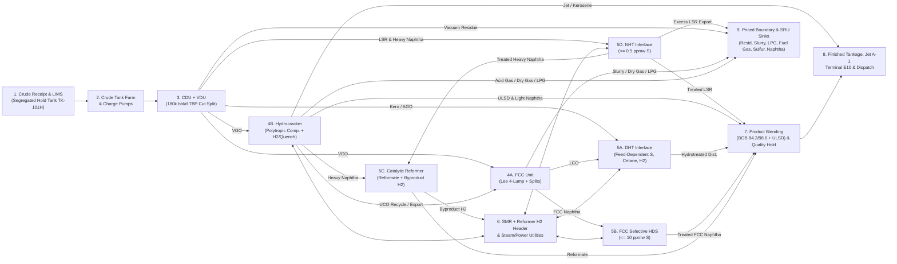

# PPC-REVIEW-002 — Governing Refinery Equations, Control Volumes, and Shift Trace

| Document control | Value |
|---|---|
| Artifact ID | `PPC-REVIEW-002` |
| Version / date | `1.2.0` / `2026-11-26` (Option A flowsheet closure, design basis, and RT-70/FCC/HCU equations locked by ADR-0054 and ADR-0056) |
| Governing ADRs | [ADR-0040](../../adr/0040-staged-mechanistic-refinery-model-and-closed-flowsheet.md), [ADR-0043](../../adr/0043-refinery-v1-unit-physics-and-hybrid-clock.md), [ADR-0049](../../adr/0049-v1-business-use-cases.md), [ADR-0054](../../adr/0054-refinery-a-flowsheet-closure-option-a-and-design-basis.md), [ADR-0056](../../adr/0056-identity-steward-action-thresholds-and-refinery-a-parameters.md) |
| Linked specifications | [PPC-ENG-001](../02-industrial-engineering/PPC-ENG-001_Physical_and_Numerical_Engineering.md), [PPC-WORLD-001](../01-enterprise-world/PPC-WORLD-001_Canonical_Enterprise_World.md), [PPC-WORLD-002](../01-enterprise-world/PPC-WORLD-002_Simulation_Time_Replay_and_Branches.md), [PPC-VERIFY-001](../07-scenarios-verification/PPC-VERIFY-001_Verification_and_Release_Qualification.md), [PPC-SCENARIO-001](../07-scenarios-verification/PPC-SCENARIO-001_Golden_Enterprise_Scenarios.md) |
| Scope | Documents and paper mathematics only. No executable simulator is implemented, calibrated, or qualified here. |

## 1. End-to-end shift trace and flowsheet closure across Refinery A v1

Refinery A v1 ([ADR-0040](../../adr/0040-staged-mechanistic-refinery-model-and-closed-flowsheet.md), amended by [ADR-0054](../../adr/0054-refinery-a-flowsheet-closure-option-a-and-design-basis.md)) models one fictional Gulf Coast refinery on a hybrid 1-minute process and exact-event-split clock ([ADR-0043](../../adr/0043-refinery-v1-unit-physics-and-hybrid-clock.md)) to support use cases `UC-1` through `UC-6` ([ADR-0049](../../adr/0049-v1-business-use-cases.md)).

### Locked flowsheet closure (`ADR-0054`, Option A)

Under [ADR-0054](../../adr/0054-refinery-a-flowsheet-closure-option-a-and-design-basis.md) (`G1-1` through `G1-6`), **Option A is locked** (Option B is rejected):

1. **Internal bounded interfaces:** **Steam Methane Reformer (SMR)**, **Naphtha Hydrotreater (NHT)**, **Catalytic Reformer**, **FCC Naphtha Selective HDS**, **Diesel Hydrotreater (DHT)**, **Sulfur Recovery Unit (SRU)**, and **Steam and Power** are declared bounded mass, element, and utility interfaces inside Refinery A v1.
2. **Mandatory pre-blend hydrotreating:** All Light Straight-Run (LSR) and straight-run heavy naphtha route through **NHT** (`<= 0.5 ppmw` sulfur) so untreated LSR never breaks the `10 ppmw` Tier 3 gasoline pool limit; excess hydrotreated LSR may route to a priced **Naphtha Export** boundary (`G1-5`). All FCC Light Cycle Oil (LCO), straight-run kerosene, and atmospheric gas oil (AGO) route through **DHT** before ULSD blending. All FCC naphtha routes through **FCC Selective HDS** (`<= 10 ppmw` S, target `8 ppmw`) before gasoline blending.
3. **Terminal ethanol boundary:** Denatured ethanol (`10.0 vol% +/- 0.2`) enters strictly inside each **terminal** control volume (never the refinery gate), raising refinery-gate BOB (`>= 84.2` regular / `>= 88.6` premium `(R+M)/2`) to finished retail E10 (`>= 87.0` / `>= 91.0`).

### Complete Refinery A v1 stream-to-sink closure table (`PO-02`, `ADR-0054`)

Every stream leaving a Refinery A v1 control volume has a declared downstream unit, product pool, utility header, or priced refinery-gate export sink (`G1-6`: Jet, LPG, sulfur, vacuum residue, slurry, and export naphtha carry a market indicator with no customer contracts in v1):

| Source unit | Output stream | Declared v1 destination / sink |
|---|---|---|
| CDU + VDU | Light Straight-Run (LSR) Naphtha | Naphtha Hydrotreater (`5D`, NHT) -> Gasoline Blending (`BL`) or priced Naphtha Export Boundary (`9`); never blended untreated (`G1-5`) |
| CDU + VDU | Heavy Naphtha | Naphtha Hydrotreater (`5D`, NHT) -> Catalytic Reformer (`5C`); never directly to gasoline blending |
| CDU + VDU | Kerosene / AGO | Diesel Hydrotreater (`5A`, DHT) -> ULSD Blending (`BL`) or priced Jet A-1 Tankage (`FT`) |
| CDU + VDU | Vacuum Gas Oil (VGO) | Split between FCC (`4A`) and Hydrocracker (`4B`) |
| CDU + VDU | Vacuum Residue | Priced Heavy Fuel Oil / Asphalt / Resid Export Boundary (`9`; no delayed coker in v1) |
| FCC (`4A`) | FCC Naphtha (Gasoline) | FCC Selective HDS (`5B`) -> Gasoline Blending (`BL`) |
| FCC (`4A`) | Light Cycle Oil (LCO) | Diesel Hydrotreater (`5A`, DHT) -> ULSD Blending (`BL`); never directly to ULSD blending |
| FCC (`4A`) | Slurry / Decant Oil | Priced Heavy Fuel Oil / Slurry Export Boundary (`9`) |
| FCC (`4A`) | Dry Gas (`C1`–`C2`) & LPG (`C3`–`C4`) | Refinery Fuel Gas Header (`6`) and priced LPG Sales / Butane-to-Blending Boundary (`9`) |
| Hydrocracker (`4B`) | Acid Gas (`H2S + NH3`) | Sulfur Recovery Unit (`SRU`, `9`) -> Elemental Sulfur Export, boundary `SO2`, and `N2` |
| Hydrocracker (`4B`) | Dry Gas (`C1`–`C2`) & LPG (`C3`–`C4`) | Refinery Fuel Gas Header (`6`) and priced LPG Sales / Butane-to-Blending Boundary (`9`) |
| Hydrocracker (`4B`) | Light Naphtha | Gasoline Blending (`BL`) |
| Hydrocracker (`4B`) | Heavy Naphtha | Catalytic Reformer (`5C`); never directly to gasoline blending |
| Hydrocracker (`4B`) | Jet / Kerosene | Priced Jet A-1 Tankage & Dispatch (`FT`; or seasonal No. 1-D / ULSD blend component) |
| Hydrocracker (`4B`) | ULSD | ULSD Blending & Finished Tankage (`BL` -> `FT`) |
| Hydrocracker (`4B`) | Unconverted Oil (UCO) | FCC VGO Feed Recycle (`4A`) or priced Lube/UCO Export Boundary (`9`) |
| NHT / DHT / FDS (`5A`/`5B`/`5D`) | Sour off-gas (`H2S`) | Sulfur Recovery Unit (`SRU`, `9`) |

### Refinery A v1 nominal design basis, interface limits, tank register, and transfer paths (`fixtures/golden/refinery_a_design_basis.yaml`)

All figures below are `SYNTHETIC` design-basis specifications locked by [ADR-0054](../../adr/0054-refinery-a-flowsheet-closure-option-a-and-design-basis.md) and [ADR-0056](../../adr/0056-identity-steward-action-thresholds-and-refinery-a-parameters.md) to be materialized in `fixtures/golden/refinery_a_design_basis.yaml` during `WP-1`:

- **Crude charge & assay slate:** Nominal crude charge `180,000 bbl/day` (operating range `105,000–190,000 bbl/day`) on a `30 / 50 / 20 vol%` design blend of three `>= 12`-point TBP assays: Light Sweet (`API 39.0`, `0.35 wt% S`), Medium Sour (`API 31.0`, `1.60 wt% S`), and Heavy Sour (`API 24.0`, `2.60 wt% S`). Design-blend cut yields (`vol%`, matching within `+/- 2 vol%` absolute): LPG `2%`, LSR `6%`, heavy naphtha `12%`, kerosene `10%`, AGO `17%`, VGO `32%`, vacuum residue `21%`. TBP cut points: `30, 85, 175, 240, 360, 565 °C` (`+/- 15 °C` shift, overlap `<= 2 wt%` per adjacent pair, column loss `0.2 wt%`, range `0–0.5 wt%`). VGO splits to HCU (`36,000` planned, `40,000 bbl/day` max) and FCC (`21,600` nominal, `30,000 bbl/day` max including UCO recycle).
- **Explicit hydrogen header identity (`G1-3`):** "Net plant H2 supply" equals `SMR H2 + Reformer byproduct H2 - NHT draw - FCC HDS draw`; HCU, DHT, and header loss draw from that net figure. In fixture mode, interface terms hold at these exact constants (reformer draws from its feed tank so a short HCU derate does not shift reformer H2 inside the fixture window); in runtime mode, each term follows the bounded interface table below:

| Hydrogen header term (`t/day`, `SYNTHETIC`) | `SCN-A-T125` (normal) | `SCN-A-H2CONT` (SMR turndown) |
|---|---:|---:|
| SMR H2 production | 107.00 | 57.00 |
| Catalytic Reformer byproduct H2 | 73.00 | 73.00 |
| NHT consumption | -5.00 | -5.00 |
| FCC Selective HDS consumption | -5.00 | -5.00 |
| **Net plant H2 supply** | **170.00** | **120.00** |
| Header loss / DHT committed draw / HCU headroom | 5.00 / 40.00 / 125.00 | 5.00 / 40.00 / 75.00 |

- **Bounded interface rules (`G1-4`):**

| Interface | Inputs | Outputs and closure rule | Capacity & operating limits |
|---|---|---|---|
| SMR | Purchased natural gas (`CH4`-eq.), steam | `99.9 mol%` H2; `3.50 kg` gas/kg H2 (`2.60` feed, `0.90` fuel; range `3.1–4.1`); `CO2 = (44/16) * gas mass` vented at boundary; water & combustion air declared boundary terms | `120.00 t/day` H2 max; `45%` min (`54.00 t/day`); ramp `2%/min` |
| NHT | All CDU LSR & straight-run heavy naphtha | `99.7 wt%` liquid, sulfur `<= 0.5 ppmw`, H2 `0.135 wt%` feed (`0.05–0.30`); `H2S` to SRU by S balance | `36,000 bbl/day` |
| Catalytic Reformer | Hydrotreated heavy naphtha + HCU heavy naphtha | At `RON 98` (`wt%` feed): reformate `86.0`, H2 `2.2`, LPG `7.8`, dry gas `4.0`; linear over `RON 95–101` (reformate `88 -> 83`, H2 `2.0 -> 2.6`) | `30,000 bbl/day`, min `50%` |
| FCC Selective HDS | All FCC naphtha | `99.5 wt%` liquid, sulfur `<= 10 ppmw` (target `8`), H2 `0.32 wt%` (`0.20–0.50`), octane loss `1.0 (R+M)/2` (`0.5–2.0`) | `18,000 bbl/day` |
| DHT | Kerosene, AGO, FCC LCO | `c_H2,SR = 0.45 wt%` (`0.30–0.60`), `c_H2,LCO = 1.60 wt%` (`1.20–2.20`), sulfur `<= 10 ppmw`, cetane uplift `+3` SR / `+8` LCO | `60,000 bbl/day`; LCO `<= 20 wt%` of feed |
| SRU | All `H2S` and `NH3` streams | `99.5%` sulfur (`99.0–99.9%`) to elemental sulfur export; remainder as boundary `SO2`; `NH3` -> `N2` | `250 t/day` sulfur |
| Steam and power | Fuel gas, purchased natural gas, purchased power | Linear specific utility draw per tonne unit feed; boiler efficiency `0.88`; purchased power closes power header | Site energy `2.5–4.5 GJ/t` crude |
| Terminal ethanol | Purchased denatured ethanol per terminal | `10.0 vol% +/- 0.2`, blending octane `113.0 (R+M)/2`, RVP rise `+1.0 psi`; mass enters terminal control volume only | Per terminal (`TERM-01`..`03`) |

- **Refinery A v1 tank register & `EQ-03` hydraulic transfer paths (`B5`):**

| Tank ID | Service | Working min / max (`bbl`) | Notes & primary `EQ-03` transfer path |
|---|---|---|---|
| `TK-101` | Paper arithmetic / active crude test tank | `1,000` / `12,000` | Preserved for `T125` / `PO-01` exact overflow fixtures (`133.417915 kg/bbl`) |
| `TK-101H` | Segregated crude receipt hold tank | `0` / `150,000` | Receives uncertified crude lots (`UC-2`, `QUALITY_HOLD`) before release to `TK-102`/`TK-103` |
| `TK-102`, `TK-103`, `TK-104` | Active crude blend charge tanks (3x) | `30,000` / `300,000` each | Path `LINE-CRUDE-CHG` (pump `P-101A/B`, ANSI/HI 9.6.7 viscous correction) -> CDU charge |
| `TK-201`, `TK-202` | VGO & Reformer intermediate feed tanks | `15,000` / `150,000` each | Path `LINE-VGO-HCU` (`P-201A/B`) -> HCU; `TK-202` buffers Reformer feed across short HCU transients |
| `TK-301`, `TK-302` | Finished ULSD blend & release tanks (2x) | `20,000` / `200,000` each | Path `LINE-ULSD-DISP` (`P-301A/B`) -> pipeline/marine/terminal dispatch (`TERM-01`..`03`) |
| `TK-303`, `TK-304` | Finished RBOB/CBOB blend & release tanks (2x) | `20,000` / `200,000` each | Path `LINE-BOB-DISP` (`P-302A/B`) -> terminal E10 splash-blending (`TERM-01`..`03`) |
| `TK-401`, `TK-402` | Jet A-1 & Heavy Resid/Slurry export tanks | `10,000` / `120,000` each | Path `LINE-RESID-EXP` (`P-401`, ANSI/HI 9.6.7 high-viscosity) -> priced export boundary |

### Physical boundaries and explicit v1 exclusions

| Stage / boundary | v1 fidelity class | Decisions supported | Behaviors outside v1 scope |
|---|---|---|---|
| Crude receipt & LIMS assay | Exact custody mass, standard volume, revisioned assay lot, segregated hold tank `TK-101H` (or pre-discharge hold) | `UC-2` crude rejection, `UC-4` crude-slate swing, `UC-3` backcasting | Online NIR analyzer dynamics; marine unloading vapor flash |
| Tankage & transfer headers | Transient mass and component balance with exact intra-step bound crossings; Darcy–Weisbach and pump head curves (`LINE-CRUDE-CHG`, `LINE-VGO-HCU`, `LINE-ULSD-DISP`, `LINE-BOB-DISP`, `LINE-RESID-EXP`) | `UC-1`, `UC-2`, `UC-5` tank bounds, overfill prevention, pump-swap routing | Tank thermal stratification; water-bottom emulsification; water hammer |
| CDU + VDU | `180,000 bbl/day` nominal; 3 assays (30/50/20); TBP cut-point separation with per-crude zero-sum overlap and loss, Watson $K_w$, API gravity, cut sulfur | `UC-4` max-distillate vs max-gasoline cut swing; `UC-2` crude quality impact | Tray-by-tray rigorous MESH flash; pumparound fouling dynamics |
| Hydrocracker (HCU) + recycle compressor | Polytropic compressor head curve coupled to recycle $\text{H}_2$ mass flow, inter-bed quench duty, $P_{\text{H2}}$ purity balance, lumped conversion, selectivity scaling, and net $\text{H}_2$ stoichiometry | `UC-1` compressor derate; `UC-3` and `UC-4` ULSD yield and $\text{H}_2$ contention | Multi-bed axial temperature profiles; multi-year catalyst deactivation |
| FCC | Lee, Chen, Huang, & Pan (1989) 4-lump kinetics with inlet CCR split + lump-to-stream/sulfur splits + reactor–regenerator coke/heat balance bounded by air-blower coke burn (`7.0 wt%` cap at `30k bbl/day`) | `UC-4` gasoline vs LCO swing; `UC-3` LP calibration vs actual conversion | Riser two-phase slip hydrodynamics; flue-gas scrubber chemistry |
| Bounded interfaces (SMR, NHT, Reformer, FCC HDS, DHT, SRU, Steam/Power) | Declared Option A mass, sulfur, $\text{H}_2$, octane, and utility interface rules (`ADR-0054` `G1-4`) | Closes sitewide mass, sulfur, $\text{H}_2$, octane, and variable utility cost | Internal Claus/SMR/Reformer bed profiles; steam pressure waves |
| Blending & quality release | Exact mass sulfur and density; Chevron RVP, Ethyl RT-70 octane (Maples/Fahim constants), Wickey–Chittenden flash, Hu–Burns/Riazi cloud, ASTM D975 cetane; refinery BOB gate + terminal E10 ethanol | `UC-1`, `UC-2`, `UC-4`, `UC-5` spec compliance, giveaway, quality hold | Inline blend-header analyzer dead-time PID tuning |

## 2. Primary-sourced governing equation register

SI mass (`kg` or metric tonnes `t`) is the sole conservation basis. Standard liquid volumes (`bbl` at `60 °F / 15.56 °C`, `14.696 psia`, API MPMS Chapter 11.1) convert to mass only through a declared density $\rho_{\text{ref}}$ at compatible reference conditions. Barrels of different densities are never summed as conserved mass.

### EQ-01 — Reference volume, density, and API gravity conversion

- **Class:** Physical definition and unit conversion (exact).
- **Primary source:** API MPMS Chapter 11.1 (2004/2019); M. R. Riazi, *Characterization and Properties of Petroleum Fractions*, ASTM Manual 50 (2005), Ch. 2, Eq. 2.4.
- **Equations:**
  $$\text{SG}_{60/60} = \frac{141.5}{\text{API} + 131.5}, \qquad \rho_{\text{ref}} = \text{SG}_{60/60} \cdot \rho_{w,60^\circ\text{F}}, \qquad m = V_{\text{std}} \cdot c_{\text{bbl}} \cdot \rho_{\text{ref}}$$
- **Constants & units:** $\rho_{w,60^\circ\text{F}} = 999.016\text{ kg/m}^3$; $c_{\text{bbl}} = 0.158987294928\text{ m}^3/\text{bbl}$; $V_{\text{std}}$ in standard bbl; $m$ in kg.
- **Valid range & rules:** Liquid phase at `60 °F`, $10 \le \text{API} \le 90$. Observed volumes at $T \neq 60^\circ\text{F}$ require an API MPMS 11.1 Volume Correction Factor ($\text{VCF}$) before mass conversion. Missing density returns `INSUFFICIENT_INPUT`. Pin reference densities as exact rational numbers for deterministic arithmetic oracles (`WORLD-002 §7`).

### EQ-02 — Transient control-volume mass, component, and transit conservation

- **Class:** Conservation law (exact).
- **Primary source:** R. H. Perry & D. W. Green, *Perry's Chemical Engineers' Handbook*, 9th ed. (McGraw-Hill, 2019), Section 4.
- **Equations:**
  $$M_k(t_1) = M_k(t_0) + \int_{t_0}^{t_1}\!\left(\sum_{i \in \text{in}(k)} \dot{m}_i - \sum_{j \in \text{out}(k)} \dot{m}_j - \dot{m}_{\text{loss},k}\right)dt, \qquad M_{k,\min} \le M_k(t) \le M_{k,\max}\;\; \forall t \in [t_0, t_1]$$
  $$\frac{d(M_k w_{k,c})}{dt} = \sum_{i \in \text{in}(k)} \dot{m}_i w_{i,c} - \sum_{j \in \text{out}(k)} \dot{m}_j w_{k,c} - \dot{m}_{\text{loss},k} w_{k,c}, \qquad M_{\text{transit},e}(t_1) = M_{\text{transit},e}(t_0) + \int_{t_0}^{t_1} (\dot{m}_{\text{send},e} - \dot{m}_{\text{recv},e})\,dt \ge 0$$
- **Update rule:** Rates stay piecewise constant across each 1-minute step $[t_0, t_0+\Delta t)$ unless an intra-step boundary crossing $t^* = t_0 + (M_{\text{bound}} - M_k(t_0)) / \dot{M}_{\text{net}}$ occurs inside $(t_0, t_0+\Delta t)$. When a crossing occurs, the engine splits the step at $t^*$ and applies the declared operating rule (throttle, divert, or block). End-of-step clipping is forbidden (`PO-01`).
- **Element balances & residual tolerance:** Total sulfur (including $\text{H}_2\text{S}$ to SRU) and total hydrogen (makeup, recycle, chemical uptake, dissolved gas, purge) obey exact conservation. Mass residual tolerance is $|r_M| \le 10^{-9}\cdot\max(1\text{ kg}, M_{\text{throughput}})$ in floating-point execution and exactly `0` in rational fixtures.

### EQ-03 — Pipe transfer hydraulics and pump head bounds

- **Class:** Mechanical energy balance (semi-empirical).
- **Primary source:** *Perry's Chemical Engineers' Handbook*, 9th ed. (2019), Section 6 (Darcy–Weisbach, Colebrook–White, centrifugal pump affinity laws); S. W. Churchill, *Chem. Eng.* 84(24), 91–92 (1977) (continuous all-regime friction factor); Hydraulic Institute ANSI/HI 9.6.7 (viscous-liquid pump correction).
- **Equations:**
  $$h_f = \left(f \frac{L}{D} + \sum K_{\text{fit}}\right)\frac{v^2}{2g}, \qquad H_{\text{pump}}(Q, N, \mu) = C_H(\mu)\left[\left(\frac{N}{N_0}\right)^2 H_0 - c_p Q^2\right] \ge \Delta z + \frac{P_{\text{dest}} - P_{\text{src}}}{\rho g} + h_f(Q)$$
- **Friction regime coverage:** Use $f = 64/\text{Re}$ for laminar flow ($\text{Re} \le 2100$), Colebrook–White for turbulent flow ($\text{Re} \ge 4000$), and the smooth Churchill (1977) interpolation across the transition band $2100 < \text{Re} < 4000$ so no Reynolds gap exists. Apply ANSI/HI 9.6.7 viscosity derating factor $C_H(\mu) \le 1$ for heavy crude or vacuum-residue pumping.

### EQ-04 — Crude assay characterization and CDU/VDU cut-point separation

- **Class:** Empirical petroleum characterization plus exact mass-fraction separation.
- **Primary source:** Riazi, ASTM Manual 50 (2005), Ch. 2–3 (Watson $K_w$, ASTM D2892 TBP ↔ ASTM D86); J. H. Gary, G. E. Handwerk, & M. J. Kaiser, *Petroleum Refining: Technology and Economics*, 5th ed. (CRC Press, 2007), Ch. 3–4.
- **Equations:**
  $$K_w = \frac{T_b^{1/3}}{\text{SG}_{60/60}}\;\;(T_b\text{ in }^\circ\text{R}), \qquad y_{c,j}(T_{j-1}^{\text{cut}}, T_j^{\text{cut}}) = (1 - y_{c,\text{loss}})\left[F_c^{\text{TBP}}(T_j^{\text{cut}}) - F_c^{\text{TBP}}(T_{j-1}^{\text{cut}})\right] + \delta_{c,\text{overlap},j}$$
  $$\sum_{j=1}^{J} \delta_{c,\text{overlap},j} = 0, \qquad \sum_{j=1}^{J} y_{c,j} + y_{c,\text{loss}} = 1, \qquad \dot{m}_j = \sum_c \dot{m}_{\text{crude},c}\, y_{c,j}, \qquad w_{j,S} = \frac{\sum_c \dot{m}_{\text{crude},c}\, y_{c,j}\, w_{c,j,S}}{\dot{m}_j}$$
- **Zero-sum overlap and loss rule:** Column/unaccounted loss $y_{c,\text{loss}} \ge 0$ is explicitly separated from the assay partition so $\sum_{j=1}^J y_{c,j} = 1 - y_{c,\text{loss}}$ while per-crude fractionation overlap $\delta_{c,\text{overlap},j}$ shifts mass only between neighboring cuts ($\sum_j \delta_{c,\text{overlap},j} = 0$ identically) and broadens cut boiling tails (T90/T95 and flash point). Cut-point shifts stay within $\pm 15^\circ\text{C}$ of nominal column design.

### EQ-05 — Hydrocracker recycle-gas compressor, quench, $P_{\text{H2}}$, and lumped conversion

- **Class:** Real-gas polytropic thermodynamics (GPSA) plus lumped hydrocracking kinetics, quench thermal bound, and mass-basis stoichiometry.
- **Primary source:** *GPSA Engineering Data Book*, 14th ed. (2016), Section 13 (polytropic head and exponent); Gary, Handwerk, & Kaiser, 5th ed. (2007), Ch. 8; R. E. Maples, *Petroleum Refinery Process Economics*, 2nd ed. (PennWell, 2000), Ch. 11.
- **Equations (all feed bounds strictly on SI mass-rate basis `kg/s` or `t/day`):**
  1. *Polytropic head and driver-limited recycle mass flow (SI):*
     $$\frac{n}{n-1} = \left(\frac{k}{k-1}\right)\eta_p, \qquad H_p = \frac{Z_{\text{avg}} R T_1}{MW_{\text{gas}}} \left(\frac{n}{n-1}\right)\!\left[\left(\frac{P_2}{P_1}\right)^{\frac{n-1}{n}} - 1\right], \qquad \dot{m}_{\text{rec,max}}(s_{\text{comp}}) = \frac{\eta_p \eta_m W_{\text{driver,max}}(s_{\text{comp}})}{H_p}$$
  2. *Dimensionally consistent mass-basis H2-to-oil conversion:*
     Given volumetric standard minimum $\text{H}_2$-to-oil ratio $R_{\min,\text{vol}}$ (in $\text{SCF }\text{H}_2/\text{bbl}$ at `60 °F, 14.696 psia` where $V_{m,\text{std}} = 379.48\text{ SCF/lbmol}$ and $M_{\text{H2}} = 2.01588\text{ lb/lbmol}$, or $\text{Nm}^3/\text{m}^3$ at `0 °C, 1 atm`), convert explicitly to a dimensionless **mass-per-mass ratio** $R_{\min,\text{mass}}$ (`kg pure H2 / kg VGO feed`) using feed reference density $\rho_{\text{feed}}$ (`EQ-01`):
     $$R_{\min,\text{mass}} = \frac{R_{\min,\text{vol}} \cdot (M_{\text{H2}} / V_{m,\text{std}}) \cdot 0.45359237}{\rho_{\text{feed}} \cdot c_{\text{bbl}}}$$
     With recycle-gas $\text{H}_2$ mass fraction $w_{\text{H2,rec}}$, the circulation-bounded feed mass rate is $\dot{m}_{\text{HCU,circ}}^{\max} = (w_{\text{H2,rec}}\,\dot{m}_{\text{rec,max}}) / R_{\min,\text{mass}}$ (exact units: `kg/s`).
  3. *Lumped inter-bed quench thermal bound:*
     Because hydrocracking is strongly exothermic (typically $70$ to $130^\circ\text{C}$ total adiabatic temperature rise at $1{,}200\text{ SCF/bbl}$ uptake), reduced recycle gas directly limits quench cooling:
     $$\dot{m}_{\text{rec,quench}}\, C_{p,\text{gas}} (T_{\text{bed,max}} - T_{\text{quench}}) \ge \dot{m}_{\text{feed}}\,\xi\,(-\Delta h_{\text{rxn}}) - \dot{m}_{\text{feed}}\, C_{p,\text{oil}}\,\Delta T_{\text{bed,allow}}$$
     giving a separate quench-bounded feed mass rate $\dot{m}_{\text{HCU,quench}}^{\max}(s_{\text{comp}})$.
  4. *Recycle loop $\text{H}_2$ partial-pressure closure:*
     $$P_{\text{H2}} = P_{\text{loop}} \cdot y_{\text{H2,rec}}, \qquad y_{\text{H2,rec}} = \frac{\dot{n}_{\text{H2,makeup}} - \dot{n}_{\text{H2,chem}} - \dot{n}_{\text{H2,diss}}}{\dot{n}_{\text{purge,total}}} \quad (\dot{n}_{\text{purge,total}} > 0)$$
     In **fixture mode** (where zero purge loss is assumed for exact rational arithmetic checks), $y_{\text{H2,rec}}$ is held fixed at `0.85` mole fraction (range `0.75–0.95`, `ADR-0056`) so no division by zero occurs.
  5. *Unified mass-rate feed cap, lumped conversion, selectivity scaling, and net H2 draw (`ADR-0056` `G3-c`):*
     $$\dot{m}_{\text{HCU,feed}}^{\max} = \min\!\left(\dot{m}_{\text{mech,max}},\; \frac{w_{\text{H2,rec}}\,\dot{m}_{\text{rec,max}}(s_{\text{comp}})}{R_{\min,\text{mass}}},\; \dot{m}_{\text{HCU,quench}}^{\max}(s_{\text{comp}}),\; \frac{\dot{m}_{\text{H2,alloc}}}{c_{\text{H2,net}}(\xi)},\; \dot{m}_{\text{feed,avail}},\; \dot{m}_{\text{downstream,cap}}\right)$$
     $$\xi = 1 - \exp\!\left(-\frac{k_0 \exp(-E_a / R T_{\text{rxr}})\, P_{\text{H2}}^{\alpha}}{\text{LHSV}}\right), \qquad c_{\text{H2,chem}}(\xi) = 0.020\cdot\frac{\xi}{0.90}, \qquad c_{\text{H2,net}}(\xi) = c_{\text{H2,chem}}(\xi) + c_{\text{H2,purge+diss}}$$
     $$\dot{m}_{\text{UCO}} = (1 - \xi)\,\dot{m}_{\text{feed}}, \qquad \dot{m}_p = s_p\cdot(\xi\,\dot{m}_{\text{feed}} + \dot{m}_{\text{H2,chem}})\;\;\left(\sum_{p \neq \text{UCO}} s_p = 1\right), \qquad \sum_{p \in \text{liquids}} \dot{m}_p + \dot{m}_{\text{drygas+LPG}} + \dot{m}_{\text{H2S+NH3}} = \dot{m}_{\text{feed}} + \dot{m}_{\text{H2,chem}}$$
- **Calibration status & parameter bounds (`ADR-0056` `G3-c`):** Valid for $P_{\text{H2}} \in [80, 180]\text{ bar}$, $T_{\text{rxr}} \in [360, 430]^\circ\text{C}$, $\xi \in [0.40, 0.95]$ (nominal `0.90`), $R_{\min,\text{vol}} = 4{,}000\text{ SCF/bbl}$ (`3,000–6,000`), purge+dissolved loss `0.10 wt%` (`0–0.20`) in runtime mode and `0` in fixture mode, heat release `30 MJ/kg H2` consumed (`25–40`), compressor $\eta_p = 0.76$ (`0.70–0.82`), and quench sized non-binding at `<= 1.05 * 4,336.08 t/day` at 75% circulation. Converted product selectivities $s_p$ match the normalized `§3` slate (`Acid gas 1.50/90`, `Dry gas 1.00/90`, `LPG 3.50/90`, `Light Naphtha 10.00/90`, `Heavy Naphtha 14.00/90`, `Jet/Kero 20.00/90`, `ULSD 40.00/90`). Scenario A's `30,000 bbl/day` cap is labeled `SCENARIO_ASSUMPTION`; numeric calibration sign-off (`PO-12a`) occurs at `WP-1` exit.

### EQ-06 — FCC 4-lump kinetics, lump-to-stream/sulfur splits, and reactor–regenerator heat/coke balance

- **Class:** Lumped catalytic kinetics plus macroscopic energy balance and stream/sulfur splits (`ADR-0056`).
- **Primary sources:** L.-S. Lee, Y.-W. Chen, T.-N. Huang, & W.-Y. Pan, *Can. J. Chem. Eng.* 67(4), 615–619 (1989) (4-lump FCC kinetic model with separate coke lump, extending the 3-lump model of V. W. Weekman Jr. & D. M. Nace, *AIChE J.* 16(3), 397–404 (1970)); Gary, Handwerk, & Kaiser, 5th ed. (2007), Ch. 6.
- **Equations (strictly mass-conservative inlet CCR split):**
  1. *Initial condition at riser inlet ($\tau = 0$):* Partition feed Conradson Carbon Residue (`CCR`) additive coke strictly into initial coke precursor so the sum of mass fractions equals `1` at $\tau = 0$:
     $$y_D(0) = f_{\text{add}}\, w_{\text{CCR,feed}} \quad (f_{\text{add}} \in [0.5, 1.0]), \qquad y_A(0) = 1 - y_D(0), \qquad y_B(0) = 0, \qquad y_C(0) = 0$$
  2. *Dimensionless riser kinetic ODEs ($\tau \in [0, 1]$, catalyst deactivation $\phi(\tau) = \exp(-\alpha_d \tau)$, rate constants $k_i$ dimensionless on $\tau$):*
     $$\frac{dy_A}{d\tau} = -\phi(k_1 + k_3 + k_4)\,y_A^2, \qquad \frac{dy_B}{d\tau} = \phi(k_1 y_A^2 - k_2 y_B)$$
     $$\frac{dy_C}{d\tau} = \phi(k_3 y_A^2 + \beta_{BC} k_2 y_B), \qquad \frac{dy_D}{d\tau} = \phi(k_4 y_A^2 + (1 - \beta_{BC}) k_2 y_B)$$
     Summing all four derivatives yields $\frac{d}{d\tau}(y_A + y_B + y_C + y_D) = 0$ **identically** for every $\tau \ge 0$ and every positive feed CCR.
  3. *Reactor–regenerator heat balance and air-blower coke-burn ceiling:*
     $$\dot{m}_{\text{cat}} C_{p,\text{cat}}(T_{\text{regen}} - T_{\text{rxr}}) = \dot{m}_{\text{feed}}\!\left[\Delta h_{\text{vap+sens}} + \Delta h_{\text{rxn}}(y_A, y_B)\right] + Q_{\text{loss,rxr}}$$
     $$\dot{m}_{\text{coke}}\Delta h_{\text{comb}} = \dot{m}_{\text{cat}} C_{p,\text{cat}}(T_{\text{regen}} - T_{\text{spent}}) + \dot{m}_{\text{flue}}\bar{C}_{p,\text{flue}}(T_{\text{regen}} - T_{\text{air}}) + Q_{\text{loss,regen}}$$
     $$\dot{m}_{\text{coke}} = \dot{m}_{\text{feed}}\,y_D(1) \le \dot{m}_{\text{coke,max}}(\dot{m}_{\text{air,max}}), \qquad T_{\text{regen}} \le T_{\text{regen,max}}$$
  4. *Lump-to-stream splits and feed sulfur distribution (`ADR-0056` `G3-c`):* Map the four kinetic lumps $(y_A, y_B, y_C, y_D)$ at $\tau = 1$ onto the flowsheet streams with exact mass conservation:
     - Unconverted lump $y_A(1)$ splits `70 / 30 wt%` to **LCO** and **Slurry / Decant Oil** (calibration range `60–80%` LCO).
     - Gasoline lump $y_B(1)$ maps `100%` to **FCC Naphtha** (routed to FCC Selective HDS `5B`).
     - Gas lump $y_C(1)$ splits `20 / 80 wt%` to **Dry Gas (`C1`–`C2`)** and **LPG (`C3`–`C4`)**.
     - Coke lump $y_D(1)$ burns in the regenerator (coke ceiling `7.0 wt%` of `30,000 bbl/day` feed).
     - Feed sulfur partitions `45%` to $\text{H}_2\text{S}$ (to SRU), `6%` to FCC naphtha, `22%` to LCO, `17%` to slurry, and `10%` to regenerator coke ($\text{SO}_x$ boundary vent); total $= 100\%$.
- **Valid range & calibration targets (`ADR-0056` `G3-c`):** $T_{\text{rxr}} \in [495, 550]^\circ\text{C}$, $T_{\text{regen}} \in [670, 740]^\circ\text{C}$, cat-to-oil $\in [4, 9]$. Calibrated `wt%` yield targets: conversion `70–78%`, naphtha `44–52%`, dry gas + LPG `16–22%`, coke `4.5–6.5%`, LCO `14–20%`, slurry `5–9%`. (The synthetic test constants in `§3` prove mass closure only; they yield `9.0 wt%` coke and are not the calibrated WP-1 kinetic set.)

### EQ-07 — Shared hydrogen and utility header network balance

- **Class:** Exact network conservation law plus feed-dependent bounded interface rules.
- **Primary source:** *Perry's Chemical Engineers' Handbook*, 9th ed. (2019), Section 4; Gary, Handwerk, & Kaiser, 5th ed. (2007), Ch. 16.
- **Equations:**
  $$\sum_{p \in \text{H2 prod}} \dot{m}_{\text{H2},p}(t) - \sum_{u \in \text{H2 users}} \dot{m}_{\text{H2,net},u}(t) - \dot{m}_{\text{H2,loss}}(t) = \frac{dM_{\text{H2,header}}}{dt}$$
  $$\dot{m}_{\text{H2,alloc},u} \le \max\!\left(0,\; \dot{m}_{\text{H2,supply}} - \dot{m}_{\text{H2,loss}} - \sum_{v \neq u} \dot{m}_{\text{H2,committed},v}\right)$$
- **Feed-dependent DHT interface closure:** For the DHT receiving straight-run distillate mass fraction $w_{\text{SR}}$ and FCC LCO mass fraction $w_{\text{LCO}}$ ($w_{\text{SR}} + w_{\text{LCO}} = 1$), net DHT $\text{H}_2$ uptake scales linearly with feed blend: $c_{\text{H2,DHT}} = w_{\text{SR}}\,c_{\text{H2,SR}} + w_{\text{LCO}}\,c_{\text{H2,LCO}}$, and treated diesel cetane/sulfur reflects the feed LCO penalty. Same single-header balance governs fuel gas, steam, power, and cooling water. Internal unit recycle cancels within its accounting boundary (`PO-04`).

### EQ-08 — Product blending properties and fuel specification gates

- **Class:** Exact mass-basis mixing (sulfur, density) plus primary empirical blending indices.
- **Primary sources:**
  - *Sulfur & density:* Exact mass conservation (ASTM D4294; EPA 40 CFR 1090 Tier 3; API MPMS).
  - *RVP:* Chevron VPBI (`1.25` exponent), Gary, Handwerk, & Kaiser, 5th ed. (2007), Ch. 13.
  - *RON / MON:* W. C. Healy Jr., C. W. Maassen, & R. T. Peterson, *Proc. API Div. Refining* 39(III), 132–143 (1959) (Ethyl RT-70).
  - *Flash point:* R. O. Wickey & D. H. Chittenden, *Hydrocarbon Processing* 42(6), 157–158 (1963).
  - *Cloud point:* J. Hu & A. M. Burns, *Hydrocarbon Processing* 49(11), 213–216 (1970); Riazi, ASTM Manual 50 (2005), Ch. 10.
  - *Diesel cetane:* ASTM D975 Table 1 and 40 CFR 1090 (mandatory ASTM D613 Cetane Number $\ge 40$, approximated via ASTM D4737 when D613 engine testing is unavailable, **AND** at least one of ASTM D976 Cetane Index $\ge 40$ **OR** ASTM D1319 aromatics $\le 35\text{ vol}\%$).
- **Equations:**
  1. *Mass-basis sulfur and ideal-volume density:*
     $$w_{S,\text{blend}} = \frac{\sum_i m_i w_{S,i}}{\sum_i m_i}, \qquad \rho_{\text{blend}} = \frac{\sum_i m_i}{\sum_i (m_i / \rho_i)}$$
  2. *Chevron RVP blending index (volume fractions $x_{v,i}$, psi at `100 °F`):*
     $$\text{RVP}_{\text{blend}} = \left[\sum_i x_{v,i}\,(\text{RVP}_i)^{1.25}\right]^{0.8}$$
  3. *Ethyl RT-70 nonlinear RON and MON interaction model (Maples 2nd ed. / Fahim et al., locked in [ADR-0056](../../adr/0056-identity-steward-action-thresholds-and-refinery-a-parameters.md) `G3-c`):*
     $$\text{RON}_{\text{blend}} = \bar{r} + a_1(\overline{rs} - \bar{r}\bar{s}) + a_2(\overline{O^2} - \bar{O}^2)$$
     $$\text{MON}_{\text{blend}} = \bar{m} + b_1(\overline{ms} - \bar{m}\bar{s}) + b_2(\overline{O^2} - \bar{O}^2) + b_3\left(\frac{\overline{A^2} - \bar{A}^2}{100}\right)^2$$
     where $s_i = \text{RON}_i - \text{MON}_i$ (sensitivity), $O_i$ is vol% olefins, $A_i$ is vol% aromatics, and the locked coefficients are $a_1 = 0.03324$, $a_2 = 0.00085$, $b_1 = 0.04285$, $b_2 = 0.00066$, and $b_3 = -0.00632$. Premium gasoline is capped at `<= 10 vol%` of the refinery gasoline pool.
  4. *Wickey–Chittenden flash point ($T_{\text{fp},i}$ in °F) and Hu–Burns / Riazi cloud point ($T_{\text{cp},i}$ in K):*
     $$\log_{10}(I_{\text{fp},i}) = -6.1188 + \frac{4345.2}{T_{\text{fp},i} + 383}, \quad I_{\text{fp,blend}} = \sum_i x_{v,i}\, I_{\text{fp},i}, \qquad T_{\text{cp,blend}} = \left(\sum_i x_{v,i}\, T_{\text{cp},i}^{20}\right)^{0.05}$$
- **Release specification gates:**
  - **ULSD (ASTM D975 S15 & 40 CFR 1090):** sulfur $\le 15\text{ ppmw}$, flash point $\ge 52^\circ\text{C}$, ASTM D613 Cetane Number $\ge 40$ (D4737 estimate when D613 is unavailable) **AND** at least one of (ASTM D976 Cetane Index $\ge 40$ **OR** ASTM D1319 aromatics $\le 35\text{ vol}\%$), cloud point $\le T_{\text{seasonal}}$.
  - **Gasoline blendstock at refinery gate (RBOB / CBOB before 10 vol% ethanol):** sub-octane blendstock `(R+M)/2 >= 84.2` (regular BOB) or `>= 88.6` (premium BOB), seasonal BOB RVP cap (accounting for the EPA `9.00 psi` conventional / `7.80 psi` ozone-nonattainment / Houston RFG summer limits and the `~1.0 psi` ethanol RVP bump where no 1 psi waiver applies), Tier 3 sulfur `<= 10 ppmw` annual refinery average and `<= 80 ppmw` per-gallon cap (40 CFR 1090). Terminal splash-blending with `10 vol%` denatured ethanol (`E10`, effective blending octane `~113 (R+M)/2`) raises finished retail grades to `>= 87.0` (`87.08`) regular and `>= 91.0` (`91.04`) premium.

### EQ-09 — Economic objective, planning LP separation, and fair backcasting

- **Class:** Commercial accounting identity plus deliberately separated Planning LP (`UC-3`, `ADR-0048`).
- **Primary source:** Maples, *Petroleum Refinery Process Economics*, 2nd ed. (2000); `PPC-005`, `PPC-008`, `PPC-ANALYTICS-001`.
- **Equations:**
  $$\Pi = \sum_p P_p V_p - \sum_c P_c V_c - C_{\text{var,util}} - C_{\text{logistics}} - C_{\text{penalty/demurrage}}$$
  $$\Delta \Pi_{\text{total}} = \underbrace{(\Pi_{\text{recal-plan}} - \Pi_{\text{orig-plan}})}_{\text{LP calibration effect}} + \underbrace{(\Pi_{\text{feasible-alt}} - \Pi_{\text{recal-plan}})}_{\text{decision-time opportunity}} + \underbrace{(\Pi_{\text{actual}} - \Pi_{\text{feasible-alt}})}_{\text{execution and exogenous residual}}$$
- **Planning LP versus World Kernel separation (fixing `UC-3` measurability):** The **Planning LP** (Pyomo + HiGHS) is a deliberately reduced linear model using base-plus-delta unit yield vectors, linearized blend indices, and vintage-pinned lagged assays. The **Canonical World Kernel** (`EQ-01`–`EQ-08`) uses the full nonlinear/mechanistic physics. Keeping the planning LP structurally distinct from the world kernel guarantees that the **LP calibration effect** $(\Pi_{\text{recal-plan}} - \Pi_{\text{orig-plan}})$ is real and measurable during operational and opportunity-based backcasting (`UC-3`).

## 3. Python-verified worked examples

All figures below were verified to full double precision using $\rho_{w,60^\circ\text{F}} = 999.016\text{ kg/m}^3$ and $c_{\text{bbl}} = 0.158987294928\text{ m}^3/\text{bbl}$.

1. **Tank conservation and intermediate overflow (`EQ-01`, `EQ-02`, `PO-01`):**
   - Constant $\text{SG}_{60/60} = 0.840$ gives $\rho_{\text{ref}} = 839.173440\text{ kg/m}^3$ (`133.417915 kg/bbl`).
   - *Baseline `T125`:* $V(0) = 10{,}000\text{ bbl}$ (`1,334,179.15 kg`), working cap `12,000 bbl`, inflow `500 bbl/h` (`66,708.96 kg/h`), outflow `700 bbl/h` (`93,392.54 kg/h`) for `2 h`. Closing stock is `9,600 bbl` (`1,280,811.99 kg`), mass residual `0.00 kg`.
   - *Intermediate overflow fixture:* $V(0) = 11{,}800\text{ bbl}$ (`1,574,331.40 kg`), cap `12,000 bbl`. Hour 1 net `+400 bbl/h` (`600 in / 200 out`), hour 2 net `-500 bbl/h` (`0 in / 500 out`). An unsplit 2-hour balance yields `11,700 bbl` (`1,560,989.61 kg`), falsely appearing legal while hiding a `200 bbl` overflow at hour 1 (`12,200 bbl` = `1,627,698.57 kg`). Exact crossing detection splits at $t^* = (12{,}000 - 11{,}800)/400 = 0.5\text{ h}$.
2. **HCU compressor derate, complete product/coproduct mass slate, and liquid volumetric gain (`EQ-01`, `EQ-05`, `EQ-07`):**
   - Nominal VGO charge `40,000 bbl/day` at $\text{SG}_{60/60} = 0.910$ equals `5,781.44 t/day`. Under normal `SCN-A-T125` plant operation, net plant $\text{H}_2$ supply is `170.00 t/day` (`165.00 t/day` allocable after `5.00 t/day` header loss; `125.00 t/day` headroom after `40.00 t/day` DHT), which covers nominal (`115.63 t/day`) and planned (`104.07 t/day`) HCU demand so shared $\text{H}_2$ is non-binding. Under the `SCENARIO_ASSUMPTION` compressor derate (assuming the unit runs at $R_{\min}$ at `40,000 bbl/day` with quench non-binding), feasible feed freezes at **`30,000 bbl/day`** (`4,336.08 t/day`).
   - Unit cancellation check for `EQ-05`: for `R_{min,vol} = 4,000 SCF H2 / bbl` at `60 °F, 14.696 psia`, $R_{\min,\text{mass}} = (4000 \times 2.01588 / 379.48 \times 0.45359237) / (909.10456 \times 0.158987294928) = 0.06669\text{ kg pure H}_2/\text{kg feed}$. A nominal pure-$\text{H}_2$ recycle flow of `385.56 t/day` (`w_H2,rec * m_dot_rec`) supports `385.56 / 0.06669 = 5,781.44 t/day` (`40,000 bbl/day`); cutting recycle to 75% (`289.17 t/day`) yields `289.17 / 0.06669 = 4,336.08 t/day` (`30,000 bbl/day`).
   - With `2.0 wt%` synthetic chemical $\text{H}_2$ uptake (`86.72 t/day`, equivalent to `1,199.7 SCF/bbl` — a synthetic illustrative distillate-mode balance at the lower end of the `1,000–2,500 SCF/bbl` `PO-12a` benchmark band; high-conversion `90%` industrial hydrocrackers typically consume `1,500–2,200 SCF/bbl` with `+12` to `+20%` liquid gain, which `WP-1` calibration verifies), total input mass is `4,422.80 t/day`. The complete synthetic output slate closes mass identically (`0.000000 t/day` residual) while separating non-liquid gas/acid-gas streams from liquid barrels:

   | Output stream | wt% of total input | Mass (`t/day`) | $\text{SG}_{60/60}$ | Liquid volume (`bbl/day`) |
   |---|---:|---:|---:|---:|
   | Acid gas ($\text{H}_2\text{S} + \text{NH}_3$) | 1.50% | 66.34 | gas | n/a |
   | Dry gas ($\text{C}_1$–$\text{C}_2$) | 1.00% | 44.23 | gas | n/a |
   | LPG ($\text{C}_3$–$\text{C}_4$) | 3.50% | 154.80 | 0.540 | 1,804.8 |
   | Light Naphtha | 10.00% | 442.28 | 0.675 | 4,125.3 |
   | Heavy Naphtha | 14.00% | 619.19 | 0.755 | 5,163.5 |
   | Jet / Kerosene | 20.00% | 884.56 | 0.810 | 6,875.6 |
   | ULSD | 40.00% | 1,769.12 | 0.840 | 13,260.0 |
   | Unconverted Oil (UCO) | 10.00% | 442.28 | 0.865 | 3,219.2 |
   | **Total** | **100.00%** | **4,422.80** | — | **32,643.6 ($\text{C}_5+$) / 34,448.4 ($\text{C}_3+$)** |

   - Liquid $\text{C}_5+$ volumetric gain vs `30,000 bbl/day` feed is `+8.81%` (`+14.83%` including LPG), while total mass residual is `0.00 t/day`.
   - *Separate SMR-turndown shared-$\text{H}_2$ boundary sub-case (`SCN-A-H2CONT`, zero purge/dissolved loss, fixed $\xi$):* If a concurrent SMR turndown lowers net plant $\text{H}_2$ supply to `120.00 t/day` (`75.00 t/day` headroom after `5.00 t/day` loss and `40.00 t/day` DHT), constant `2.0 wt%` uptake overrides the compressor cap at `75.00 / 0.02 = 3,750.00 t/day` (`25,945 bbl/day`). In full runtime mode, `c_H2,net(ξ)` includes purge/dissolved loss and updates $\xi$ at lower LHSV.
3. **FCC 4-lump mass-closure countercheck with positive CCR (`EQ-06`, Lee, Chen, Huang, & Pan 1989):**
   - Feed `w_CCR,feed = 0.04` with $f_{\text{add}} = 0.75$ gives $y_D(0) = 0.030$, $y_A(0) = 0.970$, $y_B(0) = y_C(0) = 0$. Integrating with synthetic test constants $(k_1=2.2, k_2=0.35, k_3=0.55, k_4=0.18, \beta_{BC}=0.80, \alpha_d=0.40)$ to $\tau = 1$ yields $y_A = 0.290206$, $y_B = 0.419304$, $y_C = 0.200504$, $y_D = 0.089986$; sum $= 1.000000000000$ (exact closure).
4. **Realistic summer gasoline RVP blending check (`EQ-08`):**
   - `96 vol%` conventional summer gasoline base (`6.80 psi`, $BI = 10.9809$) plus `4 vol%` $n$-butane (`52.00 psi`, $BI = 139.6382$) gives $BI_{\text{blend}} = 16.1271$ and $\text{RVP}_{\text{blend}} = 9.25\text{ psi}$ (versus linear average `8.61 psi`, a `+0.64 psi` nonlinear error that makes an off-spec blend look legal against the `9.00 psi` EPA federal summer conventional cap, 40 CFR 1090.215; ozone-nonattainment `7.80 psi` / Houston RFG limits and the `~1.0 psi` E10 ethanol RVP bump lower BOB targets further).
5. **Mass sulfur blending check (`T24`, `EQ-08`):**
   - `100 t` at `10 ppmw` sulfur plus $x$ tonnes at `100 ppmw` $\le 15\text{ ppmw}$ requires $x \le 100/17\text{ t}$ (`5.88235 t`). At `5 t`, $w_S = 100/7$ (`14.286 ppmw`, PASS); at `6 t`, $w_S = 800/53$ (`15.094 ppmw`, HOLD).
6. **Ethyl RT-70 nonlinear gasoline BOB octane blending check (`EQ-08`, `ADR-0056` `G3-c`):**
   - `SYNTHETIC` regular BOB blend: `40 vol%` Reformate (`RON 98.0`, `MON 87.0`, `O 1.0%`, `A 62.0%`), `40 vol%` Treated FCC Naphtha (`RON 90.0`, `MON 79.0`, `O 28.0%`, `A 25.0%`), `15 vol%` Hydrotreated LSR Naphtha (`RON 68.0`, `MON 66.0`, `O 1.0%`, `A 3.0%`), and `5 vol%` $n$-Butane (`RON 94.0`, `MON 90.0`, `O 0.0%`, `A 0.0%`).
   - Linear averages give $\bar{r} = 90.1000$, $\bar{m} = 80.8000$, $\bar{s} = 9.3000$, linear BOB AKI $= 85.4500$. Interaction terms are $\overline{rs}-\bar{r}\bar{s} = 28.4700$, $\overline{ms}-\bar{m}\bar{s} = 16.7600$, $\overline{O^2}-\bar{O}^2 = 176.0875$, and $\overline{A^2}-\bar{A}^2 = 546.3875$.
   - With $a_1 = 0.03324$, $a_2 = 0.00085$, $b_1 = 0.04285$, $b_2 = 0.00066$, $b_3 = -0.00632$: $\text{RON}_{\text{blend}} = 91.1960$, $\text{MON}_{\text{blend}} = 81.4457$, **BOB AKI $= 86.3209$** (`+0.8709` nonlinear synergy above linear `85.4500`, passing `>= 84.2` regular BOB and yielding `88.99` E10 AKI after terminal `10 vol%` ethanol).
